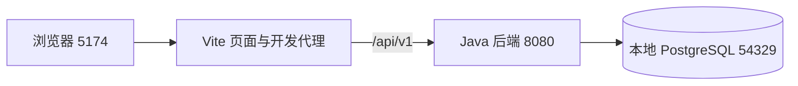

# 我的账单

个人收支管理 PWA。普通用户录入支出/收入、管理个人字典和日常模板、查询明细、处理退款报销、查看报表和导出；系统管理员管理账号、默认字典、运行概况与审计，不能读取个人账目。

一期使用内网 IP + HTTPS。实际地址、服务器和上线验收状态见[内网案例](agent-works/deployment/cases/intranet-single-host/README.md)。系统不提供账户余额、转账和离线记账。

手机安装使用 PWA 的“添加到主屏幕”，无需下载 IPA/APK；操作见下节，实际地址、证书指纹及历史验收结果见[内网案例](agent-works/deployment/cases/intranet-single-host/README.md)。

## 手机安装与使用

以下适用于使用项目内部 CA 的 iPhone/iPad。手机需连接能够访问目标环境的内网；先向运维取得该环境的 HTTPS 地址、根公钥证书 `ca.crt` 和 SHA-256 指纹。不要用本地 HTTP 开发地址安装，也不要从旧案例照搬另一环境的地址或证书。

1. 运维通过受控方式分发 `ca.crt`；使用 Mac 时可选中文件，右键“共享 → 隔空投送”发送到自己的设备。只发送公钥证书，不发送 `ca.key`、服务器私钥或整个证书目录。核对证书来源及本环境指纹，不能只凭相同证书名称判断。
2. 接收并打开证书后，进入“设置 → 已下载描述文件”；没有该入口时查看“设置 → 通用 → VPN 与设备管理”。选择已核对的根证书，点击“安装”，按系统提示输入设备锁屏密码并确认；证书来源或信息不符时停止。
3. 进入“设置 → 通用 → 关于本机 → 证书信任设置”，为该根证书开启完全信任并确认。安装描述文件本身不会自动取得 SSL/TLS 信任，见 [Apple 说明](https://support.apple.com/zh-cn/102390)；列表中没有证书时先核对安装是否完成。
4. 关闭原页面，用 Safari 重新打开本环境 HTTPS 地址，应无证书警告。仍有警告时检查设备日期、安装及完全信任状态，并由运维核对叶证书有效期和 IP SAN；不能以“继续访问”作为通过证据。
5. 在 Safari 点击“分享 → 添加到主屏幕”；系统若显示“作为网页 App 打开”，保持启用。从“我的账单”图标启动，检查独立窗口、登录和基本操作。菜单随系统版本可能不同，见 [Apple 安装说明](https://support.apple.com/guide/iphone/open-as-web-app-iphea86e5236/27/ios/27)。

网页可以直接使用，安装不提供离线记账能力。安装或发布后的离线、版本更新、横竖屏和软键盘验收按[页面复测](#页面复测方式与选择)执行并记录设备及版本；安装成功本身不能证明这些行为通过。证书签发、续期或更换 CA 由运维按[部署手册](agent-works/deployment/runbook.md#3-凭据tls-与终端信任)处理。

登录后在“记一笔”选择支出或收入填写。管理候选可点页头“常用选项”，或进入“我的 → 数据与安全 → 常用选项”；关闭后回原入口。底部导航切换保留填写与筛选，刷新和退出仍有未保存保护。

## 快速开始

### 1. 先理解本地会启动什么

开发环境不使用部署服务器，也不要求启动 Docker。`npm run dev` 是总启动命令，由 `scripts/dev.sh` 启动下面三个进程：

| 进程 | 做什么 | 默认入口/数据 | 日志在哪里 |
|---|---|---|---|
| PostgreSQL | 保存本地账号、账目、字典、任务等数据 | 127.0.0.1:54329；库 my_bill_dev；数据目录 .local/postgres | .local/logs/postgres/postgres.*.log；复用已有进程时沿用其日志 |
| Spring Boot 后端 | 登录鉴权、业务校验、数据库读写、后台任务 | http://127.0.0.1:8080/api/v1 | 启动终端及 `.local/logs/backend/application.log`；启动输出见 `launcher.*.log` |
| Vite 前端开发服务器 | 编译 Vue 页面并热更新；代理浏览器 API 请求 | 本机 http://127.0.0.1:5174；同一局域网设备访问 `http://<本机局域网 IP>:5174` | 同一启动终端及 `.local/logs/frontend/dev.*.log` |

本地总启动和单独 `dev:backend` / `dev:frontend` 均自动保存日志。应用日志由 Logback 按 10MB、7 天、归档总量 200MB 轮转；启动器、Vite 与 PostgreSQL 输出按 10MB 分片，各最多 100MB、7 天（启动及写入时清理）。`launcher` 包含 Maven 和应用控制台输出，用于应用尚未启动的失败诊断；它不是另一份长期应用档案。同类本地服务同一日志目录只允许一个启动器，避免application.log多进程冲突；启动失败/退出时回收本次子进程。日志目录权限受本地启动器的 `umask 077` 保护。配置及生产日志入口见[环境架构](agent-works/architecture/environment-configuration.md#日志配置)。

通过 **5174 的页面** 使用账单功能。浏览器请求 `/api/v1` 时，Vite 转给 8080 的 Java 后端，后端再访问 54329 的数据库；浏览器不直接连接数据库。8080 的健康接口用于检查后端，不是前端页面地址。

开发前端默认监听 `0.0.0.0`，方便同一局域网的手机访问；只允许本机访问时，使用 `MY_BILL_WEB_HOST=127.0.0.1 npm run dev`。手机和电脑需连接同一网络，电脑防火墙需允许 5174 端口。此 HTTP 开发入口不能用于手机 PWA 安装；安装使用内网 HTTPS 地址。



### 2. 检查环境并安装依赖

从仓库根目录执行命令，要求：

- Node.js 24.11.1（见 .nvmrc）、npm 11.6.2；现有脚本会查找当前 Node 或已安装的对应 nvm 版本。
- 完整 Java 21 **JDK**，包含 java、javac；Maven 使用仓库 `mvnw`，不需要另装系统 Maven。找不到 JDK 时设置 JAVA_HOME 指向安装目录。
- PostgreSQL 16+ 可执行工具位于 PATH，包括 initdb、postgres、pg_ctl、pg_isready、createdb、psql、dropdb。不需要预先运行系统的 PostgreSQL 服务。
- 本地首次账号初始化需要 OpenSSL；数据库集成验证还需 Python3。无需 Redis 或其他项目的数据库。

#### macOS 安装示例

以下示例使用 Homebrew 和 nvm；已由公司工具链统一安装时，只需保证后面的版本检查通过，不要重复安装：

```bash
brew install nvm openjdk@21 postgresql@16 openssl@3 python@3
mkdir -p "$HOME/.nvm"
export NVM_DIR="$HOME/.nvm"
source "$(brew --prefix nvm)/nvm.sh"
nvm install 24.11.1
nvm use 24.11.1
npm install --global npm@11.6.2
export JAVA_HOME="$(brew --prefix openjdk@21)/libexec/openjdk.jdk/Contents/Home"
export PATH="$(brew --prefix postgresql@16)/bin:$JAVA_HOME/bin:$PATH"
```

Apple Silicon 与 Intel Homebrew 路径不同，因此使用 `brew --prefix`，不要把 `/opt/homebrew` 写死。需要每次打开终端自动生效时，将 NVM_DIR、nvm加载、JAVA_HOME 和 PATH 配置放入自己的Shell启动文件；先在当前终端验证无误再持久化。

#### Ubuntu 24.04 安装示例

Ubuntu 24.04 官方仓库提供本项目所需的Java21和PostgreSQL16。先按 nvm 官方或组织批准方式安装 nvm，再执行：

```bash
sudo apt-get update
sudo apt-get install --yes openjdk-21-jdk postgresql-16 postgresql-client-16 openssl python3
export NVM_DIR="$HOME/.nvm"
source "$NVM_DIR/nvm.sh"
nvm install 24.11.1
nvm use 24.11.1
npm install --global npm@11.6.2
export PATH="/usr/lib/postgresql/16/bin:$PATH"
```

Ubuntu 22.04、Debian及其他发行版若默认仓库没有Java21或PostgreSQL16，应使用该系统官方支持的仓库或组织镜像；不要为了通过检查降级版本。安装后统一核对：

```bash
node --version
npm --version
java -version
javac -version
postgres --version
pg_ctl --version
openssl version
python3 --version
```

安装公开依赖可使用以下已验证方式，单次隔离用户级npm源/代理，不修改全局设置：

```bash
NPM_CONFIG_USERCONFIG=/dev/null npm_config_registry=https://registry.npmjs.org npm run bootstrap
```

bootstrap解析Node/Java工具链，然后执行 `npm --prefix web ci`，按web/package-lock.json安装前端依赖。后端依赖在首次Maven启动时下载，因此第一次启动会更慢。根目录不需要单独npm install。

若已正确配置npm，或环境必须使用组织代理/私有仓库，保留该配置执行 `npm run bootstrap`。registry是包仓库，不是HTTP CONNECT代理；不要把仓库地址直接填为proxy。包下载仍遵循锁文件URL，不关闭TLS或完整性校验。

### 3. 一条命令启动前后端

```bash
npm run dev
```

脚本依次完成：

1. 校验工具链、数据库主机/端口/库名；开发数据库只允许本机。
2. 没有 `.local/postgres` 时初始化本项目集群；数据库端口没有服务时启动它。端口已有 PG 时，检查它的数据目录确实属于本项目才复用。
3. 创建开发库和独立的迁移/应用角色；Flyway 迁移角色负责建表，应用角色负责业务读写。
4. 执行 `./mvnw -q -pl server spring-boot:run` 启动后端，执行 `npm --prefix web run dev -- --host "${MY_BILL_WEB_HOST:-0.0.0.0}"` 启动前端。**这两条已由总脚本执行，不要再重复启动同端口进程。**
5. 后端通过 Flyway 校验/升级开发库，成功后接受 API 请求。任一前后端进程退出，总脚本关闭它启动的其他进程。

在另一个终端检查：

```bash
curl --fail http://127.0.0.1:8080/api/v1/health
```

看到 `status: UP`，并能打开 http://127.0.0.1:5174/login，表示基础服务就绪。Vite 端口冲突可能顺延，实际地址以终端输出为准；不要把“前端 ready”当成后端已启动。

按 Ctrl+C 停止开发环境：脚本停止自己启动的前后端及 PG，保留运行前就存在的 PG，不删除数据库。终端的中断退出码不代表数据库已删除；不要为了重新启动删除 `.local/postgres`。

### 4. 首次如何获得可登录账号

空开发库没有默认密码，不会自动创建业务账号。先让上述开发环境完成建库/迁移并保持运行，再在**第二个终端的项目根目录**执行一次本地初始化。此方式只适用于自己的本机开发库，不连接部署服务器：

```bash
bash
set -euo pipefail
PROJECT_ROOT="$PWD"
source scripts/toolchain.sh
resolve_java
umask 077
# 目录已存在时停止，避免覆盖之前交付的凭据。
mkdir .local/dev-bootstrap
openssl rand -base64 32 > .local/dev-bootstrap/password
openssl rand -base64 32 > .local/dev-bootstrap/pepper
MY_BILL_DB_NAME=my_bill_dev \
MY_BILL_AUTH_RATE_LIMIT_PEPPER_FILE="$PWD/.local/dev-bootstrap/pepper" \
MY_BILL_BOOTSTRAP_USERNAME=admin \
MY_BILL_BOOTSTRAP_PASSWORD_FILE="$PWD/.local/dev-bootstrap/password" \
./mvnw -q -pl server spring-boot:run \
  -Dspring-boot.run.arguments="--bootstrap-admin --server.address=127.0.0.1 --server.port=0"
exit
```

若开发服务使用了自定义库名/PG端口，在该终端同步 MY_BILL_DB_NAME、MY_BILL_DB_PORT；不能只改前端地址。该命令使用本地 trust 连接和已经迁移好的库，临时启动仅监听本机随机端口的初始化进程。初始化入口复用prod配置，因此需提供专用pepper文件；这些前缀变量只影响此次初始化，不会改变已运行开发后端的配置。创建 admin 后自行退出，不取代正在运行的后端。账号库非空则拒绝，不会重置已有账号。

在本地编辑器打开 `.local/dev-bootstrap/password` 获取临时密码（不要提交或贴到日志），访问登录页登录 admin，24 小时内完成首次改密；随后从管理页创建普通用户，用普通账号进入“记一笔”。改密成功后删除本地临时密码文件。服务器的首管理员流程另见[部署初始化](agent-works/deployment/runbook.md#4-镜像迁移和首管理员)，不能复用开发凭据。

### 5. 更换端口或开发库

根 `.env.example` 只是变量示例，`dev.sh` **不会自动加载 .env**。在启动命令前传入环境变量，例如以下组合用于独立调试：

```bash
MY_BILL_DB_NAME=my_bill_docs_debug \
MY_BILL_SERVER_PORT=18080 \
MY_BILL_WEB_PORT=15174 \
npm run dev
```

此时页面为 http://127.0.0.1:15174，API 代理和后端一起改为18080；PG仍是54329，但使用另一个数据库。选用的库名会持久保存，不是每次退出就销毁。旧库校验和错误时，另建空库只能帮助区分环境与代码问题，不能替代分析原库结构，禁止直接 Flyway repair 或清空旧库。

全部变量的消费者、默认值和生效时机见[配置架构](agent-works/architecture/environment-configuration.md)。

## 日常开发与调试

### 前端修改如何生效

保持 `npm run dev` 运行，修改 web/src 下的 Vue、TypeScript 或样式；Vite 会热更新页面。改 Vite 配置、环境变量或依赖后应重启开发命令。日常改页面不需要先 build，也不需要把 web/dist 复制到服务器。

浏览器开发者工具的 Network 页检查 `/api/v1` 请求：先看 URL/状态码，再看响应的 code、message、fieldErrors 和 traceId。Sources 页可在源码映射的 `.vue/.ts` 中设置断点；Console 用于查看前端异常。session store 管登录状态，api/http.ts 统一处理 Cookie、CSRF 和超时，勿在页面另写一套请求方式。

只有想单独运行前端、且后端/数据库已经由其他受控方式运行时才执行：

```bash
npm run dev:frontend
```

该命令只起 Vite，不建库、不起 Java。若 Java 用非默认端口，调用前传相同 MY_BILL_SERVER_PORT。与总启动命令二选一，避免重复占端口；Ctrl+C 只停止该前端。

### 分开启动数据库、后端和前端

需要在IDE中只重启Java，或希望前后端使用不同终端时，可以使用三个独立入口。三个终端必须传入相同的数据库名、数据库端口和后端端口；默认配置可直接执行：

```bash
# 终端1：初始化并后台启动本项目的本地数据库；重复执行安全复用同一集群。
npm run dev:db -- start
npm run dev:db -- status

# 终端2：以前台进程启动后端；Ctrl+C 只停止后端。
npm run dev:backend

# 终端3：以前台进程启动前端；Ctrl+C 只停止前端。
npm run dev:frontend
```

结束调试后，如不再需要数据库进程：

```bash
npm run dev:db -- stop
```

数据库管理脚本只操作 `.local/postgres`，停止不会删除数据；若配置端口被其他PostgreSQL集群占用会拒绝操作。`dev:backend` 不会隐式启动或停止数据库，数据库未就绪时后端会启动失败。仍推荐日常完整联调使用 `npm run dev`，它会在退出时停止本次启动的前后端，以及本次新启动的数据库；运行前已经存在的本项目数据库会保留。

### 后端断点调试

停止原有开发前后端后，可用同一个总脚本加上 Maven JVM 参数启动调试。下例保留独立调试库/端口，Java 调试端口只监听本机5005：

```bash
MY_BILL_DB_NAME=my_bill_docs_debug \
MY_BILL_SERVER_PORT=18080 \
MY_BILL_WEB_PORT=15174 \
MAVEN_ARGS='-Dspring-boot.run.jvmArguments=-agentlib:jdwp=transport=dt_socket,server=y,suspend=n,address=127.0.0.1:5005' \
npm run dev
```

在 IntelliJ IDEA 中以 Maven 项目打开根 pom.xml，项目 SDK 选择 Java21；新建 **Remote JVM Debug / Attach**，Host=127.0.0.1、Port=5005，然后连接。VS Code 可使用 Java 调试器的 attach 配置连接同一地址。入口是 com.mybill.MyBillApplication，断点可先放 Controller 再逐层到 Service/Mapper。

`suspend=n` 表示不等待调试器也会启动；连接后从15174页面触发对应操作。只验证调试连接可使用 JDWP 握手；IDE按钮布局随版本不同，IDE界面操作需在自己的环境验证。调试端口不得发布到公网或部署环境。

当前开发依赖未提供 Spring Boot DevTools 自动重启。修改 Java 后最稳妥的方式是 Ctrl+C 再启动；IDE 热替换能否处理某次修改由 JVM/IDE 决定，不能假设所有修改即时生效。断点暂停整个 JVM 会导致前端15秒请求超时、任务租约到期或健康检查失败，只在自己的开发库调试任务。

### 接口和数据库如何排查

正常业务调试从浏览器页面触发，确保 Cookie 和 XSRF 由统一客户端携带。401通常是未登录/会话过期，403要区分角色拒绝与CSRF，409检查幂等键/版本冲突，500结合traceId查后端日志。不要为方便调试关闭鉴权或RLS。

本地数据库连接信息是127.0.0.1:54329，库名以启动时配置为准。`my_bill_dev`负责建库管理，`my_bill_migration`负责迁移，`my_bill_app`负责运行。管理账号查询“看得到数据”不能证明租户接口正确；应用角色缺少事务租户上下文时查不到租户数据是隔离设计，验证应通过真实用户API或隔离数据库测试。

## 架构与代码结构

```text
.
├── web/
│   ├── package.json、vite.config.ts   前端命令、开发代理与构建
│   ├── public/                       manifest、图标等直接发布资源
│   ├── src/
│   │   ├── main.ts                   Vue/Pinia/Router装配入口
│   │   ├── app/                      页面元数据登记与契约
│   │   ├── router/                   路由、角色与会话守卫、导航
│   │   ├── views/                    页面：录入、明细、报表、个人设置
│   │   │   ├── admin/                用户、默认字典、概况、审计页面
│   │   │   └── me/dictionaries/       个人字典页面
│   │   ├── components/               可复用表单、列表、抽屉、图表与状态块
│   │   ├── composables/              共享交互/请求状态与未保存提醒
│   │   ├── domain/                   精确金额、筛选、日期、表单与幂等规则
│   │   ├── api/                      各领域请求与统一http客户端
│   │   │   └── generated/            OpenAPI生成类型，禁止手改
│   │   ├── stores/                   唯一session、preferences、theme状态
│   │   ├── storage/                  按账号隔离的本地草稿存储
│   │   ├── auth/、theme/、pwa/        密码规则、主题和安装/缓存策略
│   │   ├── styles/                   设计token及公共样式
│   │   └── sw.ts                     Service Worker入口
│   ├── e2e/                          隔离浏览器关键链路
│   └── dist/                         构建产物，不是开发源码
├── server/
│   ├── pom.xml                       后端依赖、插件与测试开关
│   ├── src/main/java/com/mybill/
│   │   ├── MyBillApplication.java     Spring Boot/独立管理员初始化入口
│   │   ├── auth/                     登录、会话、CSRF、角色与租户事务
│   │   ├── ledger/                   收支、调整、模板、回收站、导出
│   │   ├── dictionary/、preference/   个人字典与偏好
│   │   ├── report/                   摘要、时间趋势和维度聚合
│   │   ├── admin/                    user/dictionary/overview/audit管理能力
│   │   ├── account/                  账号注销、匿名审计、离线恢复重放与文件补偿
│   │   ├── job/                      数据库任务领取、租约、重试与调度
│   │   ├── persistence/              实体映射、MyBatis配置、schema门禁
│   │   └── shared/                   API错误、时间范围、事务/Mapper工具
│   ├── src/main/resources/
│   │   ├── application*.yml           开发基线与生产覆盖配置
│   │   ├── mapper/com/mybill/         各领域运行SQL，Java通过Mapper调用
│   │   └── db/migration/、db/rollback/ schema升级与受控回退材料
│   ├── src/test/                      Java单元、HTTP、数据库/架构测试
│   └── target/                        Maven生成的classes/JAR/测试报告
├── contracts/openapi.yaml             API契约事实源
├── scripts/                          本地启动、工具链、分层检查、候选构建
├── deploy/
│   ├── compose*.yaml                 服务编排、内网覆盖、一次性管理员初始化
│   ├── Caddyfile、Dockerfile.proxy    HTTPS/静态资源/API代理
│   ├── env/、postgres/               非密钥配置模板与数据库角色初始化
│   ├── host-profiles/、profiles/      宿主变更策略与部署模式契约
│   ├── scripts/                      预检、容器入口、备份/隔离恢复、证书激活与巡检
│   ├── tls/、systemd/、monitoring/     CA签发、备份/巡检定时、本机告警与可选监控规则
├── agent-works/
│   ├── initial-development/          初始需求、计划、原型、截图及历史验收（归档）
│   ├── architecture/                 当前技术与环境配置说明
│   ├── deployment/                   通用部署架构、手册、构建、恢复
│   │   └── cases/                    具体环境的服务器/路径/证据
└── .local/                           本地数据、凭据、测试/发布临时产物，不入库
```

### 修改一个功能时从哪里开始

例如“保存支出”：ExpenseEntryForm收集输入 → web/src/api/expenses.ts通过api/http发送 → ExpenseController解析请求 → ExpenseService校验金额、字典归属与幂等 → 租户事务 → ExpenseRepository/ExpenseRepositoryMapper → 对应XML写数据库 → 返回结果并由页面显示成功/字段错误。

新增字段需要同步OpenAPI、生成类型、表单/domain校验、Controller契约、Service、Mapper及相关测试；只有真实存储结构改变时才新增Flyway迁移。修改页面布局查DESIGN和共享组件，修改金额算法先查domain/BigDecimal规则，修改后台任务查job与对应JobDefinition，不在Controller内写长循环。各模块完整机制见[架构索引](agent-works/architecture/README.md)。

## 开发与验证

| 命令（根目录） | 何时使用 | 做什么 |
|---|---|---|
| npm run check | 需要完整工程基线时 | 前端检查/构建、Maven verify、临时PG集成 |
| bash scripts/run-frontend.sh check | 前端完整验证 | 类型、lint、Vitest、OpenAPI漂移和生产构建 |
| npm run check:server | 后端改动 | Java编译/单元/架构测试；默认跳过需独立数据库的用例 |
| npm run check:database | SQL/权限/业务接口链路 | 新建临时PG运行HTTP、迁移、RLS等，结束清理 |
| npm run check:performance | 查询/批处理容量风险 | 临时PG代表性规模数据；不连开发库 |
| npm run check:security | 依赖/安全门禁 | secret与依赖OSV扫描；需网络，不包含容器OS包 |
| npm run check:e2e | 浏览器独有关键链路 | 隔离库与Chromium；需匹配版本浏览器，不使用生产账号 |
| npm run check:ios | 页面复测的真机自动检查基线 | 检查范围与连接方式见[页面复测](#页面复测方式与选择)；按改动另补直接操作与安装版检查 |
| npm run check:deployment | 部署脚本、profile或目标字段变更 | Shell语法、严格字面解析和部署配置负例 |

常规局部修改选择最低充分检查，不默认每次全跑。历史验证证据见[归档验收记录](agent-works/initial-development/pre-release-test-report.md)，不代替当前版本检查；脚本存在与实际执行结果分开说明。构建产物web/dist用于发布，server/target下JAR用于打包，不手工编辑。

### 页面复测方式与选择

页面复测检查真正运行的界面与操作结果；typecheck、lint、Vitest、契约检查和构建属于工程检查，不能代替页面验收。AI 的强制执行要求见 [AGENTS](AGENTS.md#页面改动的复测选择)，布局、主题和关键视口以 [DESIGN §8](DESIGN.md#8-responsive-behavior) 为准。以下方式按风险组合使用，不要求每次都运行全部方式；局部改动不默认检查全页或全部视口。

#### 方式选择

| 方式与入口 | 用途与选择条件 | 能证明什么／不能替代什么 |
|---|---|---|
| AI 内置浏览器，打开本地实际 Vue 页面并调整视口 | 页面改动的布局与交互初筛：字号、间距、溢出、响应式、明暗主题、加载/空/错误状态；共享组件检查相关消费者 | 证明当前浏览器下的页面表现；桌面手机尺寸不是真实 iOS，不能替代原生控件、软键盘和触摸验收 |
| Chromium E2E：根目录 `npm run check:e2e` | 低层测试不能充分证明的稳定关键浏览器业务链路；使用脚本创建的隔离数据库与测试账号 | 当前用例覆盖登录、明细/报表、角色拒绝及注销失效保留等，具体以 `web/e2e` 为准；没有覆盖的保存流程不能声称通过。局部样式/临时缺陷不新增长期 E2E，Chromium 通过不代表 iOS 通过 |
| 实体 iPhone Safari WebDriver：根目录 `npm run check:ios` | 前端代码改动的真机自动检查基线；连接、配置及脚本范围见[真机连接与自动化](#真机连接与自动化) | 只证明脚本实际检查的页面与行为；变更路由和脚本未覆盖的行为须补验，输入聚焦不保证唤起完整软键盘 |
| 实体 iPhone Safari 直接操作；已接入时可用 macOS iPhone 镜像辅助，Safari 开发菜单辅助观察 | 改动涉及输入、候选、原生选择器、滚动、触摸手势时补验实际操作；也用于定位自动化遗漏的交互问题 | 镜像操作是真机页面证据，但电脑键盘模式可能只显示输入工具栏。完整软键盘占屏与触摸手势必须实际出现并操作，不能由焦点、DOM 数值或镜像工具栏推断通过 |
| 实体 iPhone 主屏幕安装版 PWA，从图标启动本次版本 | 导航、安全区、软键盘、安装、缓存更新、离线等影响独立窗口的改动 | 检查独立窗口及 PWA 生命周期；先确认目标已提供本次构建、终端确实加载该版本。旧安装版、Safari 地址栏或本地开发 HTTP 页面不能证明本次安装版通过；验证不隐含发布授权 |

#### 执行与证据

1. 列出改动涉及的路由、共享组件消费者、角色、状态和终端行为。优先验证被改页面及同类受影响位置；断点改动检查边界两侧，全局样式选择有代表性的表单、列表、报表或管理页面。
2. 在已有服务上用内置浏览器检查实际页面；服务未启动时按本 README 的本地启动流程操作，先检查端口，只停止自己启动的进程。按 DESIGN 选择相关手机/PC视口及明暗主题，不把调窗口高度当作真实软键盘。
3. 明确数据环境：模拟 API/组件夹具适合长名称、大量候选、空态、错误和延迟响应；只证明前端状态。真实接口闭环使用隔离测试环境和账号，确认请求、响应、回显及实际持久化结果，遵守项目写入授权边界，不用个人或生产数据做破坏性测试。临时夹具与浏览器视口覆盖用完清理或恢复。
4. 关键浏览器链路按风险运行既有 E2E。按下方连接步骤执行 iPhone 真机基线，对脚本未覆盖的变更路由和行为直接补验。
5. 对输入与候选至少检查：默认展开是否需要键盘、主动搜索是否实际唤起完整键盘且无意外缩放、候选能否看见/滚动/点选、选中回显与收起、外部点击/取消/主动收起键盘/重复展开、切到下个字段时焦点与草稿是否正确，取消搜索是否保留原已选值、折叠补充项的错误是否自动展开；涉及原生日期/选择器、底部动作或横竖屏时检查相应操作和遮挡。确认键盘实际占用可见区域；未出现完整键盘就记录该场景未验证。
6. 涉及安装版时，从主屏幕进入本次版本，补验对应布局、键盘、安全区；缓存/离线改动还要检查更新、断网提示和恢复联网，不能把缓存命中或 SW 接管单独记为整体验收通过。

复测结果在回复中说明：**本次源码/构建版本（含未提交变更）、环境与页面 URL、数据是真实接口还是模拟、操作者/工具、设备/系统或浏览器/视口、实际步骤、预期与观察结果、通过/失败/未验证及原因**。只列命令或截图不等于证明操作闭环；最终源码有变化时重新检查受影响项目。工具实测、用户确认、隔离模拟分别标注，历史测试不代替当前版本。截图及诊断保存在 Git 忽略的 `.local`，避开凭据和真实敏感数据；仅在用户明确要求落盘时维护本次任务的验证文档，不自动新建报告或续写初始开发资料。

工具或设备受限时，AI 先完成能够自主操作的检查，再明确具体缺口；只有确实需要解锁、系统授权或实体触摸时才请求对应用户操作，不能直接把整套复测转交用户。锁屏/断连先检查一次可修复的前置条件，条件未恢复时停止重复连接；镜像与 WebDriver 优先分开操作，镜像结束后重新确认设备已解锁。工程检查与桌面模拟通过时，仍不能把未验证的真机/完整软键盘/PWA写成通过。

#### 真机连接与自动化

将 iPhone 解锁并连接 Mac，在手机「设置 → App → Safari → 高级」打开「网页检查器」和「远程自动化」。Mac Safari 的「开发」菜单应能看到该 iPhone；首次用线缆配对时需在手机上信任 Mac。保持手机亮屏、前后端本地服务运行，确认手机能访问本机前端地址。Mac 安装的 `safaridriver` 通过 WebDriver 启动独立的 iPhone Safari 测试会话；若 Mac 提示启用远程自动化，需在 Safari 开发者设置中开启。Apple 的[真机检查](https://developer.apple.com/documentation/safari-developer-tools/inspecting-ios)和[远程自动化](https://developer.apple.com/documentation/safari-developer-tools/ios-enabling-webdriver)说明可用于排查连接问题。

将 `admin` 和 `pengfulin` 的本地测试密码保存在 `.local/real-device-test/accounts.md`，格式为用户名与密码两列表格；测试凭据仅从该文件读取，不写入仓库、命令输出或日志。在同目录的 `config.json` 保存手机可访问的本机开发地址 `baseUrl`（`http://<本机地址>:5174`）和可选的实体手机 `deviceUDID`。运行前读取当前地址并确认手机可达，不沿用历史测试地址。目录权限设为 `700`、文件权限设为 `600`；该目录被 Git 忽略。在仓库根目录运行：

```bash
npm run check:ios
MY_BILL_IOS_ACCOUNT=admin npm run check:ios
```

当前脚本范围以 `scripts/check-ios.mjs` 为准：普通账号检查支出/收入页面横向溢出、日期控件边界，以及支出分类候选边界、240px 高度上限、重复点击收起、面板内主动搜索聚焦、16px 输入字号、可见区域、取消与外部点击关闭；管理员账号检查用户页加载后的宽度。搜索时记录实际视口收缩状态，未唤起系统键盘时输出键盘未验证。

自动检查成功判据：命令退出码为 0，输出设备为 `iOS`、实际设备名且会话 `safari:useSimulator=false`，相应检查通过并生成截图。截图写入 `.local/real-device-test/`，只留本机，不提交；真机直接操作、完整软键盘和安装版 PWA 的补验按上方清单及证据边界执行。

脚本不保存账目；会临时切换普通测试账号的最近记账类型，在成功后恢复，失败时可在页面手动切回。结束时删除本次 WebDriver 会话并停止自身启动的驱动，不停止已有开发服务。设备断开、锁屏或远程自动化关闭导致失败时，按上方受限处理规则记录阻塞与未验证范围。

## 部署与排查

开发的Vite不用于正式部署。生产只有三个常驻容器：Caddy提供前端文件/HTTPS并转发API，Java执行后端，PostgreSQL保存数据。角色初始化、迁移、首管理员是一次性工具；备份是宿主定时任务，具体区别见[部署架构](agent-works/deployment/architecture.md)。

### 新服务器如何初始化

从一台已安装受支持Linux、可由root通过严格主机密钥校验登录的服务器开始，可使用交互式入口准备宿主并完成首次部署：

```bash
npm run environment -- configure intranet-main
npm run environment -- inspect intranet-main
npm run environment -- host-plan intranet-main
npm run environment -- host-apply intranet-main
npm run environment -- host-verify intranet-main
npm run environment -- plan intranet-main
npm run environment -- preflight intranet-main
npm run environment -- bootstrap intranet-main
npm run environment -- verify intranet-main
```

向导以安装程序式问答收集宿主模式、软件源、机器、路径、网段和TLS来源，不要求输入生产密码。`managed-linux` 安装缺失的基础工具和Docker/Compose，`existing-linux` 只检查既有或共享主机；两者都不安装操作系统、创建云资源或接管防火墙。初始化入口随后自动运行持续构建、生成服务器secret、建立数据库角色/schema/首管理员、启动服务并配置备份巡检。失败可用同一提交 `resume`，完成首登改密后用 `finalize` 删除服务器初始密码副本。详见[宿主环境准备](agent-works/deployment/host-preparation.md)和[首次环境初始化自动化](agent-works/deployment/environment-bootstrap.md)。

### 前后端代码更新如何发布

当前采用“CI门禁 + 本地持续构建更新入口”。GitHub Actions 仍只做检查，不会自动连接服务器；经授权的运维人员在本机显式执行发布入口：

1. 提交推送后，GitHub Actions执行前端检查/构建、后端验证、临时数据库、性能、安全和浏览器关键链路；通过只代表候选具备发布资格，不会自动部署。
2. 在干净HEAD执行 `npm run release -- build`。入口自动执行完整检查、候选构建、白名单归档和摘要，生成 `.local/releases/<提交>/`；已校验的同提交制品会直接复用。
3. 具体机器只在本机 `.local/deploy-targets/<目标>.env` 描述。先用 `npm run release -- plan intranet-main` 查看无敏感值的计划，用 `npm run release -- deploy intranet-main` 更新一个位置，也可列出多个目标或使用 `--all` 串行更新。
4. 更新入口自动上传并校验同一候选，在目标机保留旧目录/旧镜像、执行维护前备份，构建 app/migrate/proxy，停止入口和应用，执行迁移，原子切换 `current`，依次启动 app/proxy 并验证 HTTPS。升级不执行 provision、首管理员初始化或数据库镜像替换。
5. `npm run release -- status intranet-main` 只读查看版本、Compose状态和HTTPS健康。任一目标失败后不会继续后续位置；迁移已尝试时不会盲目自动回滚，须按迁移兼容性和恢复手册判断。
6. 前端由宿主 `web/dist` 只读挂载到proxy，后端在app镜像内；发布通过重建容器应用新版本，不只替换符号链接或重启旧容器。

该入口只负责已有环境的持续构建更新，不安装Docker、不创建运行配置/secret/TLS/首管理员，也不把当前内网方案扩展成公网部署。目标配置契约见 [`deploy/targets`](deploy/targets/README.md)。详细机制见[持续构建与发布](agent-works/deployment/continuous-delivery.md)、[首次部署、升级与运维手册](agent-works/deployment/runbook.md)和[部署支持边界](agent-works/deployment/architecture.md#10-支持范围与待验收边界)。当前不承诺零停机或数据库自动回滚。

### 日常运维、备份和恢复演练

已初始化环境使用统一入口，不需要复制手册中的长命令：

```bash
npm run ops -- status intranet-main
npm run ops -- health intranet-main
npm run ops -- backup intranet-main
npm run ops -- recovery-drill intranet-main YYYY-MM-DD
```

`backup` 会在服务器生成并校验加密归档，再拉取异机副本；解密私钥首次托管必须单独执行并继续转存组织密钥库。日志可用 `npm run ops -- logs <目标> --service app --since 30m` 查询、`logs-export <目标>` 压缩导出；发布前快照及过程记录用 `logs <目标> --archive latest` 查看。启停、日志、历史副本、校验和安全边界见[统一运维入口](agent-works/deployment/operations.md)，生产覆盖恢复仍按[备份与恢复](agent-works/deployment/backup-recovery.md)的受控流程执行。

公网部署当前仍会被脚本拒绝，不可把内网配置直接开放到互联网；直连域名与可信边缘两种后续模式、必需安全门禁和实现顺序见[公网部署演进](agent-works/deployment/public-deployment.md)。

| 现象 | 检查顺序 |
|---|---|
| 前端ready但登录页请求失败 | 后端日志 → health → Vite代理目标端口；页面就绪不等于后端就绪 |
| 地址/端口与预期不同 | 终端实际地址、端口占用、两侧MY_BILL_SERVER_PORT；不要杀未知进程 |
| npm校验或501错误 | 用户.npmrc源/代理、锁文件版本/URL/摘要，不删除integrity |
| Flyway checksum失败 | 目标库是否选对、迁移源码与历史是否一致；保留旧库分析，不自动repair |
| 账号初始化失败 | 开发服务是否已完成迁移、库是否为空、密码文件是否可读；不要重跑以重置已有账号 |
| 调试断点不命中 | 5005监听、IDE连接的进程、源码是否与运行版本一致、请求是否通过角色/CSRF |
| HTTPS警告或备份状态疑问 | [实际案例](agent-works/deployment/cases/intranet-single-host/README.md)的证书/定时任务证据 |

## 文档导航

[完整目录与维护职责](agent-works/README.md)是文档总索引。常用入口如下：

| 想了解 | 文档 |
|---|---|
| AI协作规则 | [AGENTS](AGENTS.md)、[Claude入口](CLAUDE.md) |
| 一期业务基线与历史开发资料 | [初始开发资料](agent-works/initial-development/README.md)，不追加后续任务 |
| 技术架构 | [架构索引](agent-works/architecture/README.md) |
| 环境变量/secret | [配置架构](agent-works/architecture/environment-configuration.md) |
| 页面规范/接口 | [DESIGN](DESIGN.md)、[OpenAPI](contracts/openapi.yaml) |
| 可复用部署方案 | [部署架构与手册](agent-works/deployment/README.md) |
| 当前服务器与部署结果 | [案例索引](agent-works/deployment/cases/README.md) |
| 历史部署前验证 | [归档验收记录](agent-works/initial-development/pre-release-test-report.md)、[性能](agent-works/initial-development/performance-test.md)、[安全](agent-works/initial-development/security-test.md) |
