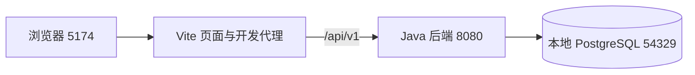

# 我的账单

项目正在改为仅供 iPhone 安装的离线 iOS App。`app/` 已具备 Vue 3 + Capacitor 原生骨架及 SQLite 初始化、升级、事务基础；个人页面和共享外壳已沿原布局迁入，八类字典维护、录入候选和商品合并已接入原生 SQLite；支出/收入录入、编辑与撤销，草稿/偏好/模板，以及退款报销、回收站和前台到期清理已接入本地事务，其余业务按阶段接入。

旧 Web PWA、服务端及部署源码仍保留用于对照，日常本地服务保持停止。旧 Web 提供个人收支、字典、模板、调整、报表与导出，管理员管理账号和默认项；实际环境资料见[内网案例](agent-works/deployment/cases/intranet-single-host/README.md)。下方原有 Web 使用说明不作为离线 App 开发的启动前提。

## 离线 iOS App 开发入口

在仓库根目录使用 `.nvmrc` 的 Node 24.11.1 / npm 11.6.2；原生检查还需要完整 Xcode 27、iOS 27 SDK 及 iOS 27.0 simulator runtime。无需启动旧 Web、Spring Boot 或 PostgreSQL。

首次安装锁定依赖：

```bash
npm --prefix app ci --ignore-scripts
```

日常定位先使用 `npm run debug:ios-app -- list`，按[局部调试流程](agent-works/testing/guide.md#原生局部调试与完整验收)选择最低层检查、单用例或场景。纯逻辑优先 `npm run debug:ios-app -- check --check app-tests --file src/domain/money.spec.ts`；编译与资源问题可单独 check，恢复问题使用 `interruption-阶段` 成对场景。局部验证通过后，仅在影响范围必要时选择下列完整检查；三个原生入口已经包含 check:app，无需为同一轮再单独重复运行它。`IOS_NATIVE_EVIDENCE` / `IOS_TOUCH_EVIDENCE` 必须取自对应局部成功命令输出的 `EVIDENCE=` 路径；多故障修复可重复传入 `--from` 合并独立回执，逐目标检查修复时序；缺少、失效、未覆盖实际失败场景或重复无变化验收会在启动前被拒绝。模拟器和触摸完整检查可按规范借用本轮受管会话，仍重建当前资源、重置合成 App 数据并执行全部门禁。

```bash
npm run check:app
npm run build:ios-app
npm run check:ios-app:simulator -- --from "$IOS_NATIVE_EVIDENCE"
npm run check:ios-app:touch -- --from "$IOS_TOUCH_EVIDENCE"
```

依赖由 app/package-lock.json 固定；命令来源为 [package.json](package.json) 与 [ios-app.sh](scripts/ios-app.sh)，各检查的条件和判据见[开发验证规范](agent-works/testing/guide.md#工程检查)。`check:app` 运行领域、队列、初始化状态、组件四态及设计契约测试、类型检查、随包资源构建和资源门禁；`build:ios-app` 编译未签名的真机架构 Release；模拟器入口运行实际 WKWebView → SQLite 桥测试，并删除本轮创建的模拟器。成功时构建/资源检查或 XCTest 报告通过；本地必要局部验证通过即可继续开发、提交与推送；远端计费受阻单独保留待验，不阻塞本地。离线 iOS CI 通过手动请求或 `ios-ci/<scripts|app|final>/<唯一名称>` 标签按需触发，普通 push/PR 不启动；范围和准确操作见[远端验证策略](agent-works/testing/guide.md#远端按需与最终集中验收)，最终候选再集中完成完整 CI 与真机验收。当前仅保留这条离线 iOS 流水线，旧 Web/服务端流水线及其 PostgreSQL 安装步骤已移除；旧源码和手工工具留待后续退役阶段清理，不是 App 的运行依赖。

每轮原生日志位于 .local/ios/tmp/ai-agent/native-*，分阶段耗时 timings.json 位于对应的 ios-full-*、调试会话 run-* 或 common/ios-build 的 ios-command-*，分别记录构建、安装和测试；失败先查对应阶段，诊断结束后可删除不再需要的日志，工作区验证状态须保留。`ios-invocation-*` 记录包含工具链前置检查的总预算和耗时，阶段修复后的缓存恢复不解除完整失败锁；详见[局部调试流程](agent-works/testing/guide.md#原生局部调试与完整验收)。增量构建与依赖缓存在 .local/ios/DerivedData、.local/ios/SourcePackages。脚本只为本次命令选择完整 Xcode，不修改全局 xcode-select；非默认安装位置可设置 DEVELOPER_DIR。不要把凭据、真实账本或 Web 本地配置复制到这些测试目录。

需要签名时在 Xcode 打开 [App.xcodeproj](app/ios/App/App.xcodeproj)，为 App target 选择自己的 Team。已用 Personal Team 完成骨架 Release 的签名安装，并在 iPhone 14 Pro Max / iOS 27.0.1 通过飞行模式、无 Wi-Fi、进程结束后的图标冷启动验证。上述自动构建入口仍生成未签名产物，不能直接安装到手机；正式业务、完整升级与性能尚未验收。当前可以调试四个原页面入口、主题、缓存草稿，以及“我的 → 选项管理”中的八类字典与商品合并；这些字典修改跨重启保留，默认清单只写入新账本。支出/收入可保存、连续录入、从原明细入口编辑并撤销适用的本次保存，账目和历史名称快照跨重启保留；明细支持本地组合筛选、快照搜索及每批 20 笔的分组加载，编辑返回保留当前查询和位置。支出/收入草稿按本地数据集分别保存在 SQLite，250ms 合并输入，切后台落盘并跨重启恢复，默认保留 7 天；偏好和主题跨重启恢复，恢复默认不会清除草稿或账目。有效收支可保存为日常模板，同名更新、选择仅回填且清空备注并使用当前时间，失效字段提示后重新选择，移除不删除来源。退款/报销、回收站及有界到期清理已接通；收支总览和日/周/月/季/年时间趋势使用本地统计，支持补零、累计、比较原因及原页面下钻返回；五种粒度页面验收已在独立模拟器通过，多维报表、备份与最终交付验收仍待后续阶段，不能作为已完成的记账 App 使用。原生装配机制见[总体架构](agent-works/architecture/architecture-decisions.md#离线-ios-原生入口)。

原生回归统一从上述根目录命令启动。局部调试使用 `npm run debug:ios-app -- list` 查看单用例和场景，按[局部调试流程](agent-works/testing/guide.md#原生局部调试与完整验收)创建、复用及关闭本轮独立模拟器；局部通过后按必要影响选择完整检查，不因局部绿色自动全跑。两个测试 target 仅允许模拟器，测试前校验本轮设备归属清单；直接在 Xcode 执行测试而没有清单会拒绝探针和页面操作。正式 App 的运行、签名与安装不需要测试清单，详见[测试隔离规则](agent-works/testing/guide.md#工程检查)。

## 手机安装与使用

本节及后续 Web/服务端流程描述保留的旧实现，手机安装形式是 PWA；不适用于上面的离线 iOS App。

以下适用于使用项目内部 CA 的 iPhone/iPad。手机需连接能够访问目标环境的内网；先向运维取得该环境的 HTTPS 地址、根公钥证书 `ca.crt` 和 SHA-256 指纹。不要用本地 HTTP 开发地址安装，也不要从旧案例照搬另一环境的地址或证书。

1. 运维通过受控方式分发 `ca.crt`；使用 Mac 时可选中文件，右键“共享 → 隔空投送”发送到自己的设备。只发送公钥证书，不发送 `ca.key`、服务器私钥或整个证书目录。核对证书来源及本环境指纹，不能只凭相同证书名称判断。
2. 接收并打开证书后，进入“设置 → 已下载描述文件”；没有该入口时查看“设置 → 通用 → VPN 与设备管理”。选择已核对的根证书，点击“安装”，按系统提示输入设备锁屏密码并确认；证书来源或信息不符时停止。
3. 进入“设置 → 通用 → 关于本机 → 证书信任设置”，为该根证书开启完全信任并确认。安装描述文件本身不会自动取得 SSL/TLS 信任，见 [Apple 说明](https://support.apple.com/zh-cn/102390)；列表中没有证书时先核对安装是否完成。
4. 关闭原页面，用 Safari 重新打开本环境 HTTPS 地址，应无证书警告。仍有警告时检查设备日期、安装及完全信任状态，并由运维核对叶证书有效期和 IP SAN；不能以“继续访问”作为通过证据。
5. 在 Safari 点击“分享 → 添加到主屏幕”；系统若显示“作为网页 App 打开”，保持启用。从“我的账单”图标启动，检查独立窗口、登录和基本操作。菜单随系统版本可能不同，见 [Apple 安装说明](https://support.apple.com/guide/iphone/open-as-web-app-iphea86e5236/27/ios/27)。

网页可以直接使用，安装不提供离线记账能力。安装或发布后的离线、版本更新、横竖屏和软键盘验收按[页面复测](#页面复测方式与选择)执行并记录设备及版本；安装成功本身不能证明这些行为通过。证书签发、续期或更换 CA 由运维按[部署手册](agent-works/deployment/runbook.md#3-凭据tls-与终端信任)处理。

登录后在“记一笔”选择支出或收入，按票据中的名称、金额和渠道信息填写。分类行显示当前分类，点击展开修改；支出单价、数量和单位直接编辑，实付金额可单独调整，补充信息按需展开。收入名称可选择最近使用、搜索或确认填写新名称。管理候选可点页头“选项管理”，或进入“我的 → 数据与安全 → 选项管理”；关闭后回原入口。各类管理列表每页最多 20 项，可滑动浏览；顶部显示本页范围与总量，列表末尾可翻页，也可搜索名称定位。底部导航切换保留填写与筛选，刷新和退出仍有未保存保护。

## 快速开始

### 1. 先理解本地会启动什么

开发环境不使用部署服务器，也不要求启动 Docker。`npm run dev` 是总启动命令，由 `scripts/dev.sh` 启动下面三个进程：

| 进程 | 做什么 | 默认入口/数据 | 日志在哪里 |
|---|---|---|---|
| PostgreSQL | 保存本地账号、账目、字典、任务等数据 | 127.0.0.1:54329；库 my_bill_dev；数据目录 .local/web/postgres | .local/web/logs/postgres/postgres.*.log；复用已有进程时沿用其日志 |
| Spring Boot 后端 | 登录鉴权、业务校验、数据库读写、后台任务 | http://127.0.0.1:8080/api/v1 | 启动终端及 `.local/web/logs/backend/application.log`；启动输出见 `launcher.*.log` |
| Vite 前端开发服务器 | 编译 Vue 页面并热更新；代理浏览器 API 请求 | 本机 http://127.0.0.1:5174；同一局域网设备访问 `http://<本机局域网 IP>:5174` | 同一启动终端及 `.local/web/logs/frontend/dev.*.log` |

本地总启动和独立后端/前端启动均保存日志；日志为私有诊断材料，应用启动前的失败先查 `launcher.*.log`。轮转、容量、权限及生产日志配置见[环境架构](agent-works/architecture/environment-configuration.md#日志配置)。

通过 **5174 的页面** 使用账单功能。浏览器请求 `/api/v1` 时，Vite 转给 8080 的 Java 后端，后端再访问 54329 的数据库；浏览器不直接连接数据库。8080 的健康接口用于检查后端，不是前端页面地址。

前端开发与本地预览的监听地址统一由 `web/vite.config.ts` 设置，默认 `0.0.0.0`（所有 IPv4 地址），方便同一局域网的手机访问。总启动、单独启动和直接运行 web 包均使用该默认值，不需要额外补 `--host`。只允许本机访问时，使用 `MY_BILL_WEB_HOST=127.0.0.1 npm run dev`；各独立前端入口同样支持该变量，显式 `--host` 参数优先于环境变量。手机和电脑需连接同一网络，电脑防火墙需允许实际前端端口。此 HTTP 开发入口不能用于手机 PWA 安装；安装使用内网 HTTPS 地址。

记账草稿用于在当前浏览器恢复尚未提交的输入，不等于离线提交账目，默认保留 7 天。手机通过局域网 HTTP 测试地址访问时，浏览器可能不支持账号隔离所需的本地备份能力；本地存储被限制或写入失败时，标题旁显示橙色“草稿未备份”入口，点击查看说明。此时输入仍在当前页面，可直接保存账目，但刷新或关闭后可能无法恢复。请使用正式 HTTPS 入口；可恢复的临时故障可在说明弹窗中点击“重试备份”。



### 2. 检查环境并安装依赖

从仓库根目录执行命令，要求：

- Node.js 24.11.1（见 .nvmrc）、npm 11.6.2；现有脚本会查找当前 Node 或已安装的对应 nvm 版本。
- 完整 Java 21 **JDK**，包含 java、javac；Maven 使用仓库 `mvnw`，不需要另装系统 Maven。找不到 JDK 时设置 JAVA_HOME 指向安装目录。
- PostgreSQL 16+ 可执行工具位于 PATH，包括 initdb、postgres、pg_ctl、pg_isready、createdb、psql、dropdb。不需要预先运行系统的 PostgreSQL 服务。
- 本地首次账号初始化需要 OpenSSL；数据库集成验证还需 Python3。无需 Redis 或其他项目的数据库。

#### macOS 安装示例

以下示例使用 Homebrew 和 nvm；已由公司工具链统一安装时，只需保证后面的版本检查通过，不要重复安装：

```bash
brew install nvm openjdk@21 postgresql@16 openssl@3 python@3
mkdir -p "$HOME/.nvm"
export NVM_DIR="$HOME/.nvm"
source "$(brew --prefix nvm)/nvm.sh"
nvm install 24.11.1
nvm use 24.11.1
npm install --global npm@11.6.2
export JAVA_HOME="$(brew --prefix openjdk@21)/libexec/openjdk.jdk/Contents/Home"
export PATH="$(brew --prefix postgresql@16)/bin:$JAVA_HOME/bin:$PATH"
```

Apple Silicon 与 Intel Homebrew 路径不同，因此使用 `brew --prefix`，不要把 `/opt/homebrew` 写死。需要每次打开终端自动生效时，将 NVM_DIR、nvm加载、JAVA_HOME 和 PATH 配置放入自己的Shell启动文件；先在当前终端验证无误再持久化。

#### Ubuntu 24.04 安装示例

Ubuntu 24.04 官方仓库提供本项目所需的Java21和PostgreSQL16。先按 nvm 官方或组织批准方式安装 nvm，再执行：

```bash
sudo apt-get update
sudo apt-get install --yes openjdk-21-jdk postgresql-16 postgresql-client-16 openssl python3
export NVM_DIR="$HOME/.nvm"
source "$NVM_DIR/nvm.sh"
nvm install 24.11.1
nvm use 24.11.1
npm install --global npm@11.6.2
export PATH="/usr/lib/postgresql/16/bin:$PATH"
```

Ubuntu 22.04、Debian及其他发行版若默认仓库没有Java21或PostgreSQL16，应使用该系统官方支持的仓库或组织镜像；不要为了通过检查降级版本。安装后统一核对：

```bash
node --version
npm --version
java -version
javac -version
postgres --version
pg_ctl --version
openssl version
python3 --version
```

安装公开依赖可使用以下已验证方式，单次隔离用户级npm源/代理，不修改全局设置：

```bash
NPM_CONFIG_USERCONFIG=/dev/null npm_config_registry=https://registry.npmjs.org npm run bootstrap
```

bootstrap解析Node/Java工具链，然后执行 `npm --prefix web ci`，按web/package-lock.json安装前端依赖。后端依赖在首次Maven启动时下载，因此第一次启动会更慢。根目录不需要单独npm install。

若已正确配置npm，或环境必须使用组织代理/私有仓库，保留该配置执行 `npm run bootstrap`。registry是包仓库，不是HTTP CONNECT代理；不要把仓库地址直接填为proxy。包下载仍遵循锁文件URL，不关闭TLS或完整性校验。

### 3. 一条命令启动前后端

```bash
npm run dev
```

脚本依次完成：

1. 校验工具链、数据库主机/端口/库名；开发数据库只允许本机。
2. 没有 `.local/web/postgres` 时初始化本项目集群；数据库端口没有服务时启动它。端口已有 PG 时，检查它的数据目录确实属于本项目才复用。
3. 创建开发库和独立的迁移/应用角色；Flyway 迁移角色负责建表，应用角色负责业务读写。
4. 通过后端启动器执行 `./mvnw -q -pl server spring-boot:run`，通过前端启动器执行 `npm --prefix web run dev`；两者保存本地日志，前端监听默认值来自 Vite 配置。**这些步骤已由总脚本执行，不要再重复启动同端口进程。**
5. 后端通过 Flyway 校验/升级开发库，成功后接受 API 请求。任一前后端进程退出，总脚本关闭它启动的其他进程。

在另一个终端检查：

```bash
curl --fail http://127.0.0.1:8080/api/v1/health
```

看到 `status: UP`，并能打开 http://127.0.0.1:5174/login，表示基础服务就绪。Vite 端口冲突可能顺延，实际地址以终端输出为准；不要把“前端 ready”当成后端已启动。

按 Ctrl+C 停止开发环境：脚本停止自己启动的前后端及 PG，保留运行前就存在的 PG，不删除数据库。终端的中断退出码不代表数据库已删除；不要为了重新启动删除 `.local/web/postgres`。

### 4. 首次如何获得可登录账号

空开发库没有默认密码，不会自动创建业务账号。先让上述开发环境完成建库/迁移并保持运行，再在**第二个终端的项目根目录**执行一次本地初始化。此方式只适用于自己的本机开发库，不连接部署服务器：

```bash
bash
set -euo pipefail
PROJECT_ROOT="$PWD"
source scripts/toolchain.sh
resolve_java
umask 077
# 目录已存在时停止，避免覆盖之前交付的凭据。
mkdir .local/web/dev-bootstrap
openssl rand -base64 32 > .local/web/dev-bootstrap/password
openssl rand -base64 32 > .local/web/dev-bootstrap/pepper
MY_BILL_DB_NAME=my_bill_dev \
MY_BILL_AUTH_RATE_LIMIT_PEPPER_FILE="$PWD/.local/web/dev-bootstrap/pepper" \
MY_BILL_BOOTSTRAP_USERNAME=admin \
MY_BILL_BOOTSTRAP_PASSWORD_FILE="$PWD/.local/web/dev-bootstrap/password" \
./mvnw -q -pl server spring-boot:run \
  -Dspring-boot.run.arguments="--bootstrap-admin --server.address=127.0.0.1 --server.port=0"
exit
```

若开发服务使用了自定义库名/PG端口，在该终端同步 MY_BILL_DB_NAME、MY_BILL_DB_PORT；不能只改前端地址。该命令使用本地 trust 连接和已经迁移好的库，临时启动仅监听本机随机端口的初始化进程。初始化入口复用prod配置，因此需提供专用pepper文件；这些前缀变量只影响此次初始化，不会改变已运行开发后端的配置。创建 admin 后自行退出，不取代正在运行的后端。账号库非空则拒绝，不会重置已有账号。

在本地编辑器打开 `.local/web/dev-bootstrap/password` 获取临时密码（不要提交或贴到日志），访问登录页登录 admin，24 小时内完成首次改密；随后从管理页创建普通用户，用普通账号进入“记一笔”。改密成功后删除本地临时密码文件。服务器的首管理员流程另见[部署初始化](agent-works/deployment/runbook.md#4-镜像迁移和首管理员)，不能复用开发凭据。

### 5. 更换端口或开发库

开发入口自动读取可选的 `.local/web/dev.env`。首次需要保存本地配置时，在项目根目录执行以下命令；已有文件不会被覆盖：

```bash
mkdir -p .local/web
(umask 077; set -o noclobber; cat .env.example > .local/web/dev.env)
```

在编辑器中修改 `.local/web/dev.env`，然后重启对应服务。文件被 Git 忽略；不存在时使用默认值。只写单行 `KEY=value`（键限 `MY_BILL_*` 和 `JAVA_HOME`），不执行命令或展开变量；根 `.env` 不加载，格式错误会在启动前拒绝且不显示值。

开发入口共用该文件，已导出的 Shell 变量优先；修改后端端口时 Vite 代理读取同一变量。生产发布、构建及隔离检查不加载它。完整加载器、空值处理、消费者与生效规则见[配置架构](agent-works/architecture/environment-configuration.md#范围与加载模型)。

也可在启动命令前临时覆盖配置，例如以下组合用于独立调试：

```bash
MY_BILL_DB_NAME=my_bill_docs_debug \
MY_BILL_SERVER_PORT=18080 \
MY_BILL_WEB_PORT=15174 \
npm run dev
```

此时页面为 http://127.0.0.1:15174，API 代理和后端一起改为18080；PG仍是54329，但使用另一个数据库。选用的库名会持久保存，不是每次退出就销毁。旧库校验和错误时，另建空库只能帮助区分环境与代码问题，不能替代分析原库结构，禁止直接 Flyway repair 或清空旧库。

全部变量的消费者、默认值和生效时机见[配置架构](agent-works/architecture/environment-configuration.md)。

## 日常开发与调试

### 前端修改如何生效

保持 `npm run dev` 运行，修改 web/src 下的 Vue、TypeScript 或样式；Vite 会热更新页面。改 Vite 配置、环境变量或依赖后应重启开发命令。日常改页面不需要先 build，也不需要把 web/dist 复制到服务器。

浏览器开发者工具的 Network 页检查 `/api/v1` 请求：先看 URL/状态码，再看响应的 code、message、fieldErrors 和 traceId。Sources 页可在源码映射的 `.vue/.ts` 中设置断点；Console 用于查看前端异常。session store 管登录状态，api/http.ts 统一处理 Cookie、CSRF 和超时，勿在页面另写一套请求方式。

只有想单独运行前端、且后端/数据库已经由其他受控方式运行时才执行：

```bash
npm run dev:frontend
```

该命令只起 Vite，不建库、不起 Java，默认监听 `0.0.0.0:5174` 并保存本地日志。若 Java 用非默认端口，在 `.local/web/dev.env` 设置 MY_BILL_SERVER_PORT，或调用前传相同变量。与总启动命令二选一，避免重复占端口；Ctrl+C 只停止该前端。

需要限制监听范围时，任选一种覆盖方式：

```bash
MY_BILL_WEB_HOST=127.0.0.1 npm run dev:frontend
npm run dev:frontend -- --host 127.0.0.1
```

直接执行 `bash scripts/run-frontend.sh dev` 或 `npm --prefix web run dev` 也默认监听所有 IPv4 地址；直接运行 web 包不会经过本地日志启动器，且需自行满足 Node 工具链要求。本地预览已有构建时，执行 `bash scripts/run-frontend.sh preview`，监听规则相同，默认端口为 4173；指定端口使用 `bash scripts/run-frontend.sh preview -- --port 15174`。`MY_BILL_WEB_PORT` 仅控制 dev 端口。Vite 的 Local / Network 输出是实际访问地址，端口占用可能顺延；`0.0.0.0` 是绑定地址，手机使用本机局域网 IP 访问。修改 `.local/web/dev.env` 或 host 环境变量后重启对应前端进程，根 `.env` 不会自动提供此配置。

### 分开启动数据库、后端和前端

需要在IDE中只重启Java，或希望前后端使用不同终端时，可以使用三个独立入口。三个入口自动读取同一份 `.local/web/dev.env`；若在 shell 临时覆盖数据库名、数据库端口或后端端口，须在相关终端保持一致。IDE 直接启动 Java 和直接执行 Maven 不经过这些入口，需要显式提供相同的环境变量。默认配置可直接执行：

```bash
# 终端1：初始化并后台启动本项目的本地数据库；重复执行安全复用同一集群。
npm run dev:db -- start
npm run dev:db -- status

# 终端2：以前台进程启动后端；Ctrl+C 只停止后端。
npm run dev:backend

# 终端3：以前台进程启动前端；Ctrl+C 只停止前端。
npm run dev:frontend
```

结束调试后，如不再需要数据库进程：

```bash
npm run dev:db -- stop
```

数据库管理脚本只操作 `.local/web/postgres`，停止不会删除数据；若配置端口被其他PostgreSQL集群占用会拒绝操作。`dev:backend` 不会隐式启动或停止数据库，数据库未就绪时后端会启动失败。仍推荐日常完整联调使用 `npm run dev`，它会在退出时停止本次启动的前后端，以及本次新启动的数据库；运行前已经存在的本项目数据库会保留。

### 后端断点调试

停止原有开发前后端后，可用同一个总脚本加上 Maven JVM 参数启动调试。下例保留独立调试库/端口，Java 调试端口只监听本机5005：

```bash
MY_BILL_DB_NAME=my_bill_docs_debug \
MY_BILL_SERVER_PORT=18080 \
MY_BILL_WEB_PORT=15174 \
MAVEN_ARGS='-Dspring-boot.run.jvmArguments=-agentlib:jdwp=transport=dt_socket,server=y,suspend=n,address=127.0.0.1:5005' \
npm run dev
```

在 IntelliJ IDEA 中以 Maven 项目打开根 pom.xml，项目 SDK 选择 Java21；新建 **Remote JVM Debug / Attach**，Host=127.0.0.1、Port=5005，然后连接。VS Code 可使用 Java 调试器的 attach 配置连接同一地址。入口是 com.mybill.MyBillApplication，断点可先放 Controller 再逐层到 Service/Mapper。

`suspend=n` 表示不等待调试器也会启动；连接后从15174页面触发对应操作。只验证调试连接可使用 JDWP 握手；IDE按钮布局随版本不同，IDE界面操作需在自己的环境验证。调试端口不得发布到公网或部署环境。

当前开发依赖未提供 Spring Boot DevTools 自动重启。修改 Java 后最稳妥的方式是 Ctrl+C 再启动；IDE 热替换能否处理某次修改由 JVM/IDE 决定，不能假设所有修改即时生效。断点暂停整个 JVM 会导致前端15秒请求超时、任务租约到期或健康检查失败，只在自己的开发库调试任务。

### 接口和数据库如何排查

正常业务调试从浏览器页面触发，确保 Cookie 和 XSRF 由统一客户端携带。401通常是未登录/会话过期，403要区分角色拒绝与CSRF，409检查幂等键/版本冲突，500结合traceId查后端日志。不要为方便调试关闭鉴权或RLS。

本地数据库连接信息是127.0.0.1:54329，库名以启动时配置为准。`my_bill_dev`负责建库管理，`my_bill_migration`负责迁移，`my_bill_app`负责运行。管理账号查询“看得到数据”不能证明租户接口正确；应用角色缺少事务租户上下文时查不到租户数据是隔离设计，验证应通过真实用户API或隔离数据库测试。

## 架构与代码结构

| 入口 | 主要职责 |
|---|---|
| `web/src/views`、`components`、`composables` | 页面、共享组件、交互与异步状态 |
| `web/src/domain`、`api`、`stores` | 精确金额/表单规则、同源请求与生成类型、会话/偏好/主题 |
| `web/src/app`、`router`、`pwa`、`sw.ts` | 页面登记、角色路由、安装与缓存 |
| `server/src/main/java/com/mybill` | auth、ledger、dictionary、report、admin、account、job 等领域服务 |
| `server/src/main/resources/mapper`、`db` | 运行期 SQL、Flyway 迁移与受控回滚材料 |
| `server/src/test`、`web/src/**/*.spec.ts`、`web/e2e` | 后端、前端及浏览器分层测试 |
| `contracts/openapi.yaml` | API 契约，生成前端类型 |
| `scripts`、`deploy` | 本地启动/检查/候选构建；Compose、宿主运维、备份和 TLS |
| `agent-works` | 架构、验证规范、部署手册、实例与归档索引 |
| `.local`、`web/dist`、`server/target` | 本地数据/凭据和构建产物，不提交 |

前端机制见[前端与 PWA](agent-works/architecture/frontend-pwa.md)，后端分层见[后端模块](agent-works/architecture/backend-domains.md)，生产运行单元见[部署架构](agent-works/deployment/architecture.md)。

### 修改一个功能时从哪里开始

例如“保存支出”：ExpenseEntryForm收集输入 → web/src/api/expenses.ts通过api/http发送 → ExpenseController解析请求 → ExpenseService校验金额、字典归属与幂等 → 租户事务 → ExpenseRepository/ExpenseRepositoryMapper → 对应XML写数据库 → 返回结果并由页面显示成功/字段错误。

新增字段需要同步OpenAPI、生成类型、表单/domain校验、Controller契约、Service、Mapper及相关测试；只有真实存储结构改变时才新增Flyway迁移。修改页面布局查DESIGN和共享组件，修改金额算法先查domain/BigDecimal规则，修改后台任务查job与对应JobDefinition，不在Controller内写长循环。各模块完整机制见[架构索引](agent-works/README.md#技术架构)。

## 开发与验证

完整命令、覆盖边界和变更维护清单见[开发验证规范](agent-works/testing/guide.md)。常用入口（仓库根目录）：

```bash
npm run check                         # 完整工程基线，含一次性数据库集成
bash scripts/run-frontend.sh check     # 前端类型、lint、单测、契约及构建
npm run check:server                   # 后端编译、单元与架构检查
npm run check:database                 # 隔离 PG 的 HTTP、迁移与 RLS 验证
```

按改动选最低充分验证；纯文档通常检查差异、引用与事实。命令退出成功仅证明对应覆盖项，不能把跳过的数据库测试或未执行的设备操作记为通过。

### 页面复测方式与选择

日常以 AI 内置浏览器和 iOS 模拟器检查受影响页面；原生输入、键盘、候选与触摸补直接操作，真机按风险与发布阶段选择。完整条件及证据要求见[页面复测](agent-works/testing/guide.md#页面复测方式与选择)。

- [模拟器连接与复测](agent-works/testing/guide.md#模拟器连接与复测)：Xcode、设备配置、自动检查、完整键盘与本次构建的主屏幕 PWA。
- [真机连接与自动化](agent-works/testing/guide.md#真机连接与自动化)：触发条件、配对与授权、测试账号、直接操作及清理。

## 部署与排查

开发的Vite不用于正式部署。生产只有三个常驻容器：Caddy提供前端文件/HTTPS并转发API，Java执行后端，PostgreSQL保存数据。角色初始化、迁移、首管理员是一次性工具；备份是宿主定时任务，具体区别见[部署架构](agent-works/deployment/architecture.md)。

### 新服务器如何初始化

从一台已安装受支持Linux、可由root通过严格主机密钥校验登录的服务器开始，可使用交互式入口准备宿主并完成首次部署：

```bash
npm run environment -- configure intranet-main
npm run environment -- inspect intranet-main
npm run environment -- host-plan intranet-main
npm run environment -- host-apply intranet-main
npm run environment -- host-verify intranet-main
npm run environment -- plan intranet-main
npm run environment -- preflight intranet-main
npm run environment -- bootstrap intranet-main
npm run environment -- verify intranet-main
```

向导以安装程序式问答收集宿主模式、软件源、机器、路径、网段和TLS来源，不要求输入生产密码。`managed-linux` 安装缺失的基础工具和Docker/Compose，`existing-linux` 只检查既有或共享主机；两者都不安装操作系统、创建云资源或接管防火墙。初始化入口随后自动运行持续构建、生成服务器secret、建立数据库角色/schema/首管理员、启动服务并配置备份巡检。失败可用同一提交 `resume`，完成首登改密后用 `finalize` 删除服务器初始密码副本。详见[宿主环境准备](agent-works/deployment/host-preparation.md)和[首次环境初始化自动化](agent-works/deployment/environment-bootstrap.md)。

### 前后端代码更新如何发布

以下为保留的旧 Web/服务端手工发布入口，其自动 CI 已移除，不属于离线 iOS App 交付流程。经授权的运维人员在干净 HEAD、已初始化的目标上执行：

```bash
npm run release -- plan intranet-main
npm run release -- build
npm run release -- deploy intranet-main
npm run release -- status intranet-main
```

`build` 执行门禁并生成 `.local/web/releases/<提交>/` 的不可变候选；`deploy` 校验候选后在维护窗口备份、迁移、切换并核验 HTTPS 与前端摘要。多目标串行，首个失败即停止；迁移已尝试后不自动回滚数据库。普通更新不替换数据库镜像，数据库补丁须单独维护。完整制品、风险例外及失败处理见[持续构建与发布](agent-works/deployment/continuous-delivery.md)，目标字段见[部署目标配置](deploy/targets/README.md)。

### 日常运维、备份和恢复演练

已初始化环境使用统一入口，不需要复制手册中的长命令：

```bash
npm run ops -- status intranet-main
npm run ops -- health intranet-main
npm run ops -- backup intranet-main
npm run ops -- recovery-drill intranet-main YYYY-MM-DD
```

`backup` 会在服务器生成并校验加密归档，再拉取异机副本；解密私钥首次托管必须单独执行并继续转存组织密钥库。日志可用 `npm run ops -- logs <目标> --service app --since 30m` 查询、`logs-export <目标>` 压缩导出；发布前快照及过程记录用 `logs <目标> --archive latest` 查看。启停、日志、历史副本、校验和安全边界见[统一运维入口](agent-works/deployment/operations.md)，生产覆盖恢复仍按[备份与恢复](agent-works/deployment/backup-recovery.md)的受控流程执行。

公网部署当前仍会被脚本拒绝，不可把内网配置直接开放到互联网；直连域名与可信边缘两种后续模式、必需安全门禁和实现顺序见[公网部署演进](agent-works/deployment/public-deployment.md)。

| 现象 | 检查顺序 |
|---|---|
| 前端ready但登录页请求失败 | 后端日志 → health → Vite代理目标端口；页面就绪不等于后端就绪 |
| 地址/端口与预期不同 | 终端实际地址、端口占用、两侧MY_BILL_SERVER_PORT；不要杀未知进程 |
| npm校验或501错误 | 用户.npmrc源/代理、锁文件版本/URL/摘要，不删除integrity |
| Flyway checksum失败 | 目标库是否选对、迁移源码与历史是否一致；保留旧库分析，不自动repair |
| 账号初始化失败 | 开发服务是否已完成迁移、库是否为空、密码文件是否可读；不要重跑以重置已有账号 |
| 调试断点不命中 | 5005监听、IDE连接的进程、源码是否与运行版本一致、请求是否通过角色/CSRF |
| HTTPS警告或备份状态疑问 | [实际案例](agent-works/deployment/cases/intranet-single-host/README.md)的证书/定时任务证据 |

## 文档导航

[完整目录与维护职责](agent-works/README.md)是文档总索引。常用入口如下：

| 想了解 | 文档 |
|---|---|
| AI协作规则 | [AGENTS](AGENTS.md)、[Claude入口](CLAUDE.md) |
| 开发验证 | [检查、页面复测与维护清单](agent-works/testing/guide.md) |
| 技术架构 | [架构索引](agent-works/README.md#技术架构) |
| 环境变量/secret | [配置架构](agent-works/architecture/environment-configuration.md) |
| 页面规范/接口 | [DESIGN](DESIGN.md)、[OpenAPI](contracts/openapi.yaml) |
| 可复用部署方案 | [部署架构与手册](agent-works/deployment/README.md) |
| 当前服务器与部署结果 | [案例索引](agent-works/deployment/README.md#部署案例) |
