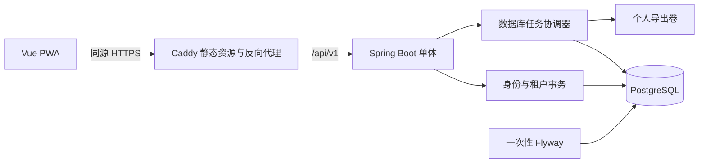

# 总体架构与工程契约

## 范围与结论

面向开发与运维，描述单仓库 Vue PWA、Spring Boot 模块化单体和 PostgreSQL 的组成、依赖及共享契约。实际运行环境见[部署案例](../deployment/README.md#部署案例)。

## 技术选择与模块关系

| 层 | 实现与入口 | 依赖边界 |
|---|---|---|
| 前端 | Node 24.11.1、Vue 3、Vite、TypeScript、Pinia、Vue Router；web/package.json | 只调用同源 API；报表使用 ECharts；不保存认证令牌到本地存储 |
| 接口 | contracts/openapi.yaml、web/src/api/generated/schema.ts | OpenAPI 为接口契约；生成类型不能手工修订 |
| 服务端 | Java 21、Spring Boot 3.5.16、MyBatis-Plus 3.5.17；server/pom.xml | Controller → 应用服务 → Repository/Mapper；跨领域写入通过应用服务 |
| 持久化 | PostgreSQL 16+；生产镜像 16.14-bookworm、Flyway 11.7.2 | 应用不拥有 schema；迁移一次性执行，prod 启动只读核验版本 012 |
| 异步 | job_run、JobCoordinator、JobPoller | 同一服务内数据库任务，无 Redis、消息队列或独立调度服务 |
| 发布 | server/Dockerfile、deploy/compose*.yaml | db/app/proxy 常驻；provision/migrate/bootstrap-admin 短生命周期 |

具体机制分见 [前端](frontend-pwa.md)、[后端](backend-domains.md)、[数据库](database-migrations.md)、[任务](jobs-export-deletion.md)。不引入账户余额、转账、地图服务；地点仅为个人标签。

## 核心数据与 HTTP 契约

- 金额通过十进制字符串传输，Java BigDecimal、PostgreSQL numeric 计算；前端业务计算用精确金额工具。人民币金额上限 `999,999,999.99`，通用金额最多两位小数。图表显示转换不作为业务金额计算。
- 日期按 `Asia/Shanghai`；发生时间使用带偏移 ISO 8601，服务端校验不能超出当前时间 5 分钟。报表日期由 BusinessDateRange 统一解析；CSV 时间显式带 `+08:00`。
- 错误固定为 `code/message/fieldErrors/traceId/retryable`，HTTP 状态表达失败，不以 200 包装失败；不得返回堆栈、凭据或租户标识。
- 用户名 3–64 位可见 ASCII；备注去首尾空白后最多 500 Unicode code point。详见 LedgerWritePolicy、AuthDtos 和 contracts。
- 支出与导出创建使用 1–128 字符幂等键，规范化内容摘要相同才返回原结果，键相同内容不同则冲突。导出终态后的新操作必须换键。
- 身份与租户只从服务端认证上下文取得，ADMIN 不具备个人账目读取能力。完整链路见 [认证与租户](auth-tenant.md)。

## 开发接入与验证

复用及工程硬约束见 [AGENTS](../../AGENTS.md#工程与业务硬约束)，接口/SQL 变更维护与检查见[开发验证规范](../testing/guide.md#变更维护与验证)。ModuleBoundaryTest、PersistenceSourceBoundaryTest、HttpContractTest 和前端页面登记契约测试分别覆盖模块、持久化、HTTP 及页面关系。

## 风险与限制

| 类型 | 当前事实 | 影响与处理 |
|---|---|---|
| 已知限制 | 一期单机 Compose，无高可用切换 | 主机故障影响服务；恢复能力按部署方案与案例分别评价 |
| 验收边界 | 工程检查不能证明终端 PWA、真实恢复切换或新实例通过 | 按候选及实例分别核验，证据与例外见部署案例 |
| 实现边界 | 管理概况读取宿主只读状态文件 | 已接入成功/失败/运行与新鲜度判定；仅本机告警，见部署案例 |
