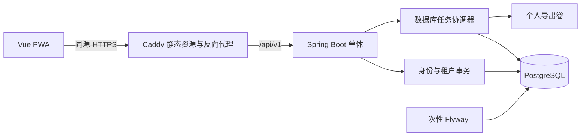

# 总体架构与工程契约

## 范围与结论

面向开发与运维，描述正在改造中的 iPhone 离线 App，以及保留的 Vue PWA、Spring Boot 模块化单体和 PostgreSQL 的组成、依赖及共享契约。下图及 Web 专题描述旧工程；旧工程源码尚未退役，日常本地服务保持停止。Web 实际运行环境资料见[部署案例](../deployment/README.md#部署案例)。

## 离线 iOS 原生入口

`app/` 是独立的 Vue 3 + Capacitor iPhone 工程，最低 iOS 27.0；`app/ios/App/App.xcodeproj` 的 `App` scheme 仅声明 iPhone 设备家族，关闭 Mac Catalyst、Mac 上的 iPhone/iPad 兼容运行和 visionOS 兼容运行。个人页面及共享组件已经沿原布局迁入 `app/src`，四个主导航及六个个人路由沿用原顺序和交互；旧 `web/src` 保留对照。启动由 bootstrap store 打开真实 LedgerDatabase，loading/error 时不挂载页面，成功后以 datasetId 隔离 KeepAlive。打开失败不重建库，仅可重试错误提供重试；完整业务服务和备份恢复仍待实现。

构建由 [ios-app.sh](../../scripts/ios-app.sh) 调用 app 的 `native:sync`：Vite 将 Vue 编译至 app/dist，Capacitor 将资源复制到原生 App/public，并生成配置和 CapApp-SPM 清单。配置不接受环境变量覆盖远程地址，未配置 `server.url`；WKWebView 从 `capacitor://localhost` 随包入口加载，HTML 的 CSP 将资源连接限制为自身。SwiftPM 清单由 CLI 生成，不维护另一份手工副本。CLI 8.6.2 在 tools 5.9 清单中生成 `.iOS(.v27)`，项目通过 [生成适配](../../scripts/normalize-capacitor-spm.mjs) 将这一已知形态转换为等价的 `.iOS("27.0")`；形态变化时明确失败，升级 CLI 时需重新评估。npm 依赖由 app/package-lock.json 锁定，原生远程依赖由 [Package.resolved](../../app/ios/App/App.xcodeproj/project.xcworkspace/xcshareddata/swiftpm/Package.resolved) 固定，禁止自动漂移。

[nativeConnection](../../app/src/infrastructure/database/nativeConnection.ts) 是最小原生连接边界：只允许 iOS 且必须存在 CapacitorSQLite 插件，拒绝浏览器替代存储。[nativeAdapter](../../app/src/infrastructure/database/nativeAdapter.ts) 只注册 CapacitorSQLite 原生插件并持有有界于实际连接数的注册表，不导入插件的 Web 实现；所有 SQL 操作仍委托锁定插件。正式账本经 createIosDatabase 创建并接管句柄后再打开，打开失败由同一生命周期释放；原生探针沿用 openIosDatabase 的独立打开/清理入口。插件配置将数据库放在沙盒 `Library/OfflineLedger`，并设置系统备份排除标记；该标记已经由模拟器上的原生测试读取确认。[LedgerDatabase](../../app/src/data/ledgerDatabase.ts) 在这一边界之上管理账本连接、生命周期与事务；启动和本地业务服务共用 appDatabase 单一所有者；页面不持有连接或执行 SQL。

App 的 API DTO 沿用旧接口类型维持页面兼容；字典 API 与支出商品候选调用本地 DictionaryService/ProductService；收支 API 调用 EntryService，均不经过 HTTP。八类字典的新增、改名、停用/恢复、分页搜索、同级排序、引用保护及商品合并已经接通。其他未接通业务由 `api/http.ts` 明确拒绝，不返回假数据。localOperation 将未知存储错误包装为安全提示，保留内部原因；字典变更通知仅在事务提交后发布。运行期 Pinia 偏好和 useLedgerDraft 通过下述 T7 个人状态服务消费原生 SQLite，维持页面缓存与持久化状态；不使用浏览器持久化。账号、管理员和 PWA 入口不进入 App 路由。原 UI 的 PageWorkspace、AppDrawer/AppDialog、CachedPageView、键盘可见视口及未保存作用域继续复用，样式与模板基线由设计契约保护。图表与报表页面按需分包。

`NativeTests` 是 hosted XCTest target，运行于真实 App 进程，通过 WKWebView 注入仅存在于 test bundle 的 [sqliteProbe](../../app/native-tests/sqliteProbe.ts)，再调用同一原生连接入口。探针以随机库名执行绑定、事务提交/回滚、关闭重开与最小升级，定点整数以字符串绑定并 `CAST(... AS TEXT)` 读取，避免桥接到 JavaScript Number 时丢失精度。探针消费 App 的权威金额函数，不调用旧 API，并验证 SQLite 64 位聚合溢出明确失败；实验结束关闭并删除本轮数据库，生产入口不含探针开关。该验证不替代正式迁移器、容量或真机验收。

[DictionaryTouch scheme](../../app/ios/App/App.xcodeproj/xcshareddata/xcschemes/DictionaryTouch.xcscheme)另建外部 UI 测试 runner，对随包 Release App 使用原生触摸和键盘，不导入 App 模块、不注入脚本或测试参数。局部入口允许同一显式会话复用脚本新建的模拟器、按内容摘要复用测试产物，完整入口默认新建设备，也可重新校验后借用同一会话设备，以全新合成 App 数据独立验收；两者共用脚本命令锁、测试源与夹具，具体操作见[开发验证规范](../testing/guide.md#原生局部调试与完整验收)。两个测试 target 仅允许 simulator SDK，并共用 [隔离守卫](../../app/ios/App/NativeTests/OwnedSimulatorTestContext.swift)：探针注入及 UI 启动前，校验脚本生成的设备清单与当前模拟器 UUID；缺少或不匹配即拒绝。测试源与 runner 不属于生产 target，正式 App 不读取清单；只有独立模拟器的空账本可准备合成历史引用，真实本地服务完成交互后再回读数据库核对持久化，机制和运行入口见开发验证规范。

精确金额、业务时间和文本纯函数统一位于 app/src/domain；旧 Web 的对应模块仅重导出同一实现，兼容测试验证入口一致，避免保留两份业务规则。金额跨 SQLite 桥只接受规范十进制整数字符串，并校验 64 位整数边界。[SerialQueue](../../app/src/infrastructure/database/serialQueue.ts) 提供默认容量 32 的串行执行能力，排队取消释放名额，运行中的取消由事务安全边界处理；LedgerDatabase 的生命周期、读写和关闭均通过这一队列执行，事务在同一独占操作内提交或回滚。

[账本生命周期](../../app/src/data/ledgerDatabase.ts) 取得同名库的单一所有权后，校验原生外键及 schema/履历，初始化或升级成功且文件策略生效后才接受业务操作。结构链由 [migrations](../../app/src/data/migrations/index.ts) 维护，纯 SQL 迁移沿用原 SQL 的 SHA-256；含数据步骤的迁移将 SQL、数据步骤及其版本化算法源码一并计入摘要，DDL、数据回填和履历在同一事务提交；各版本同时维护完整结构清单，启动先按旧版本清单校验，再在迁移事务中按目标清单核对。结构检查比较表/索引/触发器的类型、归属和 SQL 词法单元，覆盖列类型、CHECK、外键及唯一性；只忽略语法外空白与注释，不忽略字符串内容或词边界。当前尚无正式发布的历史数据库版本，兼容测试使用受控旧版夹具。未知高版本、断档、历史摘要不符或不能解释的元信息缺失均拒绝，不删库重建。基础表承载元信息、字典标识、偏好、幂等结果及带定点金额/历史渠道快照的收支共同记录，类型专有字段和规则按相应功能追加迁移。

[编号迁移 0002](../../app/src/data/migrations/0002_dictionary_governance.sql) 在 v1 上追加 product_details、daily_entry_template、product_merge_event、账目字典引用/名称快照和引用索引；不改写 v1。触发器约束字典种类、两级分类、停用/恢复顺序及引用类型，外键保护已引用项；商品改名只联动当前模板，不覆盖账目历史快照。管理页包含停用项，新录入候选仅含启用项，每次打开重新读取有界候选，历史停用值经 ID 回显，不混入新候选。名称显示值与 NFKC 唯一键共用原有文本规范化规则。排序在单一事务内由 SQLite 重排同级序列，不把整库拉入 JS。

商品合并先读取预览，确认后将账目引用、模板冲突收敛、合并去向、事件及幂等回执在同一事务提交；账目金额/名称快照保持，行版本递增。模板冲突保留目标 ID，按最近使用时间、更新时间和 ID 选取内容；时间相同时，ID 沿用旧 Java UUID.compareTo 的两个有符号 64 位整数顺序；保留目标已有默认/最近值。源商品停用并标记去向，不再进入管理列表/候选，但保留名称唯一键和历史事件。链式合并更新当前去向，原事件不重写。同一对商品重试返回原回执；故障整体回滚。管理页刷新若发现当前页超出最后一页，在同一次可取消请求内最多补读一次有效末页，仅接纳当前代次结果，保持搜索与状态筛选。模板创建/选择/移除经 T7 的 TemplateService 接通，和上述合并协调共用同一张表和队列；未根据旧版缺失字段猜测历史商品归属。

关闭失败时账本停止读写，保留连接引用与同名库所有权；只有原生关闭成功才释放两者。调用方可再次 close，或调用 open 先重试遗留连接的关闭；清理失败时不创建同名新连接。打开/校验与清理同时失败会保留两个原因，原生打开前已接管的句柄同样适用这组恢复规则。

[编号迁移 0003](../../app/src/data/migrations/0003_ledger_writes.sql) 追加收支量价、计算金额、收入名称、备注、更新时间和 payer_details；不修改 v1/v2 或重跑 seed，存量缺失字段保持 NULL。EntryService 统一校验精度/上限、Unicode 长度、上海业务日期及设备时间未来 5 分钟、启用字典与分类层级。金额/单价/数量以定点 INTEGER 存储并以字符串跨桥；量价计算与可手改实付独立保存。账目、商品/付款方最近值及规范化输入的幂等回执同事务提交，未知存储失败由 localOperation 安全封装，提交后才广播 ledger-changed。设备时钟的未来 5 分钟校验仅作用于首次执行，已提交回执不因时钟回拨被拒绝。首次执行和回放都在同一事务内检查结果是否仍有效：编辑回执对应的记录若已推进版本则返回 LEDGER_VERSION_CONFLICT，原回执保持不变；创建回执若已撤销则拒绝回放。编辑按 ID+预期版本条件写入；原表单继续提供保留输入重新确认/加载最新内容，操作 ID 同时绑定编辑版本。撤销需原创建回执、未编辑的有效记录、无模板引用且在 24 小时内；同一撤销可重试，创建回执保留，撤销后旧创建重试明确拒绝，不复活账目。撤销或编辑更换商品/付款方后回算原对象的最近值。T8 已将所有调整关联加入撤销保护，并在实付编辑时校验有效调整最低额。

[编号迁移 0004](../../app/src/data/migrations/0004_snapshot_search.sql) 追加历史商品名称的规范化检索键；[数据步骤](../../app/src/data/migrations/0004_snapshot_search.ts) 按稳定 ID 每批最多 200 条回填，和 DDL/履历共同提交或回滚，不改名称展示值、金额、行版本、字典及用户偏好。已有 v1—v3 SQL、结构清单和摘要规则保持；v4 将数据步骤及复用的 [名称算法 v1](../../app/src/domain/dictionaryNameV1.ts) 原文计入摘要。版本化算法只承载原有 NFKC、空白折叠及小写规则，由原 text 入口重导出；后续规则变化须新增版本及迁移，不改写历史源码。新建/编辑与旧数据回填使用同一算法，查询不再用 SQLite lower() 近似 Unicode 规范化。

[EntryReadbackQuery](../../app/src/data/entries/readbackQuery.ts) 承接 T6/T8 原明细入口回读、编辑及回收站所需查询：日期、类型、资金渠道、名称及单条 ID，按业务时间和 ID 的游标每页最多 50 条；未接入条件明确拒绝。支出 DTO/列表读取同一调整表的真实有效累计及净额，调整只冲减支出，不混为收入；冻结、撤销和删除的调整不进入有效明细。T9 再接完整跨维搜索、20 条分批及报表下钻；当前回读不代表 T9 已完成。草稿、偏好与模板持久化由下述 T7 服务承接。

T7 的 [0005](../../app/src/data/migrations/0005_personal_state.sql) 追加按 datasetId/类型唯一的 ledger_draft，以及收入模板独立名称字段；只为真正缺失的偏好补默认，不重跑 seed。旧模板收入名称由已保存的展示名补齐，不依赖仍存在的来源。DDL、数据与迁移履历仍在原生命周期事务内提交或回滚；v1—v4 及其摘要不改写。

[DraftService / PreferenceService / TemplateService](../../app/src/data/personal/) 在实际队列读写及事务内核对 datasetId；新数据集的迟到恢复和旧任务均拒绝，原始非法/未知版本草稿保留供兼容恢复。双草稿采用 16 KiB/字段白名单、版本及 7 天有效期，允许不完整小数；useLedgerDraft 以 250ms 合并输入，最多一笔在途写入及一份最新编辑态。旧快照慢写失败且已有较新输入时，每轮最多立即续写最新快照一次；失败接管落盘时取消既有防抖，防止连续失败后遗留计时器再开一轮；再次失败保留最新输入和原备份失败提示，等待后续编辑、前后台落盘或重试入口再次提交，不循环重试。清除草稿或切换数据集后，旧失败不触发续写。缓存页停用、页面隐藏及原生 willResignActive 都请求同一落盘入口；原生提供到期必释放的后台完成窗口，不能保证操作系统直接杀进程前尚未送达的最后输入。提交前排空并冻结草稿写入，创建账目时在同一事务消费对应草稿；失败保留输入并允许重试，不把草稿存储失败伪装成账目保存失败。重置偏好不删除草稿、模板或账目。

偏好沿用既有 SQLite 存储键，统一默认、合法值与引用回退；无效值仅消费时回退，不覆盖原值。保存按字段排队、按字段代次接纳响应，失败的乐观输入保持，其他字段成功不会抹掉失败输入；重置失败保持原偏好。main 在首个 Vue 帧前等待 bootstrap 的偏好加载，ThemeModeControl、设置、最近类型、表单默认资金渠道及查询范围消费同一状态源；不使用 localStorage 首屏缓存。

TemplateService 只从有效且引用可用的收支生成定点字段白名单；按类型/规范化名称同键更新并保留 ID，查询按最近使用排序、最多 100 项。选择时复验字典及分类层级，只清除并提示失效字段，保留其余值；原表单负责使用当前时间、清空备注和继续普通校验，不自动入账。商品改名/合并沿用 T5 协调；来源删除以 SET NULL 保留模板，移除模板不改来源和金额。T12 接恢复/清空时须在切换数据集的事务内处理恢复草稿归属，并让页面缓存随 datasetId 重建。

[默认清单](../../app/src/data/seed/defaults.ts) 只对确认的新数据集写入，与 datasetId、schemaVersion、seedVersion 和初始化标记共同提交。现有清单采用已确认的八项收入分类；已有账本不随安装包 seed 变化更新，空字典也不补种。偏好以 JSON 原值保存，区分缺失与 false、0、空值。新数据集执行结构/必需数据迁移后，初始偏好由当前 seed 显式覆盖同键迁移缺省值；此覆盖仅存在于新装事务。存量升级不执行 seed，缺失字段只由相应迁移补齐，已有用户值继续保持。数据层 executeOnce 将业务写入和操作结果共同提交，相同操作名/ID/摘要回传已有结果，摘要不同拒绝；调用者仍须提供规范化业务输入摘要及领域校验。

升级前关闭原生连接，通过 [LedgerFilesPlugin](../../app/ios/App/App/LedgerFilesPlugin.swift) 检查空间、复制已关闭的数据库，以 128 KiB 分块计算并核对 SHA-256，写入清单后将临时目录原子改名为完成快照。文件能力只接受受限库标识，路径均由 App 私有目录派生；非空 WAL 及 magic 非零/日志头不完整的 journal 拒绝复制；SQLite 已失效的完整 journal 头（8 字节 magic 清零）可保留在原处，快照只复制已由 SQLite 校验并关闭的主库，不主动删除日志。私有目录、数据库及完成快照重新设置并回读系统备份排除标记；实体 iOS 构建还要求 completeUntilFirstUserAuthentication 文件保护回读成功。模拟器构建明确返回 protected=false、simulator=true，不把模拟器结果作为实体文件保护证据。快照自动调度、保留 7 份、恢复替换及外部加密备份在数据管理功能接入。

迁移阶段通过可注入的只读进度观察器报告 snapshot-ready、migration-recorded、upgrade-committed，不传出数据库连接。测试 bundle 在正式 open→upgrade 流程观察到指定阶段后挂起，隔离脚本再终止该 App；生产入口不读取测试请求文件，也没有启用故障的参数。提交前中断须恢复旧版完整结构/履历并可重试，提交后中断须保留新版且不重放迁移。

[offline-ios 工作流](../../.github/workflows/offline-ios.yml) 已定义 Linux 构建/资源检查与 Xcode 27 镜像上的原生构建、模拟器测试；当前只有本地执行证据，远端尚未运行。构建脚本只新建和删除本轮 iPhone 14 Pro Max 模拟器，保留用户已有模拟器；日志及 xcresult 在 .local/ios/tmp/ai-agent 的独立轮次目录，增量构建和依赖缓存在 .local/ios。工程检查入口及各自证明范围见[开发验证规范](../testing/guide.md#工程检查)。未签名的 Release 编译产物不能直接安装到真机；骨架已另用 Personal Team 签名并在指定真机完成图标离线冷启动。正式业务、完整生命周期和容量性能仍待实现/验证，不能把骨架证据扩大为产品交付通过。

T8 的 [0006](../../app/src/data/migrations/0006_adjustment_lifecycle.sql) 追加 expense_adjustment、到期索引与 maintenance_state，旧迁移保持不变。AdjustmentService/LifecycleService 在真实事务内核对 datasetId、版本、来源及有效累计；账目实付不得低于有效调整，创建回执已有后续关联时不能撤销。删除支出由同一 SQL 触发器冻结有效调整，恢复时重新校验并解冻；已撤销/单独删除的调整不复活。调整和账目操作与回执同事务，回放读取当前累计且拒绝已改变的版本/状态。永久删除有关联的来源必须由原确认弹窗明确传入连同删除，外键拒绝留下孤儿；模板来源仍按 SET NULL 保留。

CleanupService 在启动/回到前台执行一次有界轮次，最多 5 批，每批合计删除不超过 100 行；先删除到期来源的子调整，再删已无关联的来源。删除和最小进度状态同事务，已提交删除就是断点，重启重新选择剩余到期对象，不回放已删内容。持久化时钟样本、状态、批次数及最后处理 ID，不保存账目正文。无基线、回退超过 5 分钟、同进程墙钟/单调经过时间差超过 5 分钟、跨启动间隔达到 30 天均延期；本轮不重试，后续前台重新判定，显式永久删除不依赖此自动清理资格。DOM/原生事件合并，后台取消在事务边界生效；失败、取消和遗留 running 中断分别记录。原全局提示组件显示延期原因或失败状态；尚未完成的轮次不声称已清完。清理资格同时检查当前 DOM 可见性、已观测前后台状态和账本就绪，后台迟到的初始化不能启动新轮次。最终维护状态写失败返回已提交进度和运行期错误，由既有 mutateEntry 使页面缓存失效；不把状态保存失败当作业务删除回滚。部分失败提示明确已永久清理的行数，零提交不误报删除；失败状态仅补写一次，底层原因链只留内存，不进入维护 JSON，后续前台从已提交断点继续。

## 保留的 Web 运行拓扑

## 技术选择与模块关系

| 层 | 实现与入口 | 依赖边界 |
|---|---|---|
| 前端 | Node 24.11.1、Vue 3、Vite、TypeScript、Pinia、Vue Router；web/package.json | 只调用同源 API；报表使用 ECharts；不保存认证令牌到本地存储 |
| 接口 | contracts/openapi.yaml、web/src/api/generated/schema.ts | OpenAPI 为接口契约；生成类型不能手工修订 |
| 服务端 | Java 21、Spring Boot 3.5.16、MyBatis-Plus 3.5.17；server/pom.xml | Controller → 应用服务 → Repository/Mapper；跨领域写入通过应用服务 |
| 持久化 | PostgreSQL 16+；生产镜像 16.14-bookworm、Flyway 11.7.2 | 应用不拥有 schema；迁移一次性执行，prod 启动只读核验版本 012 |
| 异步 | job_run、JobCoordinator、JobPoller | 同一服务内数据库任务，无 Redis、消息队列或独立调度服务 |
| 发布 | server/Dockerfile、deploy/compose*.yaml | db/app/proxy 常驻；provision/migrate/bootstrap-admin 短生命周期 |

具体机制分见 [前端](frontend-pwa.md)、[后端](backend-domains.md)、[数据库](database-migrations.md)、[任务](jobs-export-deletion.md)。不引入账户余额、转账、地图服务；地点仅为个人标签。

## 核心数据与 HTTP 契约

- 金额通过十进制字符串传输，Java BigDecimal、PostgreSQL numeric 计算；前端业务计算用精确金额工具。人民币金额上限 `999,999,999.99`，通用金额最多两位小数。图表显示转换不作为业务金额计算。
- 日期按 `Asia/Shanghai`；发生时间使用带偏移 ISO 8601，服务端校验不能超出当前时间 5 分钟。报表日期由 BusinessDateRange 统一解析；CSV 时间显式带 `+08:00`。
- 错误固定为 `code/message/fieldErrors/traceId/retryable`，HTTP 状态表达失败，不以 200 包装失败；不得返回堆栈、凭据或租户标识。
- 用户名 3–64 位可见 ASCII；备注去首尾空白后最多 500 Unicode code point。详见 LedgerWritePolicy、AuthDtos 和 contracts。
- 支出与导出创建使用 1–128 字符幂等键，规范化内容摘要相同才返回原结果，键相同内容不同则冲突。导出终态后的新操作必须换键。
- 身份与租户只从服务端认证上下文取得，ADMIN 不具备个人账目读取能力。完整链路见 [认证与租户](auth-tenant.md)。

## 开发接入与验证

复用及工程硬约束见 [AGENTS](../../AGENTS.md#工程与业务硬约束)，接口/SQL 变更维护与检查见[开发验证规范](../testing/guide.md#变更维护与验证)。ModuleBoundaryTest、PersistenceSourceBoundaryTest、HttpContractTest 和前端页面登记契约测试分别覆盖模块、持久化、HTTP 及页面关系。

## 风险与限制

| 类型 | 当前事实 | 影响与处理 |
|---|---|---|
| 已知限制 | 一期单机 Compose，无高可用切换 | 主机故障影响服务；恢复能力按部署方案与案例分别评价 |
| 验收边界 | 工程检查不能证明终端 PWA、真实恢复切换或新实例通过 | 按候选及实例分别核验，证据与例外见部署案例 |
| 实现边界 | 管理概况读取宿主只读状态文件 | 已接入成功/失败/运行与新鲜度判定；仅本机告警，见部署案例 |
