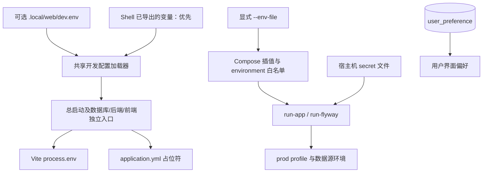

# 环境变量与配置加载架构

## 范围与加载模型

本地运行资料按端分层：Web 端使用 `.local/web/`，离线 iOS App 预留 `.local/ios/`。下述 Web 开发、测试和部署工具默认使用 Web 子目录，开发配置不回退读取根 `.local` 或 iOS 配置；支持显式路径的环境变量保留原有覆盖规则。相对路径仍以所属进程工作目录解析；例如 Maven 启动的后端导出默认在 `server/.local/web/exports`。Git 忽略所有层级的 `.local`。

本文说明环境变量从哪里读取、如何进入进程、何时生效，以及密钥如何分发和轮换。开发使用 Shell 变量、可选的 `.local/web/dev.env` 与 application.yml，部署使用 Compose 配置和 secret 文件；用户偏好另存业务数据库，不属于基础设施配置。

部署目标文件 `.local/web/deploy-targets/<目标>.env` 仅供运维端入口消费，不进入 Compose 或应用容器；它指向目标机 `/etc/my-bill/production.env`，不替代其中的运行变量与 secret。字段、解析格式和旧目标默认行为见[部署目标配置](../../deploy/targets/README.md)，宿主与初始化流程见[部署导航](../deployment/README.md)。

| 来源 | 谁加载 | 生效与优先级 |
|---|---|---|
| 根 .env.example | 无，纯模板 | 复制到 .local/web/dev.env 后由开发入口读取；根 .env 不加载 |
| .local/web/dev.env | scripts/lib/dev-environment.mjs；Shell 桥接 dev-environment.sh、web 包 dev-vite.mjs | 仅启动开发服务/本地预览时补充缺失变量；已导出的 shell 变量（含空值）优先，工具显式命令参数再覆盖；修改后重启 |
| Shell 环境 | dev.sh、工具链、Vite process.env、Spring | 启动时读取；脚本默认值仅在变量缺失/空值时回退，具体以代码为准 |
| application.yml | Spring Boot | 非生产默认、占位符与配置结构；标准 Spring 属性覆盖仍存在，不应手工注入绕过安全配置 |
| application-prod.yml | run-app 强制 prod | 关闭内嵌 Flyway、开启 schema 012 校验、Secure Cookie、文件 pepper；并非任意 Spring 覆盖均有代码硬拦截 |
| production.env.example | 无，纯 Compose 模板 | 必须复制到受控路径并通过 --env-file 指定；当前模板含内网案例值，换实例必须替换 |
| Compose 插值 | docker compose | 当前 shell 同名变量可覆盖 --env-file；environment 只透传列出的字段，env 文件不是整体进入容器 |
| /run/secrets/* | 启动脚本/认证属性 | 文件挂载；run-app 派生 SPRING_DATASOURCE_*，run-flyway 派生 FLYWAY_*，不输出值 |
| user_preference、个人字典 | 业务服务 | 当前账号数据，不覆盖基础设施参数，不构成全局环境变量管理中心 |

`web/vite.config.ts` 直接读取 process.env，不调用 loadEnv 加载根目录模板。`server.host` 与 `preview.host` 共用 `MY_BILL_WEB_HOST`，未设置或空值时回退 `0.0.0.0`；显式 Vite `--host` 优先于环境变量和配置默认值。总启动、前端启动器及直接运行 web 包均消费这一配置，不在各入口重复注入 host。前端没有自定义 VITE_* 密钥/连接配置；API 固定同源 /api/v1。MY_BILL_BUILD_ID 只决定构建缓存名，不能运行时通过服务器 env 改已构建资源。

开发文件的解析只有一份实现：`scripts/lib/dev-environment.mjs` 使用 Node 内置 `parseEnv` 解析单行 `KEY=value`，支持注释、空值和引号，限制键为 `MY_BILL_*`/`JAVA_HOME`，拒绝重复键、未闭合引号、NUL 和超过 64 KiB 的文件。文件缺失不创建，读取失败或格式错误则在消费者启动前拒绝，错误不输出值。`dev-environment.sh` 用 NUL 分隔协议传递给 Bash，不 `source`/`eval` 用户内容；`dev-vite.mjs` 为 web 包 dev/preview 复用同一解析器。文件值不做 shell 命令执行或变量展开，也不通过 VITE_* 暴露给浏览器。现有 shell 同名变量（包括空值）不被覆盖，具体空值回退由消费者决定。

此机制只在总开发启动、开发数据库管理、独立后端及前端 dev/preview 入口加载。后端仍以 application.yml 的结构和环境占位符为准；生产 Compose、发布构建和隔离检查不加载开发文件。隔离 E2E 的预览直接调用 Vite CLI，并显式指定测试后端端口、前端端口和回环监听，避开开发加载器。首次复制步骤见 [README](../../README.md#5-更换端口或开发库)。

## 用两个例子理解配置实际如何生效

### 开发端口

调用 `MY_BILL_SERVER_PORT=18080 MY_BILL_WEB_PORT=15174 npm run dev` 时，Shell把两个变量传给dev.sh；脚本启动的Maven/Java和npm/Vite继承环境。Java从application.yml占位符取得18080，Vite从process.env取得同一个18080作为代理目标，前端开发命令使用15174。只修改浏览器URL不能修改Java端口；只在某个独立前端终端设置变量，也不会改变已经运行的后端。

### 生产数据库密码

`MY_BILL_APP_DB_PASSWORD_HOST_FILE=/etc/my-bill/secrets/app_db_password` 是宿主路径；Compose把该文件挂到app里的 `/run/secrets/app_db_password`。run-app.sh根据容器内的MY_BILL_APP_DB_PASSWORD_FILE读取内容，再向Java子进程提供SPRING_DATASOURCE_PASSWORD。Java连接数据库，浏览器和proxy都拿不到该密码。

因此有三个不同的值：配置里的宿主路径、容器看到的路径、文件内真正的密码。env示例只保存路径；不能把密码写进“路径变量”，也不能把宿主路径原样当作容器路径。secret名称本身不会加密宿主文件，文件权限和Docker管理权限仍然关键。

### 修改后需要做什么

| 改动 | 需要的动作 | 原因 |
|---|---|---|
| 开发 Shell 变量或 .local/web/dev.env | 停止并重新启动对应进程 | 已启动进程不会读取另一个终端的新环境或更新后的文件 |
| Compose env/挂载参数 | config校验后重新创建受影响容器 | restart复用原容器配置，不重新装配environment |
| 数据库密码文件 | 先协调数据库角色密码，再替换文件并重建消费者 | 文件内容和数据库实际密码必须一致；现有连接池可能暂时掩盖不一致 |
| TLS叶证书 | 校验新文件、替换、Caddy reload并从客户端核验 | 文件更新不代表进程已经加载 |
| MY_BILL_BUILD_ID | 重新构建并交付前端 | 这是构建时缓存版本，不是运行期网页参数 |
| 用户偏好 | 通过本人偏好API保存 | 属于业务数据，按业务请求读取，不重启服务 |

操作前后要核对受影响消费者，而不是只确认“文件已经改了”。

## 开发与工具链变量

以下为脚本直接支持的配置；本地连接为开发用途，不将空密码/trust 用于生产。

| 变量 | 默认/约束 | 消费位置与生效 |
|---|---|---|
| JAVA_HOME | 自动查找完整 Java 21 JDK，缺失失败 | scripts/toolchain.sh，启动/检查时 |
| MY_BILL_SERVER_PORT | 8080 | application.yml 与 Vite API proxy；两侧必须一致 |
| MY_BILL_WEB_HOST | 0.0.0.0；缺失/空值均回退；可设 127.0.0.1 限制本机 | web/vite.config.ts 的 dev/preview；显式 --host 优先，环境变量变更需重启；不自动读取根 .env |
| MY_BILL_WEB_PORT | 5174；缺失/空值均回退 | web/vite.config.ts server.port；显式 --port 优先，Vite 端口占用可能顺延，核对实际输出 |
| MY_BILL_DB_HOST | 127.0.0.1；dev 只允许本机 | dev.sh 与 application.yml |
| MY_BILL_DB_PORT | 54329，1–65535 | 同上；复用前校验 data_directory 属于本仓库 |
| MY_BILL_DB_NAME | my_bill_dev，受限标识符 | dev.sh 创建目标库；设置新名字不删除旧库 |
| MY_BILL_DB_ADMIN_USER | my_bill_dev | dev.sh 建库建角，不给应用使用 |
| MY_BILL_DB_MIGRATION_USER | my_bill_migration，dev 固定 | 内嵌 Flyway 用户 |
| MY_BILL_DB_MIGRATION_PASSWORD | 空，仅本机 trust | 内嵌 Flyway，不用于生产 migrate 容器 |
| MY_BILL_DB_MIGRATION_URL | 缺省回退应用 datasource URL | application.yml 的 Flyway URL；dev.sh 不验证这个覆盖值，开发时不要指向外部库 |
| MY_BILL_DB_APP_USER | my_bill_app，dev 固定 | 应用连接用户 |
| MY_BILL_DB_APP_PASSWORD | 空，仅本机 trust | application.yml；生产由文件派生 Spring 密码覆盖 |
| MY_BILL_AUTH_RATE_LIMIT_PEPPER | 本地专用弱默认 | 仅非 prod 开发；生产 rate-limit-pepper 置空并读文件 |
| MY_BILL_BUILD_ID | npm_package_version，最终 local | Vite 构建静态缓存名；发布应设置提交号 |

工具链 Node 精确匹配 .nvmrc 的 24.11.1，npm 声明 11.6.2；不是随意用当前 shell Node。工具脚本会查已安装版本，不自动下载。Python 用于验证/备份辅助，未作为独立业务服务。

`npm run dev` 由同一父进程管理数据库、后端和前端；`npm run dev:db -- start|status|stop`、`npm run dev:backend`、`npm run dev:frontend` 用于分终端调试。数据库入口与总启动脚本复用 `scripts/lib/dev-database.sh` 中的配置校验、集群归属核对和角色准备逻辑；独立后端/前端不会替开发者隐式管理数据库。分开启动时，共用 `.local/web/dev.env` 中的 MY_BILL_DB_* 与 MY_BILL_SERVER_PORT；若 shell 显式覆盖，相关终端仍须保持一致。IDE/Maven 直接启动不经过开发加载器，需自行提供相同环境。`dev:frontend` 保留 npm 参数分隔符，将用户追加的 Vite 参数原样传入 web 包；直接运行 web 包的 dev/preview 也使用同一 host 配置，但不经过日志启动器。preview 默认端口 4173，可用 `--port` 覆盖，不消费仅用于 dev 的 MY_BILL_WEB_PORT。

### 离线 App 原生测试配置

CI 规划消费 GITHUB_EVENT_PATH、GITHUB_EVENT_NAME、GITHUB_RUN_ID、GITHUB_RUN_ATTEMPT 和 GITHUB_OUTPUT；PR 提供 base/head，手动提供 verification/base_revision，schedule 固定依赖审计。IOS_CI_RESULTS、IOS_CI_GROUP、IOS_CI_ATTEMPT 分别绑定结果目录、平台组与 attempt；IOS_CI_PLAN_STATUS、IOS_CI_CHECKS_STATUS 绑定实际作业，PR 另通过 IOS_CI_IS_PR=true 和 IOS_CI_LOCAL_STATUS 核验回执作业，缺失/失败不能回退成功。普通本地命令使用 --results/--group，不需要 Actions 变量，不加载 `.local/web`。

本地 hook 的仓库/目标分支/原 hook/公钥信息位于 Git 私有目录 `codex/local-gate.json`，其中 hooksPath/hooksState/hookActivation 保存转发目录、内容快照及未完成切换意图；core.hooksPath 指向完整发布的 `.git/codex/hooks-*`，版本化入口仍在 `.githooks`，保留及恢复规则见统一验证策略。私钥仅在 macOS 钥匙串的随机 com.mybill.local-evidence 服务项；本地尝试索引和报告位于 `.local/ios/tmp/ai-agent/`，不进入 App。仓库变量 IOS_LOCAL_EVIDENCE_SIGNERS 是 keyId 到 PEM 公钥的 JSON 映射，不含私钥；IOS_EVIDENCE_HEAD/BASE 用于 PR 只读核验，可信工作流通过 IOS_EVIDENCE_PR 和 IOS_EVIDENCE_PUBLISH=true 读取实际 PR 并发布状态。该可信任务独享 GH_TOKEN 的 contents/pull-requests 只读及 statuses 写权限，普通 PR 代码不得接触写令牌。回执通过 refs/notes/ios-local-evidence 发布，字段及信任边界见[统一验证策略](../testing/guide.md#统一套件按需-ci-与最终验收)。

安全工具固定缓存为 `.local/ios/tools`，下载沿用系统 curl 的 TLS 校验。macOS 远端常规组固定 DEVELOPER_DIR=/Applications/Xcode_27.app/Contents/Developer（Xcode 27.0），运行前核验 SDK，不修改全局选择，不启动模拟器。日常本地按变更选择独立模拟器，远端只做常规/回执/日审计，最终集中本地与真机验收；准确操作、失效及受阻规则统一见上述验证策略。

[进程清理器](../../scripts/lib/ios-processes.mjs)内部传递 `MYBILL_PROCESS_SCOPE`，绑定本次命令树的私有目录、随机令牌和父登记 ID；目录及成员校验由[归属登记](../../scripts/lib/ios-process-scope.mjs)统一处理。它由执行器生成并随子进程环境继承，不从开发配置加载，也不参与验收授权。登记目录为 `.local/ios/tmp/ai-agent/ios-process-*`（700），文件为 600；仅记录 PID 和父子归属，不承载账本、安装回执或缓存。补偿命令经内部启动管道确认登记后才执行；正常关闭回收目录，清理失败保留诊断，不能手工复用旧范围。执行预算和清理规则见[验证策略](../testing/guide.md#统一套件按需-ci-与最终验收)。

原生测试清单 `test-context.json` 由[完整流程](../../scripts/lib/ios-app-full.sh)在 `.local/ios/tmp/ai-agent/native-*` 创建，或由[调度器](../../scripts/ios-app.mjs)在显式创建的 `ios-debug-*` 会话目录维护，文件权限为 600。共同字段为 simulatorId、随机 runId 与固定 appId；局部清单另有 kind/schema/state/name 及运行时可选 scenario，测试方法在设备校验后读取场景，缓存 xctestrun 仍引用该会话清单。

| 配置项 | 来源、传递与消费 | 生效与拒绝边界 |
| --- | --- | --- |
| `MYBILL_TEST_CONTEXT_FILE` | 脚本传给 xcodebuild 的绝对路径构建设置，经两个 scheme 的 TestAction 环境进入测试进程 | [隔离守卫](../../app/ios/App/NativeTests/OwnedSimulatorTestContext.swift)限制清单路径、大小和结构，缺失、损坏、不匹配或非模拟器环境拒绝测试；手工 Xcode 测试不能借用其他会话或已关闭的清单 |
| `SIMULATOR_UDID` | 模拟器测试进程的系统环境，由守卫与清单 simulatorId 比较 | 不是用户指定测试设备的配置入口；设备须由受管命令创建或复用 |
| `MYBILL_FULL_ATTEMPT` | 调度器向内部 Shell 传递当前活动许可及阶段进度目录，common/ios-build 和完整原生入口均消费 | 子流程在生成资源前核对许可与工作区命令锁；外部提供同名变量不能替代有效许可 |
| `MYBILL_FULL_SESSION` | 完整 simulator/touch 显式选择 `--session` 后，调度器传递已校验会话路径，子脚本在重置前再次校验设备 | 未选择会话时调度器清空该内部变量，不接受外部环境注入；借用与新建设备的生命周期按验证规范执行 |
| `MYBILL_APP_ID` / `MYBILL_APP_NAME` | Xcode App 构建设置，默认 `com.mybill.offline` / `我的账单`；Capacity 构建显式传入独立 Bundle / 名称 | Capacity 两个测试 target 的构建前置和运行守卫只接受 `com.mybill.offline.capacity`，不放宽 NativeTests/DictionaryUITests 的模拟器守卫；显示名称用于区分验收 App |
| `MYBILL_CAPACITY_CONTEXT` | 每次容量运行生成 JSON，经临时 xctestrun 传入：runId、mode、deviceId、count、sourceHash、artifactHash，页面/冷启动另绑定 datasetId | 最大 4096 字节，规模仅 10000/100000；测试核对 Bundle、环境和模拟器 UDID。device 模式仅供连接目标手机的可信 Mac；报告继续核对 Release、签名及完整采样，不接受模拟器代跑 |

测试上下文配置不进入 Run/Archive 环境或正式 App 资源；App 身份/显示名构建设置除外，也不读取 `.local/web`。失败锁、证据与阶段预算、分层缓存、安装/沙盒迁移及会话清理的完整规则统一见[原生局部调试与完整验收](../testing/guide.md#原生局部调试与完整验收)；清单缺失负例及实际数据未写入判据见[工程检查](../testing/guide.md#工程检查)。

### iOS 复测配置

`scripts/check-ios.sh` 解析项目 Node，调用共用的 `check-ios.mjs`。`npm run check:ios:simulator` 传入 `--simulator`，读取 `.local/web/simulator-test/config.json`；`npm run check:ios` 保持真机模式，读取 `.local/web/real-device-test/config.json`。二者均从 `.local/web/real-device-test/accounts.md` 读取测试密码，不从环境变量接收密码。操作、权限与证据边界见 [页面复测](../testing/guide.md#页面复测方式与选择)。

| 配置 | 加载与优先级 | 作用范围 |
|---|---|---|
| MY_BILL_IOS_BASE_URL | 环境变量 → 所选模式 config.json 的 baseUrl → 模拟器默认 `http://127.0.0.1:5174`；真机无默认地址，空值拒绝 | 本次检查的页面入口，接受本机、私有/共享 IPv4 或 `.local` 主机的 HTTP 地址及明确端口；真机固定 5174，不接受 HTTPS、凭据或路径。地址限制不证明数据源是测试库 |
| MY_BILL_IOS_ACCOUNT | 环境变量 → `pengfulin`，仅支持 `pengfulin` 或 `admin` | 选择账号文件中的测试账号，不进入 Vite、Spring 或 Compose |
| config.json 的 deviceUDID | 模拟器必填，真机可选；会话创建时选择并核对设备，不支持环境变量覆盖 | 必须是设备 UUID；模拟器校验为可用 iPhone 并等待启动就绪，不切换到其他设备冒充通过 |
| DEVELOPER_DIR | 已设置时沿用；仅模拟器模式、全局选择 Command Line Tools 且 `/Applications/Xcode.app` 存在时，为本次进程选择其 `Contents/Developer` | `xcrun simctl` 的完整 Xcode 路径，不修改全局 xcode-select；许可和 runtime 安装由用户先完成 |

驱动监听本机端口：模拟器 14444、真机 4444；检查复用可用驱动，仅回收自己创建的进程及本次会话。配置在命令启动时读取，修改不影响正在运行的会话，也不改变前后端服务的端口或数据库连接。

## 生产 Compose 配置

除标记为宿主配置者，其余通过 Compose environment 进入指定容器；变更后执行 config --quiet 再重建受影响服务，单纯 restart 不重新装配容器环境。

| 变量 | 默认/要求 | 消费者 |
|---|---|---|
| POSTGRES_DB | my_bill；现有备份脚本固定此库名，改名需同时改脚本 | db、provision |
| MY_BILL_MIGRATION_DB_URL | jdbc:postgresql://db:5432/my_bill | migrate；必须与目标库一致 |
| MY_BILL_MIGRATION_DB_USERNAME | my_bill_migration；角色 SQL 固定 | migrate |
| MY_BILL_APP_DB_URL | jdbc:postgresql://db:5432/my_bill | app、bootstrap-admin |
| MY_BILL_APP_DB_USERNAME | my_bill_app；角色 SQL 固定 | app、bootstrap-admin |
| MY_BILL_POSTGRES_ADMIN_PASSWORD_HOST_FILE | 必填宿主文件路径 | postgres_admin_password secret → db/provision |
| MY_BILL_MIGRATION_DB_PASSWORD_HOST_FILE | 必填宿主文件路径 | migration_db_password secret → provision/migrate |
| MY_BILL_APP_DB_PASSWORD_HOST_FILE | 必填宿主文件路径 | app_db_password secret → provision/app/bootstrap |
| MY_BILL_AUTH_RATE_LIMIT_PEPPER_HOST_FILE | 必填宿主文件路径 | auth_rate_limit_pepper secret → app/bootstrap |
| MY_BILL_BIND_IP | 必填本机内网 IPv4，无通用默认 | proxy 发布地址、preflight 参数另行传入 |
| MY_BILL_HTTPS_PORT | 18443 | proxy 宿主端口 → 容器 8443 |
| MY_BILL_ALLOWED_CIDRS | 必填，以空格分隔 CIDR | Caddy remote_ip 来源校验，非登录权限 |
| MY_BILL_WEB_DIST | 必填宿主静态产物目录 | proxy → /srv，只读 |
| MY_BILL_TLS_DIRECTORY | 必填宿主叶证书目录 | proxy → /etc/my-bill/tls，只读 |
| MY_BILL_SERVER_PORT | 8080 | app、proxy 上游与健康检查 |
| MY_BILL_DB_POOL_MAX_SIZE | 5 | app Hikari 最大连接数 |
| MY_BILL_DB_POOL_MIN_IDLE | 1 | app Hikari 最小空闲数 |
| MY_BILL_DB_CONNECTION_TIMEOUT_MS | 5000 | app Hikari 借连接超时 |
| MY_BILL_AUTH_MAX_SOURCE_LOGIN_FAILURES | 50 | app 来源失败限额；当前代理下共享来源 |
| MY_BILL_JOB_POLL_DELAY_MS | 5000 | app 轮询间隔 |
| MY_BILL_JOB_MAX_TASKS_PER_POLL | 20，1–100 | app 单轮任务数 |
| MY_BILL_EXPORT_DIRECTORY | /var/lib/my-bill/exports | app；若改容器路径必须同时调整 volume、备份和恢复脚本 |
| MY_BILL_EXPORT_RETENTION | PT24H | app ISO-8601 Duration，导出保留期 |
| JAVA_OPTS | 内网覆盖固定 -Xms128m -Xmx512m -XX:MaxDirectMemorySize=128m | run-app；在 env 文件改值不会覆盖 Compose 的固定值，需改受控覆盖文件 |
| TZ | 内网覆盖固定 Asia/Shanghai | db/app；与业务显式时区一致，不替代主机 timer 时区 |

MY_BILL_*_PASSWORD_FILE（容器路径）与 *_PASSWORD_HOST_FILE（宿主路径）不能混用。compose.yaml 把容器路径固定为 /run/secrets/{secret 名}；模板中的 MY_BILL_APP_DB_PASSWORD_FILE、MY_BILL_MIGRATION_DB_PASSWORD_FILE 不参与该插值，改模板这些行不会换挂载点。

## 内部变量、一次性配置与测试开关

| 变量/配置 | 入口与作用 | 边界 |
|---|---|---|
| MY_BILL_POSTGRES_HOST、MY_BILL_POSTGRES_ADMIN_USERNAME、MY_BILL_POSTGRES_ADMIN_PASSWORD_FILE | run-roles，缺省 db/my_bill_admin/管理员 secret | provision 短生命周期 |
| MY_BILL_ROLE_MIGRATION_PASSWORD、MY_BILL_ROLE_APP_PASSWORD、PGPASSWORD | run-roles 从文件派生给 psql | 不写入 env 模板、日志或命令参数 |
| MY_BILL_MIGRATION_DB_PASSWORD_FILE、FLYWAY_URL/USER/PASSWORD/LOCATIONS | run-flyway 读迁移 secret 并派生 | 仅 migrate；常驻 app 拒绝 MY_BILL_MIGRATION_DB_* |
| MY_BILL_APP_DB_PASSWORD_FILE、SPRING_DATASOURCE_URL/USERNAME/PASSWORD | run-app 读文件派生 | 常驻进程需要，但禁止输出整个进程环境/完整 docker inspect Environment |
| MY_BILL_AUTH_RATE_LIMIT_PEPPER_FILE | app/bootstrap 认证文件 | 常驻 app 可读，其他不相关服务不可挂载 |
| MY_BILL_BOOTSTRAP_USERNAME、MY_BILL_BOOTSTRAP_PASSWORD_FILE | compose.bootstrap 固定 admin 与 initial_admin_password 文件 | 只在空账号库初始化；常驻 app 拒绝 MY_BILL_BOOTSTRAP_* |
| MY_BILL_ALLOW_EOL_CENTOS7 | preflight 无默认放行 | 唯一已授权实例例外，见案例；不是通用部署开关 |
| MY_BILL_SECURITY_EXCEPTION_FILE | 无默认值；本地check:security读取审批JSON，release记录摘要并在交付前复核 | 不进入Compose/app；仅已批准的精确依赖/公告、候选HEAD及目标，最长7天；无记录仍严格拒绝，具体授权见部署案例 |
| MY_BILL_DATABASE_TEST_SUITE | test-database.sh：regression/e2e/performance/recovery | 隔离集群测试分支，不进入运行 app |
| MY_BILL_E2E_WRITE、MY_BILL_E2E_EXPECTED_DB_FINGERPRINT | 隔离 E2E seed 写入授权与库指纹 | 错误指纹拒绝写；生产 run-app 拒绝全部 MY_BILL_E2E_* |
| MY_BILL_E2E_BASE_URL | Playwright 临时服务地址 | 只指向受控测试环境，禁止生产 |

YAML 中未额外定义专名环境变量的固定属性包括会话 Cookie 名/12h 时长、BCrypt strength 12、限流15min、任务租约30s、schema 012。Spring 标准属性绑定虽可覆盖，不等于项目批准提供运行时管理入口；修改需代码/配置审查及测试，不绕过 prod 安全基线。

## npm源与代理

安装还受用户级 `~/.npmrc` 影响。registry是包仓库，不是HTTP CONNECT代理，不能把仓库服务地址直接填入proxy/https-proxy。单次命令 `NPM_CONFIG_USERCONFIG=/dev/null npm_config_registry=https://registry.npmjs.org npm run bootstrap` 可隔离用户配置而不修改全局设置。组织网络需要真实代理时由运维提供受控配置，不一律删除用户设置。

锁文件的version、resolved目标版本和integrity必须对应同一发布包。先比对可信HTTPS源元数据，不能靠清缓存或删integrity掩盖源包不一致。

## 文件权限、轮换与故障定位

secret 文件模式 0600；app/migrate 使用 UID/GID 10001，文件属主必须可供其读取。Compose 文件 secret 是绑定挂载，不能靠 uid/gid/mode 声明替代宿主权限。CA 私钥仅留签发端，TLS 叶私钥与备份解密私钥分离。

数据库与 TLS 变更按[生效动作](#修改后需要做什么)处理；pepper 变更重建 app。备份密钥轮换保留旧解密密钥到旧副本全部过期，不能简单覆盖。操作步骤见[部署手册](../deployment/runbook.md)和[备份恢复](../deployment/backup-recovery.md)。

| 现象 | 排查顺序 |
|---|---|
| 修改 env 没生效 | 是否显式 --env-file → shell 同名覆盖 → Compose 是否透传 → 容器是否重建 |
| secret 不可读 | 宿主文件存在/属主/模式 → 挂载路径 → 容器 UID；不 cat 秘密到终端 |
| prod 启动失败 | 禁止变量 → secret → DB 连通 → schema 版本；不关闭校验绕过 |
| 本地启动 checksum 错误 | 比对迁移历史和源码，另建临时空库验证；禁止自动 repair 旧库 |

## 验证边界

配置验证分三层：静态检查变量消费、隔离环境测试生效与拒绝路径、目标实例核验挂载/权限/启动结果。检查选择见[开发验证规范](../testing/guide.md)，实例结果见[部署案例](../deployment/README.md#部署案例)，变量表不能代替轮换演练。备份脚本硬编码数据库/容器/路径，迁移到新模式时必须逐项核对，不能只换 env 就声称支持。

## 备份运行状态

`MY_BILL_BACKUP_STATUS_FILE` 是应用进程内的文件路径，指向宿主原子发布并只读挂载的 `backup.properties`；默认空值表示未配置。内网覆盖文件固定为 `/run/my-bill-operations/backup.properties`，只在env模板添加同名键不会改写该固定值。内网 Compose 将 `/var/lib/my-bill/operations` 只读挂到 `/run/my-bill-operations`，只包含状态与时间，不包含归档、私钥或 Docker socket。生产者只写RUNNING/SUCCEEDED/FAILED及UTC时间，原子替换文件；状态目录需以root持有并允许应用只读访问。运行概况最多读4KiB；缺失/损坏返回 UNAVAILABLE，成功超过 26 小时或运行超过 1 小时返回 STALE，最近失败不得被历史成功覆盖。配置修改后重建 app 容器，状态文件更新无需重启。

备份脚本将旧 `last-success` 的宿主偏移时间规范成 UTC，RUNNING/FAILED 仍携带最近成功时间。巡检允许最近成功未超过26小时、当前运行未超过一小时的 RUNNING；失败、过期或未来时间仍告警。

## 离线恢复工具配置

这些变量仅供 `run-app --recovery-tool`，常驻入口发现 `MY_BILL_RECOVERY_*` 即拒绝启动。数据库仍只使用 app 角色；不扩大发布端口、数据库权限或挂载范围。

| 变量 | 必填与用途 | 边界 |
|---|---|---|
| MY_BILL_RECOVERY_ACTION | 必填，preserve 或 replay | 保全当前库匿名审计，或在专用恢复库重放 |
| MY_BILL_RECOVERY_AUDIT_FILE | 必填，容器内文件绝对路径 | preserve 只创建新文件；replay 只读，64MiB 上限，输入来自受控运维 |
| MY_BILL_RECOVERY_EXPECTED_DB_FINGERPRINT | replay 必填 | 必须与当前连接实时指纹完全一致，且库名以 my_bill_restore_ 开头 |

后台轮询与启动任务恢复在 recovery profile 下关闭；回环随机 HTTP 端口强制覆盖普通配置，仅为复用现有 Spring 依赖装配，不发布给宿主。应用上下文在工具结束后关闭，失败以非零退出，禁止把失败进程当作可用服务。运行步骤、写入阻断、文件挂载与失败重试见 [备份恢复](../deployment/backup-recovery.md)。

## 日志配置

本地 PostgreSQL 新启动也由同一输出工具按 postgres.*.log 分片，复用既有数据库时不改变其输出位置；旧 .local/web/postgres.log 不清理。`dev:db start` 后台运行日志工具，`dev:db stop` 通过 pg_ctl 停止本项目集群。

本地启动器使用 `umask 077`；同类服务在同一日志目录只允许一个启动器，避免多进程争用 application.log。启动失败或退出时回收本次子进程。launcher 包含 Maven 和应用控制台输出，用于应用尚未启动的诊断；启动器、Vite 与 PostgreSQL 输出在启动及写入时按下表的天数和容量清理。

本地 `run-backend.sh` 启用 `local-logging` profile 并设置 `LOGGING_FILE_NAME`；总启动复用该入口。Logback 同时写终端与 application.log，按日期/大小归档；非本地入口只写控制台。生产 `prod` 使用 ECS 单行 JSON，仅写控制台，由 Docker 管理轮转。请求摘要只记录路由模板、方法、状态和耗时；MDC 关联 traceId，任务执行关联 jobId/jobType 并恢复原 MDC。异常输出只保留有限的类型/代码帧，不输出异常消息和 suppressed 内容；MyBatis使用NoLoggingImpl，业务包DEBUG也不会启用Mapper SQL/参数输出；业务代码仍不得把敏感值拼进日志消息。

| 配置 | 默认/消费者 | 生效与边界 |
| --- | --- | --- |
| MY_BILL_LOG_LEVEL / MY_BILL_APP_LOG_LEVEL | INFO / INFO；Spring Logging | 重启应用生效；临时 DEBUG 优先仅调整业务包，不输出 SQL 参数 |
| MY_BILL_LOCAL_LOG_ROOT | .local/web/logs；本地启动器 | 相对仓库或绝对目录；不自动读取根 .env |
| MY_BILL_LOCAL_LOG_DAYS | 7；启动器 | 整数 1–365；仅清理其命名的归档 |
| MY_BILL_LOCAL_LOG_FILE_MB / MY_BILL_LOCAL_LOG_TOTAL_MB | 10 / 100；启动器 | 整数 1–100 / 1–2048；单文件不能超过总量 |
| MY_BILL_APP_LOG_FILE_SIZE / MY_BILL_APP_LOG_HISTORY / MY_BILL_APP_LOG_TOTAL_SIZE | 10MB / 7 / 200MB；Logback | 仅本地文件；本地启动器校验历史1–365天，大小使用正整数KB/MB/GB，单文件≤100MB、总量≤2GB且单文件≤总量；容量优先于历史天数，当前活动文件另计 |
| MY_BILL_VERSION | unknown；生产 ECS | 发布/初始化及日常Compose入口从REVISION设置实际版本；标准时间戳带时区，文本按 Asia/Shanghai |

启动记录同时保存控制台输出，可能包含框架消息；按私有诊断材料保管，不上传至公共渠道。浏览器 Console 不会自动进入服务器日志，业务审计继续保存在审计表。

部署白名单传递 MY_BILL_LOG_LEVEL、MY_BILL_APP_LOG_LEVEL、MY_BILL_VERSION；基础、内网及 bootstrap Compose 使用相同 `MY_BILL_DOCKER_LOG_MAX_SIZE`（默认 10m）和 `MY_BILL_DOCKER_LOG_MAX_FILES`（默认 3）。Docker 驱动固定 json-file，修改后重建容器生效，不修改宿主 daemon 全局设置。预算约为每容器单文件大小×份数，不代表固定天数，容器内部日志文件仅由 Docker 管理。

| 运维目标日志字段 | 默认与消费链 | 生效与边界 |
| --- | --- | --- |
| BILL_LOG_ARCHIVE_DIRECTORY | 留空使用发布根/logs；release/environment传给目标执行器，ops读取 | 服务器专用绝对目录，无符号链接，0700；不影响Docker内部日志位置 |
| BILL_LOG_ARCHIVE_DAYS | 14；共享Shell归档工具 | 1–365天，创建归档时按修改时间清理 |
| BILL_LOG_ARCHIVE_TOTAL_MB | 500；共享Shell归档工具 | 100–10240MB；仅完成归档预算，最旧先删；本机诊断导出沿用同目标保留参数 |

共享 log-archive.sh 随候选单独校验和交付，在源码解包前记录失败；源包也包含同一工具。目标只依赖宿主现有Shell/coreutils/gzip/flock，不为日志新增Python/Node需求。初始化本身原有Python3.8+要求仍然保留。PostgreSQL启动禁用SQL语句/参数记录并使用terse错误格式；新本地进程和新db容器生效，复用进程不静默改配置。
