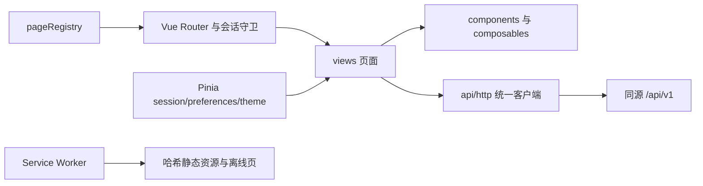

# 前端与 PWA 架构

## 范围与组成

面向前端开发，覆盖 web/src、Vite 构建和浏览器状态；不定义业务计算口径或服务器权限。当前机制以源码为准；已有环境执行与用户实机确认见[历史验收](../initial-development/test-report.md)，后续验证不向归档追加记录。

## 页面、状态与复用

`web/src/app/pageRegistry.ts` 声明 pageKey/path/role/navigation/archetype/prototype/states；`router/index.ts` 从登记生成路由并映射真实页面，ReportView 按需加载。PlaceholderView 仅为未映射页面兜底，当前页面不能再描述为六个占位页。

| 入口 | 处理链路 | 共享边界 |
|---|---|---|
| /login | session 初始化、登录、首次改密、安全回跳 | session store、api/http、密码校验 |
| /entry、/ledger | 表单/筛选 → API → 保存或列表反馈 | domain 金额/筛选/幂等、composables、共享表单与列表 |
| /reports | 统一条件 → summary/time/维度接口 → 图表与明细下钻 | reportQuery、ChartPanel、维度与时间组件 |
| /me 与个人字典 | 偏好、主题、安装、字典、修改密码与注销 | preferences/theme、accountStorage、PWA 安装模块 |
| /admin 及子页面 | 用户、默认字典、运行概况、审计 | 管理 API；不查询个人账目 |

加载、空、错误和就绪状态登记为 pageStates；权限态由角色守卫和 AppShell 承接。普通用户访问管理 URL 时保留地址并呈现权限反馈，管理员访问个人页面回管理入口。内部页面导航保留未保存内容；刷新、退出与账号变更的保护仍由 unsavedChanges 处理。样式 token、组件选择、响应式和页面维护矩阵以 [DESIGN](../../DESIGN.md) 为准，不在页面私有复制共享状态或样式。

`App` 在认证外壳中用有界 KeepAlive 保存登记页面，缓存根键包含 accountId/role；登录、退出或身份改变会销毁旧实例，权限不匹配的页面不挂载。`pageCacheKey` 按页面和合法字典类型区分实例，query 更新同一页；上限由登记页面数与字典类型数推导。`CachedPageView` 提供该实例的局部路由上下文，避免隐藏页响应其他页面的 query/params，并在离页前记录滚动、重新布局后恢复；缓存页关闭浏览器的旧 DOM 滚动锚定，避免再次偏移。`usePageActivity` 阻止旧异步响应改变当前页面的滚动，`useRefreshOnReturn` 在重新激活时更新候选或列表；明细只刷新已经加载的分页深度。同条件网络/服务异常保留原结果并提示过期；替换条件失败显示区域错误，`useLatestRequest` 在 401/403 时清除受保护的旧结果。

管理导航由 AppShell 维护同一组路由，834px 起显示侧栏，窄屏通过 AppDrawer 展开；用户与操作日志主表占据外壳剩余空间，由表体内部滚动，表头、筛选和分页保持可达；低于 600px 的窗口复用摘要卡片，由页面正文单独滚动。用户、操作日志、个人及默认字典使用 AppPagination；查询条件改变回到首页，翻页替换当前结果。
页面停用与销毁是不同生命周期：共享候选在停用时关闭并解绑浮层监听；原生 dialog 退出顶层且不抢回焦点，逻辑编辑状态可在返回时恢复；图表断开尺寸/主题观察器、返回重连；导出暂停计时与当前查询，返回再检查服务端任务，停用期间不触发下载。密码弹层停用会清空临时凭据。最终卸载继续执行原有取消/资源释放，服务端导出任务不会因切页被取消。

普通用户页头共用 `PageHeading`，两类记账表单共用 `FormSection`、`FormDisclosure` 与保存栏；折叠摘要来自表单当前值，字段错误触发补充区展开。视觉分组、密度与响应式字段组合以 DESIGN 为准。

`SectionTitle` 由 FormSection/FormDisclosure 共用，页面传入与任务含义对应的 lucide 图标；组件保留 h2/strong 与标题文本，图标作为辅助识别隐藏于无障碍树。收支新增、编辑与支出调整共用此结构，不按标题字符串猜测图标，也不在页面复制标题底板样式。

底部导航高度由链接命中高度、上下留白和边框推导，底部安全区以相加方式同时用于导航 padding 和保存栏偏移，避免两种计算产生接缝。`EntrySaveBar` 的新增模式固定于视口，操作行透明且无额外边框，透明留白不截获点击；按钮留白按页面宽度与字段内边距计算；ResizeObserver 按实际栏高维护正文占位，页面停用/卸载断开，返回重连。编辑/调整抽屉保持 sticky，外层 display:contents 不新增限制粘性的容器；手机键盘期间转为自然流并取消额外占位。

商品和字典共用 `ComboboxField`：手机锚点保持按钮，面板内搜索栏在用户手势内同步显示与聚焦；PC直接输入。`useActiveCombobox` 交接唯一活动字段，作用域销毁时释放引用。`AnchoredDropdown` 通过 `domain/dropdownLayout` 计算有界上下方空间，并在外部操作、锚点离开可见区和页面隐藏时关闭。搜索词与已选业务值分开，关闭取消查询、恢复原值；明确选中才传递稳定 ID，明确清除才清空。

`useKeyboardViewport` 在应用外壳、候选组件和抽屉之间共享可见视口监听，最后一个消费者卸载时清理；只有编辑聚焦且视口实际收缩才判定键盘，缩放期间保留此前状态。导航和保存栏消费键盘状态调整空间；抽屉消费实际可见高度和底部偏移，避让完整键盘及镜像输入工具栏，正文在稳定头尾之间收缩并滚动；活动手机搜索在已出现的键盘收起时退出，外部关闭不恢复旧字段焦点。明细与报表的清除入口通过 `hasFilterChanges` 对照各自默认条件决定是否显示。`AppliedFilterBar` 用字段名和当前值承接单条件编辑，取消保留已应用条件；报表类型与常驻搜索不在摘要重复。`DictionaryFilterPicker` 复用候选容器、主动搜索和请求代次，按需加载包含停用项的服务端分页列表，选中 ID 独立回显；筛选日期与业务时间复用 `DateTimeControl` 的原生输入边界处理。

记一笔页头及“我的”使用 `panel=dictionaries` 打开共享 `DictionaryManager`/`DictionaryIndexPanel`。详情只接受 entry/profile 来源并返回原索引；已从索引进入时退回对应历史项，直接打开时替换为受控入口，避免返回循环。关闭抽屉留在原入口，记账表单无需丢弃草稿。独立索引路由仍可访问。底部导航保留本账号报表/明细的最近 URL 条件，换账号清空；记账页内收支表单各保存一个实例。修改密码由 `PasswordChangeSheet` 调用既有 `session.changePassword`，接受服务端轮换会话；临时输入只存在组件内存，成功或关闭即清空，不进入持久化存储。

## 一次页面操作经过哪些层

以保存支出为例，LedgerEntryPreferenceView组织页面，ExpenseEntryForm收集输入，分类、单位、资金渠道、购买渠道与地点通过共享 `DictionaryCombobox` 搜索或在锚定浮层内新增个人字典项；收入的付款方、收入分类及默认资金渠道沿用同一交互，浮层通过 `AnchoredDropdown` 在页面/抽屉/弹窗内定位，不推动后续字段，再将服务端返回的稳定 ID 写入表单；二级分类始终绑定当前一级分类。domain/ledgerEntryForm与money等工具处理表单规则和精确金额，api/expenses调用api/http，后者实际请求同源 `/api/v1`。业务返回后页面更新保存反馈；字段错误保留到对应输入项，不能在API封装层把失败改成成功。

| 层 | 应放入的内容 | 不应放入的内容 |
|---|---|---|
| views | 页面组织、路由筛选承接、区域状态 | 再造全局会话或直接写fetch |
| components | 可复用输入、列表、图表、弹层和反馈 | 根据任意客户端tenantId决定权限 |
| composables | 多处共用的交互/异步状态、清理与请求取消 | 第二份权威账号状态 |
| domain | 金额、日期、查询参数、幂等及纯表单规则 | DOM操作、数据库连接、密码存储 |
| api | HTTP请求和契约类型 | 猜测服务端业务成功、吞掉错误 |
| stores | 跨页面共享会话/偏好/主题 | 各页面临时输入无限累积 |

调试时先检查Network实际请求和响应，再回到发起操作的页面、domain规则与api封装。共享客户端默认15秒超时，请求完成、取消或超时后清理自身计时器/监听；缓存页离开不等于请求销毁，活动资源按前述停用规则处理。超时只说明没有及时拿到响应，不证明服务器没有保存，写入重试应保留正确的幂等键。

页面登记中的loading/empty/error不是同一视觉状态：loading等待首次结果，empty是成功返回但无数据，error是请求失败；静默刷新失败时应按现有共享模式保留旧数据并反馈，不能把失败渲染为空列表。角色不匹配另由权限态承接，不伪装为无数据。

## 会话与偏好流程

守卫等待唯一 session store 初始化 → 认证失败去登录 → 临时密码去首次改密 → 角色外壳渲染。`api/http.ts` 统一 Cookie、XSRF、no-store 和错误解析；浏览器不自行构造租户身份。登出清理当前内存会话/偏好；未过期草稿按不可逆账号命名空间和收支类型保留供同账号恢复，换账号不能读取其他账号草稿。账号注销成功后清理其本地数据；不能把作用域退化为全局共享键。

主题首屏只恢复合法 `system/light/dark` 值，随后由 theme store 接管；登录后的服务端偏好为权威，本地仅回退。新增偏好要同步 Preference API 与 store，不能用额外 localStorage 取代跨设备保存。

## 缓存、构建与依赖

`sw.ts`、`pwa/cachePolicy.ts` 只缓存同源带内容哈希资源和无个人信息离线页；API、下载、个性化导航走网络，不提供离线记账。`MY_BILL_BUILD_ID` 生成静态缓存版本，发布须按提交设置。前端 API 固定同源 `/api/v1`，Vite 开发代理到本机后端；生产由 Caddy 分流。环境装配见 [配置架构](environment-configuration.md)。

前端 build 产物为 web/dist，包含 sw.js；生产不能用 Vite dev/preview 承担部署入口。接口类型源自 OpenAPI，不手改 generated/schema.ts。新增页面影响登记、路由、设计契约、权限、导航与测试；新增 API 影响后端契约与 Cookie/CSRF 统一客户端。

## 安装资产与更新机制

正式名称为“我的账单”，manifest 的 display 为 standalone，start_url 为 `/entry`；普通用户和管理员仍由认证角色路由决定落点。图标使用源SVG生成的192/512 PNG、maskable512和Apple180，Apple入口由 `web/index.html` 声明，不提供IPA/APK包。安装检测覆盖iOS/iPadOS桌面UA的触摸识别，安装不可用时保留完整网页使用能力。

生产构建注册模块型 `/sw.js`。install预取无数据离线页并skipWaiting；activate删除旧版本 `my-bill-static-*` 缓存并clients.claim。当前没有“发现新版”提示按钮；页面导航始终走网络，加载新页面取得新资源，断网只显示离线页。旧页面可能仍持有旧哈希资源，交付需兼顾资源保留与API兼容，不能把SW接管当作所有打开页面已刷新。

## 验证与限制

`npm --prefix web run check` 覆盖 typecheck、lint、Vitest、OpenAPI 漂移和构建；位于 stores/router/domain/pwa 的测试用于行为边界。命令也由根 `npm run check` 调用。自动化检查不能代替目标设备上的安装、系统信任与独立窗口验收。

页面复测的五种方式、数据环境、执行路径和证据边界统一维护于 [README 页面复测](../../README.md#页面复测方式与选择)，强制选择条件见 [AGENTS](../../AGENTS.md#页面改动的复测选择)。本节的历史环境证据不能替代本次源码版本的真机与安装版验收。

| 类型 | 证据状态 | 限制及验证方式 |
|---|---|---|
| PWA 发布 | 按环境验收 | 当前内网iOS由用户确认通过，浏览器机制补验见验收报告；Android真机未验证，新环境不得复用结论 |
| 离线 | 已确认代码边界 | 只提供静态离线提示；不能从缓存显示个人账目或声称离线提交成功 |
| 发布资源 | 已确认 | 旧页面可能持有旧资源地址，更新时保留上一版哈希资源并验证 SW 更新 |
