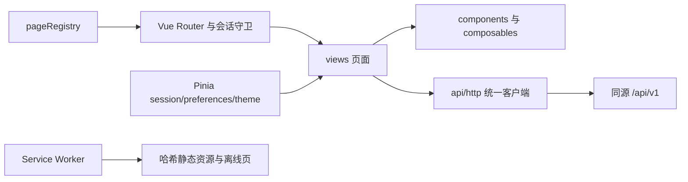

# 前端与 PWA 架构

## 范围与组成

本文面向前端开发，解释 `web/src` 的路由、状态、资源生命周期、浏览器存储以及 PWA 构建与更新机制，当前实现以源码为准。

界面布局、间距、对齐、滚动与图表交互、组件使用规则统一由 [DESIGN](../../DESIGN.md) 定义；本文只说明支撑这些行为的实现机制，不维护第二份设计规范。服务器认证与权限见[认证与租户隔离](auth-tenant.md)，业务计算见[后端与业务模块](backend-domains.md)，复测方法见 [README 页面复测](../../README.md#页面复测方式与选择)。

## 页面、状态与复用

`web/src/app/pageRegistry.ts` 声明 pageKey/path/role/navigation/archetype/prototype/states；`router/index.ts` 从登记生成路由并映射真实页面，ReportView 按需加载。PlaceholderView 仅为未映射页面兜底。

| 入口 | 处理链路 | 共享边界 |
|---|---|---|
| /login | session 初始化、登录、首次改密、安全回跳 | session store、api/http、密码校验 |
| /entry、/ledger | 表单/筛选 → API → 保存或列表反馈 | domain 金额/筛选/幂等、composables、共享表单与列表 |
| /reports | 统一条件 → summary/time/维度接口 → 图表与明细下钻 | reportQuery、ChartPanel、维度与时间组件 |
| /me 与个人字典 | 偏好、主题、安装、字典、修改密码与注销 | preferences/theme、accountStorage、PWA 安装模块 |
| /admin 及子页面 | 用户、默认字典、运行概况、审计 | 管理 API；不查询个人账目 |

加载、空、错误和就绪状态登记为 pageStates；权限态由角色守卫和 AppShell 承接。普通用户访问管理 URL 时保留地址并呈现权限反馈，管理员访问个人页面回管理入口。内部页面导航保留未保存内容；刷新、退出与账号变更的保护由 unsavedChanges 处理。

`App` 在认证外壳中用有界 KeepAlive 保存登记页面，缓存根键包含 accountId/role；登录、退出或身份改变会销毁旧实例，权限不匹配的页面不挂载。`pageCacheKey` 按页面和合法字典类型区分实例，query 更新同一页；上限由登记页面数与字典类型数推导。`CachedPageView` 提供该实例的局部路由上下文，避免隐藏页响应其他页面的 query/params，并在离页前记录滚动、重新布局后恢复；缓存页关闭浏览器的旧 DOM 滚动锚定，避免再次偏移。`usePageActivity` 阻止旧异步响应改变当前页面的滚动，`useRefreshOnReturn` 在重新激活时更新候选或列表；明细只刷新已经加载的分页深度。同条件网络/服务异常保留原结果并提示过期；替换条件失败显示区域错误，`useLatestRequest` 在 401/403 时清除受保护的旧结果。

管理导航由 AppShell 与 AppDrawer 消费同一组登记路由；断点与布局遵循 DESIGN 的响应式契约。用户、操作日志、个人及默认字典使用 AppPagination；查询条件改变回到首页，翻页替换当前结果。

页面停用与销毁是不同生命周期：共享候选在停用时关闭并解绑浮层监听；原生 dialog 退出顶层且不抢回焦点，逻辑编辑状态可在返回时恢复；图表断开尺寸/主题观察器、返回重连；导出暂停计时与当前查询，返回再检查服务端任务，停用期间不触发下载。密码弹层停用会清空临时凭据。最终卸载继续执行原有取消/资源释放，服务端导出任务不会因切页被取消。

`PageWorkspace` 以 header、正文和 overlays 插槽组织页面，正文交给 `ScrollRegion`；`pageScroll` 提供活动正文的滚动读取与恢复入口，缓存页、明细位置记忆与报表下钻共用它。报表仅在对应路由加载时应用下钻返回的 `scroll` 参数，普通缓存页刷新保留最新位置，异步恢复还须核对活动页与原路由，避免旧请求覆盖新页面位置。`ScrollRegion` 根据被动 scroll 事件更新位置提示，并在停用/卸载时清理计时器。固定区域、边界缓冲和提示显隐时序见 DESIGN 的组件与布局规则。

`PageWorkspace` 提供共享动作及标题状态目标，非阻塞草稿警告由活动表单传送到 PageHeading 的标题行，停用时移除；新增表单的 `EntrySaveBar` 通过 Teleport 进入正文外的动作区，参与外壳布局而不覆盖字段或创建占位；外置主按钮通过唯一 form ID 保持原提交链路，表单停用时移出共享目标，避免缓存实例重复显示。编辑与调整由 `AppDrawer` 提供自己的动作目标，保存栏位于正文之外；编辑的更多操作通过表单插槽与保存并排，提交仍关联原表单。`useDialogController` 统一顶层遮罩点按、Esc 和关闭焦点恢复，父弹层留在原生 top layer；子层关闭回到父层，正文拖出与遮罩滑动不触发关闭，busy 状态阻止退出。`AppToast` 传送到当前顶层 dialog 或页面 body，父子层切换后成功/失败反馈仍可见且不抢焦点。`AppDrawer` 提供未保存作用域，收支编辑和调整表单按作用域登记；关闭子表单只确认和清理本层，路由/账号守卫仍检查所有来源。`AppShell` 消费 `useKeyboardViewport`，将键盘状态、可见高度和顶部平移写入外壳 class 与 CSS 变量。键盘判定比较可见视口与布局视口高度，兼容 iOS 聚焦下方字段时 `innerHeight` 缩小；外壳跟随真实可见区域，PageWorkspace 仅在所属正文内显露聚焦控件，保存动作回到表单自然流。收起键盘后恢复动作区，结束 iOS 遗留输入焦点，纠正外层平移及正文越界滚动，保留有效位置。

收支表单用 `SavedEntrySummary` 承接刚保存记录与撤销，置于正文滚动区域内、表单表面之后，支出明细通过插槽保留。`AppToast` 统一消费 `useToastAutoDismiss` 管理成功提示的计时、交互暂停与清理，错误不自动关闭；缓存页和收支类型停用时清除旧提示，异步回调不能在隐藏页面重放反馈。保存记录 ID 用于区分连续相同文案的通知，提示关闭不清除已保存记录或撤销标识。位置与展示时长由 DESIGN 定义。

`useReportChart` 统一初始化 ECharts SVG 实例，提供主题 token 读取和刷新入口；ResizeObserver 处理容器变化，MutationObserver 处理根节点主题变化，停用时断开观察器，卸载时销毁实例。查询参数和下钻条件由 reportQuery 承接；图表读数与查看明细的交互规则见 DESIGN。

`EntryReceipt` 统一收支新增和明细编辑的结构，`AmountField` 只承接字符串值与输入事件，金额计算、覆盖保护和提交仍由原表单及 domain 承担。`FormField` 的普通与复合帮助内容共用帮助 ID，和错误一起通过 aria-describedby 关联控件；支出金额差额和计算金额属于同一帮助区域。两类记账表单的分类及补充摘要来自当前值，字段错误触发对应区域展开；分类名称消费 `DictionaryCombobox` 的已选项解析通知，复用候选外 ID 的既有回显查询，不另建字典请求或选择状态。`SettingsGroup` 和 `SettingsDisclosureList` 统一设置分组与整行披露，普通及危险账号动作仍交给原处理器；筛选日期与业务时间复用 `DateTimeControl` 的原生输入边界处理。组件清单、控件对齐与说明排版见 DESIGN。

商品、收入名称和字典共用 `ComboboxField`；`NameSuggestionCombobox` 消费最近收入名称查询，不创建唯一字典，浏览与搜索状态同候选容器共享，确认使用才更新名称，取消保留原值；手机面板内的搜索栏在用户手势内同步显示与聚焦，以承接原生键盘。`useActiveCombobox` 交接唯一活动字段，作用域销毁时释放引用。`AnchoredDropdown` 通过 `domain/dropdownLayout` 计算字段下方的有界空间，面板留在所属正文内，以实际内容提供滚动范围；展开或键盘变化时滚动正文让出候选空间，不翻转到字段上方，并在外部操作、浏览态锚点离开可见区和页面隐藏时关闭；搜索焦点仍在浮层内时，软键盘导致锚点不可见会先调整所属正文滚动位置，保留搜索。已选值的清除入口由 ComboboxField 统一放在面板顶部工具行。搜索词与已选业务值分开，关闭取消查询、恢复原值；明确选中才传递稳定 ID，明确清除才清空。

`useKeyboardViewport` 在应用外壳、候选组件和抽屉之间共享可见视口监听，最后一个消费者卸载时清理；只有编辑聚焦且视口实际收缩才判定键盘，缩放期间保留此前状态。收起后在原生平移动画结束时补一次有界滚动校正，重新输入或卸载时取消；补充区域展开、折叠时也校正所属正文的滚动边界。抽屉消费实际可见高度和底部偏移；活动手机搜索在已出现的键盘收起时退出，外部关闭不恢复旧字段焦点。

明细与报表通过 `hasFilterChanges` 对照各自默认条件判断筛选是否改变。常驻搜索独占一行；`AppliedFilterBar` 的 controls 插槽承接范围/生命周期 tab，与筛选按钮同行，条件摘要在下方承接单条件编辑，取消保留已应用条件。`DictionaryFilterPicker` 复用候选容器、主动搜索和请求代次，按需加载包含停用项的服务端分页列表，选中 ID 独立回显。

记一笔页头及“我的”使用 `panel=dictionaries` 打开共享 `DictionaryManager`/`DictionaryIndexPanel`。详情只接受 entry/profile 来源并返回原索引；已从索引进入时退回对应历史项，直接打开时替换为受控入口，避免返回循环。关闭抽屉留在原入口，记账表单无需丢弃草稿。独立索引路由仍可访问。入口统一显示“选项管理”；个人和默认列表复用 DictionaryToolbar、DictionaryItemList、DictionaryListFooter，管理页大小来自 DICTIONARY_PAGE_SIZE。长列表保持内容高度，个人列表由 PageWorkspace 正文滚动，默认列表随管理页正文滚动，多页末尾仅提供 AppPagination，单页结束提示居中，翻页和搜索通过现有分页接口替换结果；选项、日常模板与明细内容共用 content-list，末尾提示共用 list-end-note；历史筛选候选同样复用 AppPagination。填报候选仍是有界首批，ComboboxField 展示批次数量并引导搜索，不把批次当作全部数据。底部导航保留本账号报表/明细的最近 URL 条件，换账号清空；明细清除条件时移除报表来源元数据，返回报表后底部导航中的明细 URL 也移除旧下钻返回上下文；记账页内收支表单各保存一个实例。修改密码由 `PasswordChangeSheet` 调用既有 `session.changePassword`，接受服务端轮换会话；临时输入只存在组件内存，成功或关闭即清空，不进入持久化存储。

## 一次页面操作经过哪些层

以保存支出为例，`LedgerEntryPreferenceView` 组织页面，`ExpenseEntryForm` 收集输入，分类、单位、资金渠道、购买渠道与地点通过共享 `DictionaryCombobox` 搜索或新增个人字典项，再将服务端返回的稳定 ID 写入表单；收入的付款方、收入分类及默认资金渠道沿用同一数据链路，二级分类始终绑定当前一级分类。`domain/ledgerEntryForm` 与 money 等工具处理表单规则和精确金额，`api/expenses` 调用 `api/http`，后者实际请求同源 `/api/v1`。业务返回后页面更新保存反馈；字段错误保留到对应输入项，不能在 API 封装层把失败改成成功。

`domain/idempotency` 统一生成请求 UUID：优先使用 `crypto.randomUUID`，局域网 HTTP 等不支持该方法的环境使用 `crypto.getRandomValues` 生成 UUID v4；不使用普通伪随机数替代。失败重试复用原键，内容改变或成功后重新生成。收支表单将请求转换与键生成纳入保存错误捕获，浏览器能力缺失时显示失败提示并保留输入；正式提交不依赖草稿备份的 SHA-256 能力。

| 层 | 应放入的内容 | 不应放入的内容 |
|---|---|---|
| views | 页面组织、路由筛选承接、区域状态 | 再造全局会话或直接写fetch |
| components | 可复用输入、列表、图表、弹层和反馈 | 根据任意客户端tenantId决定权限 |
| composables | 多处共用的交互/异步状态、清理与请求取消 | 第二份权威账号状态 |
| domain | 金额、日期、查询参数、幂等及纯表单规则 | DOM操作、数据库连接、密码存储 |
| api | HTTP请求和契约类型 | 猜测服务端业务成功、吞掉错误 |
| stores | 跨页面共享会话/偏好/主题 | 各页面临时输入无限累积 |

调试时先检查Network实际请求和响应，再回到发起操作的页面、domain规则与api封装。共享客户端默认15秒超时，请求完成、取消或超时后清理自身计时器/监听；缓存页离开不等于请求销毁，活动资源按前述停用规则处理。超时只说明没有及时拿到响应，不证明服务器没有保存，写入重试应保留正确的幂等键。

## 会话与偏好流程

守卫等待唯一 session store 初始化 → 认证失败去登录 → 临时密码去首次改密 → 角色外壳渲染。`api/http.ts` 统一 Cookie、XSRF、no-store 和错误解析；浏览器不自行构造租户身份。

登出清理当前内存会话/偏好；`useLedgerDraft` 经 `accountStorage` 按不可逆账号命名空间和收支类型保存草稿，恢复时检查有效期，换账号不能读取其他账号草稿。账号注销成功后清理其本地数据；不能把作用域退化为全局共享键。命名空间依赖 Web Crypto 的 SHA-256；缺少安全上下文、哈希能力或本地存储权限时保留页面内输入，备份失败交给共享 `DraftBackupNotice` 承接，标题旁仅展示橙色警告入口，详细说明与可恢复失败的重试动作通过共享 AppDialog 承接。正式提交不依赖本地备份；提示文案由 DESIGN 定义。

主题首屏只恢复合法 `system/light/dark` 值，随后由 theme store 接管；登录后的服务端偏好为权威，本地仅回退。新增偏好要同步 Preference API 与 store，不能用额外 localStorage 取代跨设备保存。

`web/build/themeAssets.ts` 在开发响应与生产构建时从 `styles/tokens.css` 生成首屏脚本的背景色、manifest 的安装底色及离线页的明暗色板。manifest 与离线页模板位于 `web/templates`，输出 URL 仍为 `/manifest.webmanifest` 与 `/offline.html`；离线页跟随系统主题，不读取个人偏好或账单缓存。修改主题颜色只维护 token 与 DESIGN，不复制静态色值。

## 缓存、构建与依赖

`sw.ts`、`pwa/cachePolicy.ts` 只缓存同源带内容哈希资源和无个人信息离线页；API、下载、个性化导航走网络，不提供离线记账。`MY_BILL_BUILD_ID` 生成静态缓存版本，发布须按提交设置。前端 API 固定同源 `/api/v1`，Vite 开发代理到本机后端；生产由 Caddy 分流。环境装配见 [配置架构](environment-configuration.md)。

前端 build 产物为 `web/dist`，包含 `sw.js`；生产入口见[部署架构](../deployment/architecture.md)。接口类型由 OpenAPI 生成至 `api/generated/schema.ts`。页面登记连接路由、权限、导航与登记测试；设计契约与页面维护矩阵见 DESIGN，接口维护约束见 [AGENTS](../../AGENTS.md#工程与业务硬约束)。

## 安装资产与更新机制

manifest 的 display 为 standalone，start_url 为 `/entry`；普通用户和管理员仍由认证角色路由决定落点。安装图标由源 SVG 生成，Apple 入口由 `web/index.html` 声明；名称与图标规格见 DESIGN。`pwa/install.ts` 共享安装事件与平台检测状态，覆盖 iOS/iPadOS 桌面 UA 的触摸识别；安装或 Service Worker 注册不可用时继续以网页模式运行。

`pwa/register.ts` 仅在生产构建注册模块型 `/sw.js`。install 预取无数据离线页并 skipWaiting；activate 删除旧版本 `my-bill-static-*` 缓存并 clients.claim。浏览器文档导航走网络，加载新文档取得新资源，网络请求失败时回退到离线页；Vue Router 页内切换不重新加载文档。旧页面可能仍持有旧哈希资源，交付需兼顾资源保留与 API 兼容，不能把 SW 接管当作所有打开页面已刷新；交付流程见[部署方案](../deployment/README.md)。

## 验证与限制

`npm --prefix web run check` 覆盖 typecheck、lint、Vitest、OpenAPI 漂移和构建；位于 stores/router/domain/pwa 的测试用于行为边界。命令也由根 `npm run check` 调用。工程检查不能证明目标设备上的安装、系统信任与独立窗口行为。

页面复测的方式、数据环境、执行路径和证据边界统一维护于 [README 页面复测](../../README.md#页面复测方式与选择)，模拟器默认复测、真机触发及发布验收条件见 [AGENTS](../../AGENTS.md#页面改动的复测选择)。具体环境证据见[部署案例](../deployment/cases/README.md)，历史环境验收不能替代当前候选版本的验证。
