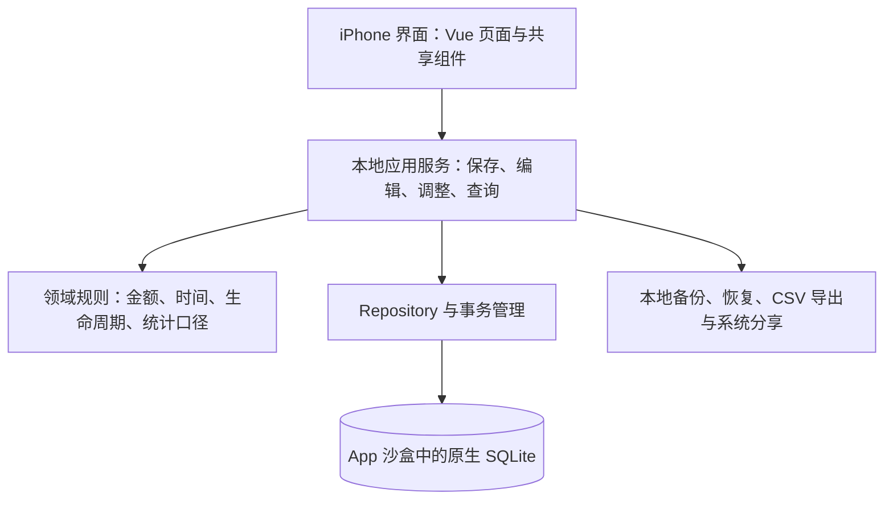

按你最终确认的目标，方案范围是：**仅 iPhone（iOS）、完全离线记账、可以安装使用，不要求上架 App Store。**

迁移可行，但属于一次较大的架构调整。我的建议是：**保留成熟的记账功能和手机界面，重建本地业务与存储层，移除账号体系、服务端和部署体系，再按本项目需要补齐设计门禁与 iOS CI。**

**1. 技术路线建议**

| 路线 | 改动与收益 | 判断 |
|---|---|---|
| Vue 3 + Capacitor + 原生 SQLite | 复用现有手机界面、组件和图表，将业务处理迁到本机，生成 iOS 安装包 | **优先推荐，迁移成本较可控** |
| SwiftUI + 本地数据库 | 页面、交互、图表及业务调用全面重写，直接使用 Apple 原生界面能力 | 适合明确要求彻底放弃 Web 技术的情况 |

推荐路线中，Vue 页面会随安装包一起放入 App，通过 WKWebView 运行；数据经原生插件写入 SQLite。用户直接打开 iPhone App，运行时不依赖网站或业务服务器。[Capacitor 官方说明](https://capacitorjs.com/docs/ios)、[资源打包流程](https://capacitorjs.com/docs/basics/workflow)

**这里有一个需要明确的区别：移除“网页产品”可以复用 Vue；如果你要求连 HTML/CSS/Vue 技术也全部移除，就应选择 SwiftUI。** 以下总体方案按前者展开。

**2. 功能保留与移除范围**

当前项目已有账号、管理员和租户隔离，未发现独立的组织树或部门管理模块。实际应按功能及依赖链清理：

| 类别 | 总体处理 |
|---|---|
| 支出、收入录入与编辑 | 保留，改为本地事务保存 |
| 商品、分类、单位、资金渠道、地点等字典 | 保留，改为本机维护 |
| 日常模板、最近使用、独立草稿 | 保留，移除账号命名空间和远程同步 |
| 退款、报销、回收站、恢复 | 保留现有业务规则 |
| 明细搜索、筛选、报表和下钻 | 保留，重写本地查询与聚合 |
| 主题和填写偏好 | 保留，存储到本机 |
| 用户、登录、密码、会话、租户、管理员后台 | 移除 |
| 默认字典管理后台 | 移除，改为首次初始化的内置数据 |
| 账号注销 | 改为“清空本机数据”，明确范围并进行危险确认 |
| 浏览器访问、PWA 安装、Service Worker | 移除 |
| Java 服务端、PostgreSQL、HTTP API、服务器任务 | 移除，其有效业务规则迁入 App |
| Docker、反向代理、证书、主机运维与部署脚本 | 移除 |

现有功能分层可从[业务模块架构](/Users/pengshuaifeng/ai-my-bill/agent-works/architecture/backend-domains.md)定位。最大的迁移成本在业务处理和报表查询，界面不是唯一工作重点。

**3. 离线架构与数据闭环**

建议采用以下分层：

页面只调用本地应用服务，不直接操作表，也不保留一套伪装成服务器的本地 HTTP API。原 OpenAPI 及生成类型由本地类型、校验和错误契约替代。

需要重点处理以下问题：

- **金额精度。** 保留金额 2 位、单价 4 位、数量 3 位及原有舍入规则。建议按对应精度使用缩放整数存储，计算使用精确十进制或大整数；覆盖乘法、聚合及原生桥传值的溢出边界，避免落入 SQLite `REAL` 浮点计算。[SQLite 精度说明](https://www.sqlite.org/floatingpoint.html)
- **事务完整性。** 保存账目、更新商品最近值、记录退款、联动回收站等操作必须保持原子性；重复点击、保存中切后台和中断恢复不能产生半条数据。
- **统计口径。** 现有报表包含 PostgreSQL 专用 SQL，需要逐项迁移。退款冲减支出、不计收入，删除退出统计、恢复重新计入等规则继续保留。
- **时间口径。** 业务日期继续使用 `Asia/Shanghai`；原来的“服务端当前时间”改为设备时间，并处理设备时间异常对校验和到期清理的影响。
- **任务机制。** 回收站清理、备份等改为启动、回到前台或操作后按需执行，有界且可中断。iOS 后台调度时机由系统决定，不能沿用服务器每天准点执行的承诺。[Apple 后台执行说明](https://developer.apple.com/documentation/backgroundtasks/choosing-background-strategies-for-your-app)

一条完整的目标链路应是：

> 飞行模式打开 App → 录入支出 → SQLite 事务提交 → 明细和报表一致更新 → 强制结束后重开仍存在 → 添加退款后净支出正确 → 删除与恢复后统计同步变化。

这条链路应成为迁移验收的核心。

**备份恢复需要补建。** 当前 CSV 是账目导出，不能完整恢复字典、模板和偏好。建议分别提供：

- CSV：用于查看和分析。
- 完整备份文件：包含版本、字典、关联关系、账目、调整、模板及偏好，可通过“文件”App 导入导出。
- 恢复流程：先校验，在临时库恢复成功后切换，失败保留原库。

App 默认不接入云同步。系统备份是否包含账本应明确配置；用户主动把备份保存到 iCloud Drive 属于另外的用户操作。

**4. stock 的设计能力如何吸收**

我核对了 stock 当前的[设计规范](/Users/pengshuaifeng/ai-stocks/DESIGN.md)及实际检查入口。本项目本身已经具备主题 token、共享组件、四态、页面登记和手机适配，应该在这些基础上补强。

| stock 能力 | 在本项目中的处理 |
|---|---|
| 语义 token、字体、间距、边框及完整控件状态 | 纳入，沿用账单产品现有视觉语言 |
| 相同交互角色共用组件和状态逻辑 | 纳入，覆盖保存、选择、弹层、提示和列表操作 |
| 阅读态与编辑态区分、无修改不保存 | 按具体业务纳入 |
| 四态、局部错误、持续提示与瞬时反馈分层 | 纳入，将网络失败场景改为本地读取、存储和恢复失败 |
| 页面、组件、真实消费者与规范登记一致 | 纳入自动检查，并为检查器补违规反例 |
| 响应式的信息优先级、降级与恢复规则 | 改写为小屏 iPhone、大屏、横屏、键盘和辅助功能场景 |
| 桌面密度、多栏工作台、布局配置中心、权限配置 | 不纳入 |
| 行情色彩、证券组件和股票业务规则 | 不纳入 |

界面建议继续保留“记一笔、明细、报表、设置”四个主入口。设置中集中承载字典、模板、主题、备份恢复与数据清理。

iOS 适配还要覆盖真实键盘、中文输入、状态栏、安全区、返回手势、后台恢复、VoiceOver 和文字放大，不能用浏览器手机尺寸预览替代安装版验证。

**5. CI 要建设为持续可用的能力**

stock 的[CI 编排方案](/Users/pengshuaifeng/ai-stocks/agent-works/architecture/continuous-integration.md)值得吸收的是统一入口、自动发现、资源隔离、严格报告和失败传播机制。其 Python、三库及行情夹具不适用于这里；当前 stock 工作区还有未提交的 CI 更新，也不能把文件存在视为远端已验收。

建议本项目建立：

| 检查层 | 覆盖内容 |
|---|---|
| 静态质量 | TypeScript、ESLint、工作流语法、适用的原生代码检查 |
| 设计契约 | token、共享组件入口、状态反馈、页面登记及响应式约束 |
| 业务回归 | 金额、时间、退款报销、字典引用、模板、回收站与报表口径 |
| SQLite 集成 | 新装、真实事务、约束、旧库升级、失败回滚、备份恢复 |
| 前端完整回归 | 自动发现普通测试，输出有效覆盖率报告 |
| iOS 构建 | macOS runner 编译原生工程，校验资源和插件接入 |
| 安装版关键链路 | 模拟器运行实际 App，验证原生 SQLite 保存、重启回读和关键操作 |
| 安全与依赖 | 密钥扫描、npm 与原生依赖审计、锁文件一致性 |
| 安装包任务 | 可信手动入口执行归档、签名和 IPA 导出，保存构建版本信息 |

编排上建议：

- 本地与 GitHub Actions 使用同一套套件定义和执行入口。
- push、PR 自动执行常用门禁；较重的升级、恢复和规模专项按变更调用。
- 拒绝空测试、意外跳过、`only`、报告缺失或实际少跑；失败、取消不能被总状态掩盖。
- 测试只使用独立临时数据库和 App 数据目录，保护个人账本。
- CI 保留测试报告、失败截图、原生日志及构建信息，签名凭据不进入普通 PR。
- 分支必过规则、远端运行、真机安装分别核验。

**“完整 CI”应覆盖实际产品边界；浏览器测试通过不能证明 iOS 原生数据库和安装包可用。**

**6. 安装方式是交付前置条件**

不要求上架可以做到，但 iPhone 安装仍需要 Apple 签名：

| 方式 | 适用情况 |
|---|---|
| 免费 Apple 账号，通过 Xcode 安装自己的设备 | 适合开发验证；签名配置有效期为 **7 天**，到期需要重新构建安装 |
| Apple Developer Program + 已登记设备分发 | 可导出签名 IPA，在登记设备安装，无需上架；仍需维护签名有效期 |

以上限制来自 [Apple 账号说明](https://developer.apple.com/help/account/basics/about-your-developer-account)和[登记设备分发说明](https://developer.apple.com/documentation/xcode/distributing-your-app-to-registered-devices)。

本机已发现完整 **Xcode 27.0 和 iOS 27.0 模拟器**；当前全局工具目录指向 Command Line Tools，可在项目命令中选择完整 Xcode。开发者账号、目标 iPhone 系统版本及真机签名尚未验证。

**7. 建议实施顺序**

| 阶段 | 完成条件 |
|---|---|
| 原生最小验证 | 现有记账界面装入 iPhone，断网保存、重开回读、事务和基本升级验证成立；同时建立初始 CI |
| 本地业务迁移 | 收支、字典、模板、调整、回收站及报表迁移完成，用固定数据核对原有口径 |
| iOS 交互与数据保护 | 原生生命周期、输入、分享、完整备份恢复及设计门禁完成 |
| 旧体系清理 | 移除服务端、网页发行、部署脚本与失效文档，更新 README、AGENTS、DESIGN、架构和验证规范 |
| 最终交付 | 远端 CI、签名包、真机安装、断网使用及覆盖升级后的数据保留均有实际证据 |

旧体系清理前，要先承接仍有效的业务规则；Git 历史继续提供追溯。本机数据库、备份、凭据及已有部署不会因仓库清理而被删除或停止。

实施前需要定下三项：**是否接受复用 Vue 的混合 App、是否迁移现有个人数据、采用哪种签名安装方式。** 如果要迁移旧数据，需包含完整字典、模板和关联关系，不能仅依赖现有 CSV。

本次完成的是静态评估与总体方案，未修改文件，未执行构建、数据库迁移或真机安装。