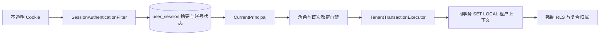

# 认证、权限与租户隔离架构

## 范围与安全链

覆盖 auth、安全过滤器和租户事务；面向接口与持久化开发。2026-09-28 静态核对。这里说明应用机制，真实部署验证见案例。

## 登录与权限流程

SecurityConfig 默认拒绝未登记 `/api/v1/**`。公开面是 GET health 和 POST auth/login；登录写请求仍要求 CSRF。auth 其余接口要求认证；admin/metrics/prometheus 仅 ADMIN；个人字典、账目、报表、导出、偏好、me 仅 USER。前端隐藏入口不能代替这些守卫。

AuthenticationService 校验账号与 BCrypt 摘要，生成 32 字节随机令牌，数据库仅保存 SHA-256 摘要；Cookie 为 HttpOnly、SameSite=Lax，prod 强制 Secure。Spring Security STATELESS 表示不使用 Servlet session，不代表无数据库会话。默认会话 12h，服务端每次检查身份与账号状态。

正式密码 15–64 Unicode code point，经 NFKC 与小写归一查询离线弱密码拒绝表，不把候选密码发外部服务。改密使用凭据版本防并发冲突，撤销旧会话后发新会话。首次临时密码 24h，临时会话只可读取当前会话、退出与首次改密。

LoginRateLimiter 把账号/来源失败状态存 PostgreSQL，RateLimitSubjectHasher 使用服务端 pepper 做 HMAC-SHA256。默认账号失败阈值 5、来源阈值 50、窗口/锁定 15min；配置见 [环境架构](environment-configuration.md)。当前 Caddy 去掉转发头，应用按代理地址做共享来源限流，不能声称已按每台终端独立限流。

## 数据边界与错误路径

CurrentPrincipal 只能由会话查询构建，DTO 不返回租户 ID 或令牌。TenantTransactionExecutor 仅接受含租户的普通用户；TenantDatabaseExecutor 在同一事务通过 Mapper 调用 `set_config('app.tenant_id', ..., true)`。V007/V010 的 FORCE RLS 同时约束读与写；无上下文默认不可见，事务结束不向连接池遗留租户。

关联记录还需复合 tenant_id/owner 或显式归属条件，不能只依靠客户端 UUID。后台租户任务同样逐批设置上下文；全局任务不绕过隔离读取账目。数据库连接不可使用超级用户或 BYPASSRLS。

未登录返回 401，角色或 CSRF 拒绝返回 403，认证存储异常不得退回匿名放行。错误由 SecurityErrorWriter 与共享 API 错误契约输出；生产不返回堆栈或凭据。

## 初始化与扩展

InitialAdminBootstrap 只在独立 bootstrap profile 下运行，锁账号表并要求空库，事务写入管理员及审计，退出时关闭应用；JobPoller 不在此 profile 启动。首管理员无个人租户，普通账号由管理员创建。重复初始化拒绝，不用开发测试 seed 初始化生产。

新增 API 时同步 SecurityConfig、服务身份检查、OpenAPI 与角色/RLS 负例。生产 app 仅持 app DB secret 与 pepper，完整 secret 生命周期见 [部署手册](../deployment/runbook.md)。

## 验证与限制

AuthHttpIntegrationTest、AdminUserHttpIntegrationTest、PostgresSchemaIntegrationTest、DeploymentBoundaryTest、InitialAdminBootstrapTest 分别覆盖认证、账号管理、RLS、生产配置边界和初始化；真实数据库运行入口为 `npm run check:database`，初始化入口为 `bash scripts/test-initial-admin.sh`（先构建 JAR）。后者在本次文档整理未重跑，既有运行结果记录于案例。

| 类型 | 证据状态 | 限制与处理 |
|---|---|---|
| 来源限流 | 已确认 | 代理下共享来源阈值可能连带影响其他用户，变更可信代理策略须整体复核防伪造链路 |
| 密钥轮换 | 已确认依赖 | pepper 同时影响限流主体识别；轮换需维护窗口、重建 app 并检查失败计数行为 |
| 环境安全 | 未验证全部 | 内网不豁免 HTTPS、CSRF、角色或 RLS；宿主例外不得自动推广 |
