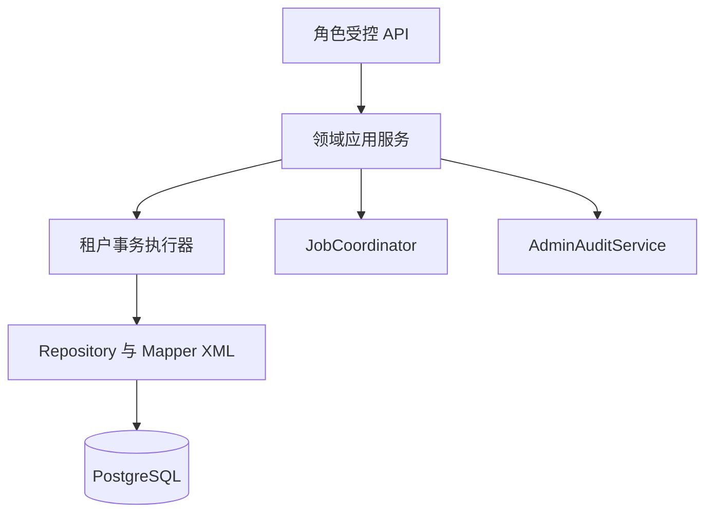

# 后端与业务模块架构

## 范围与调用关系

面向后端开发，说明 server/src/main/java/com/mybill 的业务职责。2026-09-28 静态核对源码；认证、数据和异步细节分别交由专题文档。Spring Boot 单体内按领域组织 Controller、Service、Repository、Mapper，Mapper XML 执行参数化 SQL。

## 模块职责与使用入口

| 领域 | 输入与输出 | 机制、持有的数据与跨域影响 |
|---|---|---|
| dictionary | /dictionaries；个人分类、商品、渠道等维护 | 名称规范化、启停、排序、商品合并；已有账目引用与历史快照不能被字典改名破坏；GovernanceHttpIntegrationTest |
| preference | /preferences；主题/填报偏好 | 当前普通用户的 user_preference，服务端权威；影响前端回填 |
| ledger | /expenses、/incomes、/daily-templates、/ledger-entries、/adjustments | 收支与条目、模板、退款报销、回收站、幂等；账目与调整同归属校验 |
| report | /reports | summary/time、支出和收入维度分析；读相同有效账目口径，不另存冗余总额 |
| admin/user | /admin/users | 创建普通用户及租户、状态/临时密码管理、委托 account 注销；不会赋予管理员账目权限 |
| admin/dictionary | /admin/default-dictionaries | 系统默认字典治理；不覆盖个人字典历史 |
| admin/overview | /admin/overview | 账号、会话、健康和存储元数据；禁止业务金额聚合 |
| admin/audit | /admin/audit-logs | 脱敏审计筛选与详情；只读查询，追加经统一审计服务 |
| account、job | 注销和后台执行 | 见任务专题；不用 Controller 内长循环替代任务 |

API 的精确字段、枚举和状态以 [OpenAPI](../../../contracts/openapi.yaml) 为准；上述前缀用于定位，不代替契约。

## 分层名称对应什么工作

“模块化单体”表示一个Java进程内按领域组织代码，不是为auth、ledger、report分别启动服务。仓库Maven的server模块产出一个业务JAR，领域包之间通过Java调用协作，共享同一个数据库和事务体系。

| 代码层 | 以支出为例 | 负责什么 |
|---|---|---|
| Controller | ExpenseController | 声明HTTP路径、绑定/验证请求、取得CurrentPrincipal并调用服务 |
| Service | ExpenseService | 业务规则、字典归属、幂等、事务边界与跨模块协调 |
| Repository | ExpenseRepository | 面向领域的数据读写操作及结果映射 |
| Mapper接口 | ExpenseRepositoryMapper | 声明与XML语句对应的方法，不放业务流程 |
| Mapper XML | resources/mapper/com/mybill/ledger/ExpenseRepositoryMapper.xml | 参数绑定、查询/锁/插入/更新语句；SQL性能与隔离的重要检查点 |
| 共享事务 | TenantTransactionExecutor | 将认证主体的租户放入同一数据库事务，供RLS读取 |

该分层让HTTP参数变化不必影响SQL细节，数据库读取方式变化也不要求页面知道表结构。新增业务规则优先放在所属服务；跨领域不能因为“同一个JAR”就随意写别人的表。

GlobalExceptionHandler将预期业务异常转换为统一错误；TraceIdFilter提供请求关联标识。调试按Controller→Service→Mapper跟踪，并用traceId关联日志；不要在全局异常处理里吞掉失败，也不要向客户端返回内部堆栈。

## 代表性业务闭环

普通用户提交支出 → 身份上下文及 USER 角色 → ExpenseService 校验金额、时间、个人字典可用性与幂等键 → 同事务设置租户上下文 → Mapper 保存条目与快照 → 返回已保存结果。重试相同键和规范化内容得到原结果，内容冲突返回冲突；不存在或不属于本人的引用不越权解析。

编辑/调整依赖服务端版本和归属判断；退款报销归属原支出，不伪造收入。LedgerLifecycleService 处理移入回收站、恢复、彻底删除，并调度 30 天到期清理；列表和报表依各自明确状态范围查询。

ReportService 解析 BusinessDateRange，统一筛选与金额口径，在租户事务聚合。时间趋势最多 400 个桶，过细/过长范围明确报错；前端下钻保留筛选，不用图表展示值重算服务端总额。ExpenseReportService、IncomeReportService 承担对应维度分析。

管理写操作由 AdminAuditService 记录动作、目标、真正变化的 before/after 白名单；敏感字段递归剔除，摘要长度与深度受限。成功审计与业务同事务，拒绝/失败由统一入口在适当事务中留痕。

## 数据、配置与扩展

业务数据表所有权见 [数据库](database-migrations.md)。跨领域修改调用公开应用服务，只读调用使用明确查询接口/投影；不随意跨包访问 Repository。当前没有可在管理端动态覆盖任意后端配置的 app_config 能力，用户偏好不等于环境配置。

新增业务同时检查权限匹配、Controller/服务验证、租户复合归属、Mapper、OpenAPI、前端 API 与边界测试；金额处理走 LedgerWritePolicy/BigDecimal，日期使用共享 BusinessDateRange，错误走 ApiException/GlobalExceptionHandler。

## 验证与风险

后端单元/架构测试由 `npm run check:server` 执行；真实数据库业务入口由 `npm run check:database` 在一次性集群中执行（也是全量 check 的一部分）。Expense/Income/Adjustment/Lifecycle/Report/AdminUser 等 HttpIntegrationTest 覆盖相关链路；具体执行结果见验收记录，不将默认跳过数据库测试算为通过。

| 类型 | 证据状态 | 风险与处理 |
|---|---|---|
| 运维集成 | 已确认 | BackupStatus 仅有 UNCONFIGURED；真实宿主备份未接入概况 API |
| 性能边界 | 已确认 | 报表同步查询受数据量和索引影响，变更聚合需按 performance-test.md 的规模复核 |
| 权限回归 | 已确认约束 | ADMIN 与 USER 互斥业务边界，新路由须补角色拒绝与跨租户负例 |
