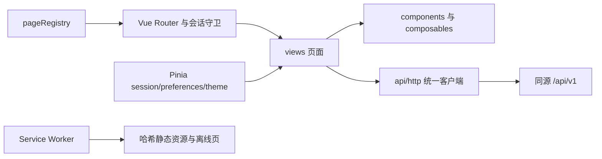

# 前端与 PWA 架构

## 范围与组成

面向前端开发，覆盖 web/src、Vite 构建和浏览器状态；不定义业务计算口径或服务器权限。2026-09-28 按当前源码静态核对，实机安装未验证。

## 页面、状态与复用

`web/src/app/pageRegistry.ts` 声明 pageKey/path/role/navigation/archetype/prototype/states；`router/index.ts` 从登记生成路由并映射真实页面，ReportView 按需加载。PlaceholderView 仅为未映射页面兜底，当前页面不能再描述为六个占位页。

| 入口 | 处理链路 | 共享边界 |
|---|---|---|
| /login | session 初始化、登录、首次改密、安全回跳 | session store、api/http、密码校验 |
| /entry、/ledger | 表单/筛选 → API → 保存或列表反馈 | domain 金额/筛选/幂等、composables、共享表单与列表 |
| /reports | 统一条件 → summary/time/维度接口 → 图表与明细下钻 | reportQuery、ChartPanel、维度与时间组件 |
| /me 与个人字典 | 偏好、主题、安装、字典与注销 | preferences/theme、accountStorage、PWA 安装模块 |
| /admin 及子页面 | 用户、默认字典、运行概况、审计 | 管理 API；不查询个人账目 |

加载、空、错误和就绪状态登记为 pageStates；权限态由角色守卫和 AppShell 承接。普通用户访问管理 URL 时保留地址并呈现权限反馈，管理员访问个人页面回管理入口。未保存内容通过 unsavedChanges 统一拦截。样式 token、组件选择、响应式和页面维护矩阵以 [DESIGN](../../../DESIGN.md) 为准，不在页面私有复制共享状态或样式。

## 一次页面操作经过哪些层

以保存支出为例，LedgerEntryPreferenceView组织页面，ExpenseEntryForm收集输入，domain/ledgerEntryForm与money等工具处理表单规则和精确金额，api/expenses调用api/http，后者实际请求同源 `/api/v1`。业务返回后页面更新保存反馈；字段错误保留到对应输入项，不能在API封装层把失败改成成功。

| 层 | 应放入的内容 | 不应放入的内容 |
|---|---|---|
| views | 页面组织、路由筛选承接、区域状态 | 再造全局会话或直接写fetch |
| components | 可复用输入、列表、图表、弹层和反馈 | 根据任意客户端tenantId决定权限 |
| composables | 多处共用的交互/异步状态、清理与请求取消 | 第二份权威账号状态 |
| domain | 金额、日期、查询参数、幂等及纯表单规则 | DOM操作、数据库连接、密码存储 |
| api | HTTP请求和契约类型 | 猜测服务端业务成功、吞掉错误 |
| stores | 跨页面共享会话/偏好/主题 | 各页面临时输入无限累积 |

调试时先检查Network实际请求和响应，再回到发起操作的页面、domain规则与api封装。共享客户端默认15秒超时，离开页面或请求取消时会清理计时器/监听；超时只说明没有及时拿到响应，不证明服务器没有保存，写入重试应保留正确的幂等键。

页面登记中的loading/empty/error不是同一视觉状态：loading等待首次结果，empty是成功返回但无数据，error是请求失败；静默刷新失败时应按现有共享模式保留旧数据并反馈，不能把失败渲染为空列表。角色不匹配另由权限态承接，不伪装为无数据。

## 会话与偏好流程

守卫等待唯一 session store 初始化 → 认证失败去登录 → 临时密码去首次改密 → 角色外壳渲染。`api/http.ts` 统一 Cookie、XSRF、no-store 和错误解析；浏览器不自行构造租户身份。登出/切换账号需清理账号范围草稿；accountStorage 的作用域不能退化为全局共享键。

主题首屏只恢复合法 `system/light/dark` 值，随后由 theme store 接管；登录后的服务端偏好为权威，本地仅回退。新增偏好要同步 Preference API 与 store，不能用额外 localStorage 取代跨设备保存。

## 缓存、构建与依赖

`sw.ts`、`pwa/cachePolicy.ts` 只缓存同源带内容哈希资源和无个人信息离线页；API、下载、个性化导航走网络，不提供离线记账。`MY_BILL_BUILD_ID` 生成静态缓存版本，发布须按提交设置。前端 API 固定同源 `/api/v1`，Vite 开发代理到本机后端；生产由 Caddy 分流。环境装配见 [配置架构](environment-configuration.md)。

前端 build 产物为 web/dist，包含 sw.js；生产不能用 Vite dev/preview 承担部署入口。接口类型源自 OpenAPI，不手改 generated/schema.ts。新增页面影响登记、路由、设计契约、权限、导航与测试；新增 API 影响后端契约与 Cookie/CSRF 统一客户端。

## 验证与限制

`npm --prefix web run check` 覆盖 typecheck、lint、Vitest、OpenAPI 漂移和构建；位于 stores/router/domain/pwa 的测试用于行为边界。命令也由根 `npm run check` 调用。自动化检查不能代替目标设备上的安装、系统信任与独立窗口验收。

| 类型 | 证据状态 | 限制及验证方式 |
|---|---|---|
| PWA 发布 | 未验证 | 真实 iOS/Android 安装、独立窗口、CA 系统信任仍需目标终端验收 |
| 离线 | 已确认代码边界 | 只提供静态离线提示；不能从缓存显示个人账目或声称离线提交成功 |
| 发布资源 | 已确认 | 旧页面可能持有旧资源地址，更新时保留上一版哈希资源并验证 SW 更新 |
