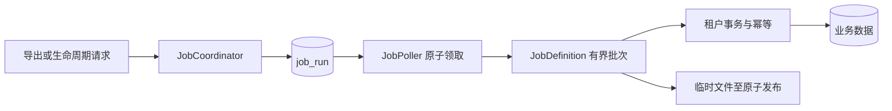

# 后台任务、导出与账号注销架构

## 范围与组成

面向后端与运维，覆盖 job、ledger 导出/清理和 account 注销；2026-09-28 静态核对。任务协调在单体内运行，数据库是执行状态事实源，文件位于独立导出目录。

## 任务生命周期与失败路径

JobDefinition 声明类型、租户/全局作用域、是否可取消/重试、最大尝试次数；JobDefinitionRegistry 统一注册。job_run 非空 batch key 去重，`available_at` 到期后用 `FOR UPDATE SKIP LOCKED` 原子领取。默认租约 30 秒；长批次通过独立事务续租，不能被业务长事务遮蔽。

领取前处理过期租约：允许重试且未耗尽次数回到 PENDING，否则 FAILED。JobPoller 默认一轮最多 20 个任务，按任务类型轮转，配置限制 1–100；业务实现分批幂等。租户任务每批设置 RLS；全局任务不能读取租户账目。bootstrap profile 不运行轮询器。

## 导出闭环

普通用户选择当前筛选或完整数据 → ExportService 创建同租户 export_job 与后台任务 → PersonalExportJob 用 MyBatis Cursor、fetch size 200 流式读账目 → ExportCsvWriter 输出 UTF-8 BOM、引号转义、公式防护、上海时间 → 同租户临时文件原子替换 → 成功后可下载。

下载重新验证账号、租户、任务状态和期限，API 不暴露服务器路径。运行中取消需处理终态提交竞态并补偿删除已发布文件；到期由 ExpiredExportPurgeJob 删除文件并收敛状态。默认保留 24h，目录必须位于持久卷，配置见环境文档。前端终态后再导出须更换幂等键。

## 回收站与注销闭环

ExpiredLedgerPurgeJob 按租户与到期分钟合并调度，每批最多 100 条，执行 30 天回收站清理。注销由 AccountDeletionService 锁用户、校验本人确认文本或管理端版本，写匿名审计并删除租户在线数据、撤销会话。

个人导出先在受控根目录原子移到隔离名，数据库回滚恢复，提交后物理删除。AccountDeletionFileStartupRecovery 启动时根据仍存在的导出记录恢复或清除隔离文件，收敛进程中断的半状态。匿名审计不保存用户名、用户/租户 ID 或账目，仅匿名编号、执行元数据和不可逆主体指纹，保留 180 天后任务清理。

在线注销补偿与“旧备份恢复后重放注销”是两个不同链路。后者尚未完成，不能据前者通过即关闭 R55。

## 使用与开发接入

接口由 [OpenAPI](../../../contracts/openapi.yaml) 的 exports、ledger lifecycle、me/admin users 定义；任务没有独立公共消息入口。新增后台能力实现 JobDefinition、明确作用域、失败重试与批次幂等、注册后补 JobCoordinator 和真实数据库测试；禁止新增无限队列或无限批次。

任务变更影响 job_run、租户事务、资源限额与轮询延迟；导出格式变更影响下载、公式防护、前端进度及备份；注销变更影响审计、所有租户资产和备份恢复政策。

## 验证与风险

JobCoordinatorTest、PersonalExportJobTest、ExportFileStoreTest、ExportHttpIntegrationTest、AccountDeletionHttpIntegrationTest 和 PostgresSchemaIntegrationTest 覆盖协调、文件、HTTP、补偿与 RLS；由 check:server/check:database 按类型执行。性能数据见 [性能记录](../performance-test.md)。

| 类型 | 证据状态 | 限制与处理 |
|---|---|---|
| 恢复合规 | 已确认未完成 | 恢复前审计保全、恢复后重放注销仍需实现与演练 |
| 文件容量 | 已确认 | 导出卷和备份占用随数据增长，需容量告警；不能只看数据库大小 |
| 备份一致性 | 已确认实现边界 | 当前先 dump 后复制导出，无跨资源快照；业务恢复须核对缺失/过期文件，维护窗口暂停写入与任务 |
