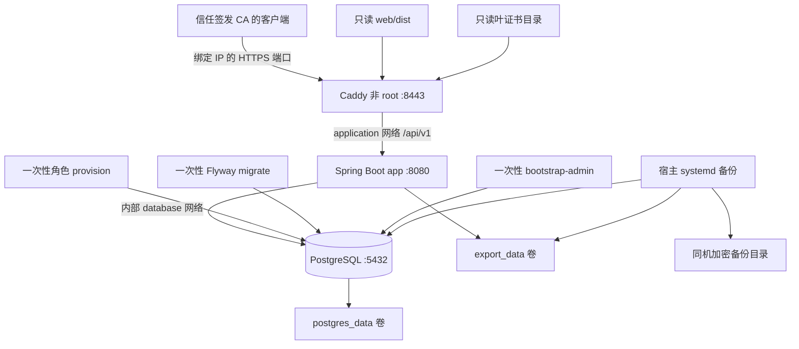

# 项目部署架构与模式

## 范围与现状

面向开发、发布和运维人员，定义可复用部署单元及安全边界；不记录某台机器的信息。2026-09-28 按 deploy/compose*.yaml、Dockerfile、Caddyfile 静态核对。当前已实现单机内网 IP + HTTPS Compose；公网模式为后续扩展要求，尚无已验证配置或案例。

## 单元与隔离

| 单元 | 产物/配置 | 运行约束 |
|---|---|---|
| db | postgres:16.14-bookworm | 不发布宿主端口，数据卷持久化，健康探针 pg_isready |
| provision | 同版本 PostgreSQL 客户端与 001_roles.sql | 短时使用管理员及迁移/应用密码，收敛角色权限后退出 |
| migrate | server/Dockerfile migrate target | Flyway 11.7.2，仅迁移凭据，成功退出后才启动 app |
| bootstrap-admin | app 镜像 + compose.bootstrap.yaml | 仅空账号库初始化，临时密码、审计同事务，执行后退出 |
| app | server/Dockerfile app target，Java 21 JRE | UID10001，只读根、cap_drop ALL、临时 /tmp 与导出卷；无 DDL 凭据 |
| proxy | deploy/Dockerfile.proxy，Caddy 2.11.4 | UID10001、8443 非特权端口、移除文件 capability；只读根和证书/静态目录 |
| backup | 宿主 bash/OpenSSL/Python 与 systemd | root 调用 Docker；加密日/周副本，无异机复制或自动生产恢复 |

database 网络 internal；app 同时连接 application/database，proxy 只接 application。只有 proxy 发布明确绑定 IP 的 HTTPS 端口。镜像 EXPOSE 信息不等于已发布端口，核验以 docker ps/inspect 的 PortBindings 为准。不使用 docker stack deploy，不改已有 Swarm。

app 默认1GiB/1CPU，db768MiB/1CPU，proxy128MiB/0.5CPU；单次迁移和初始化另需内存。日志轮转10MiB×3，容器有 pids_limit/no-new-privileges。容量预检至少2GiB可用内存、Docker盘至少10GiB空闲且使用率<85%；这只是准入值，导出、备份、构建峰值仍需余量，不能当成生产压测容量结论。

## 安全与模式差异

| 模式 | 现有支持 | 差异与准入 |
|---|---|---|
| 内网单机 | compose.yaml + compose.intranet.yaml 已实现 | 明确私网 IPv4、来源 CIDR、独立端口；项目/组织 CA 与客户端信任；不配置公网映射 |
| 公网部署 | 未实现、未验证 | 后续需独立覆盖配置与案例、目标网络/入口评估、受支持主机、可被目标终端信任的证书方案、访问防护、告警及恢复验收；不能直接把 bind IP 换成公网地址 |
| 多机/高可用 | 未实现 | 当前固定容器名/文件卷/备份脚本不支持自动故障转移，需要新方案后实施 |

所有模式保持 HTTPS、Secure Cookie、CSRF、默认拒绝路由、租户 RLS、凭据最小分发与恢复后的注销策略。主机安全基线为受维护 Linux 与已核查补丁；特定旧系统例外只在对应案例登记，不代表一般推荐或已通过补丁核查。来源全放开必须是具体实例的明确访问决策，不能作为通用模板推断。

## 操作与依赖

执行顺序为候选构建/扫描 → 主机/配置/凭据预检 → db → provision → migrate → 首次管理员 → app → proxy → HTTPS/权限/PWA/备份验收。各命令、成功判定和失败处理见 [手册](runbook.md)。数据库迁移失败时不启新 app；健康成功不代表业务验收完成。

构建依赖 Node/npm/Maven 和基础镜像获取；运行依赖 Docker/Compose、PostgreSQL、持久卷与 secret；备份依赖宿主工具链和解密密钥。前端 dist 是宿主绑定目录，不包含在 proxy 镜像中，回退时必须把前端、app、migration/config 对应到同一发布记录。

## 验证与限制

入口负例测试为 DeploymentBoundaryTest，代理/CA 验证为 scripts/test-intranet-proxy.py；真实运行证据只记 [案例](cases/intranet-single-host.md)。本次文档工作不执行新部署。

| 类型 | 证据状态 | 影响与处理 |
|---|---|---|
| 恢复 | 已确认缺口 | 同机副本不能覆盖主机/磁盘丢失；注销重放与完整 RTO 未验收 |
| 自动发布 | 已确认缺口 | 当前只有 CI 检查，无 registry push/自动部署流水线 |
| 运维 | 已确认缺口 | 告警规则存在但实际采集/发送、证书续期演练仍需环境证据 |
