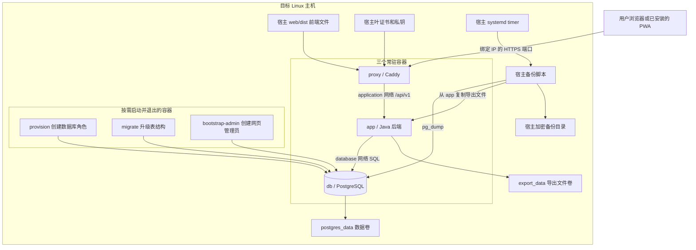

# 项目部署架构与模式

## 1. 系统到底由哪些东西组成

这是一套部署在同一台 Linux 主机上的个人账单系统。正常对外提供功能时，**只有三个常驻容器：proxy、app、db**。另外三个名字 provision、migrate、bootstrap-admin 是用完即退出的初始化工具；backup 是宿主机定时执行的脚本。它们不是七个独立业务系统，也不是微服务架构。

Docker Compose 文件把容器执行单元都写在 `services:` 下，所以“一次性工具”在配置中也叫 service。本文用“常驻服务”“一次性工具”“宿主任务”区分它们的实际生命周期。

| 类别 | 名称 | 用一句话说明用途 | 平时应该在运行吗 |
|---|---|---|---|
| 常驻服务 | proxy（Caddy） | 向浏览器提供前端页面、处理 HTTPS，并将 API 请求转给 Java | 是 |
| 常驻服务 | app（Spring Boot） | 执行登录、记账、报表、管理、导出等后端业务 | 是 |
| 常驻服务 | db（PostgreSQL） | 持久保存账号、账目、字典、会话、任务等数据 | 是 |
| 一次性工具 | provision | 创建并授权数据库连接角色，让迁移与应用分别用不同权限访问库 | 否，成功退出即可 |
| 一次性工具 | migrate（Flyway） | 按版本创建或升级表、索引、约束和数据库授权 | 否，每次需要校验/升级 schema 时执行 |
| 一次性工具 | bootstrap-admin | 在空账号库创建首个网页登录管理员 | 否，仅首次初始化 |
| 宿主任务 | my-bill-backup.service / .timer | 到时间运行备份脚本，将数据库和导出文件加密归档 | timer 等待，service 执行完即退出 |

当前实现的是单机内网 IP + HTTPS 模式。下文讲可复用结构与约束；真实服务器、版本、地址和验收证据在[部署案例](cases/README.md)，命令逐步执行见[操作手册](runbook.md)。

## 2. 谁运行在哪，用户请求怎么走

例如用户打开“记一笔”并保存支出：

1. 浏览器访问目标 IP 的 HTTPS 入口，proxy 读取挂载的 `web/dist`，返回 HTML、JavaScript、CSS、图标等前端文件。
2. Vue 页面在浏览器中运行。提交表单时浏览器向**同一个地址**的 `/api/v1/expenses` 发送请求，不知道数据库地址，也不携带可信租户身份。
3. proxy 根据 `/api/*` 路径把请求转给内部 app；普通页面路径则走静态文件/SPA回退。API错误不能回退为 HTML 页面。
4. app 验证会话、CSRF、角色、字段和幂等键，在租户事务中访问 db。db 通过角色权限、约束与行级隔离再次限制数据访问。
5. app 返回 JSON，proxy 原样转给浏览器，页面显示保存结果或字段错误。导出等长任务由 app 内部任务执行器处理，不是另起一个后台服务。

### 前端为什么没有单独的 frontend 容器

生产前端是构建后的静态文件 `web/dist`，由 proxy 提供；Vue 的交互代码最终在用户浏览器运行。Node/npm/Vite 只用于开发或构建，正式运行无需保留 Vite 开发服务器。开发环境的 Vite 代理职责由生产 Caddy 替代。

## 3. 三个常驻服务的职责与故障表现

### proxy：唯一浏览器入口

实现文件为 `deploy/Dockerfile.proxy`、`deploy/Caddyfile` 和 `compose.intranet.yaml`。基于 Caddy 镜像，负责加载 IP 叶证书、检查允许来源网段、设置安全响应头、分流静态文件和 API。它不验证业务密码、不查询账目、不连接数据库。

proxy 挂载三类只读文件：Caddyfile、前端 dist、叶证书目录。它只连接 application 网络，容器内监听8443，宿主发布端口由 MY_BILL_HTTPS_PORT 决定。修改 dist 不会改变 proxy 镜像 ID，因此发布与回退必须同时记录前端文件版本。

proxy 停止时页面与API入口均不可达，但 app/db 可能仍在运行；app 停止时静态页面可能仍能打开，API请求会失败。这就是“页面能打开”不能作为后端验收依据的原因。

### app：唯一业务后端

实现入口为 `MyBillApplication`，镜像由 `server/Dockerfile` 的 app target 构建。它包含 Spring Boot JAR、Java21 JRE 和健康检查所需 curl；运行时不需要 Maven，也不动态编译 Java。

app 承担认证、字典、偏好、收支、报表、管理、导出和注销。JobPoller/JobCoordinator 也在这个 Java 进程里执行，通过数据库的 job_run 领取任务；没有独立 worker 容器、Redis或消息队列。

app 只持运行数据库密码和认证限流 pepper，不持数据库管理员/迁移密码。根文件系统只读；临时文件放 /tmp，需持久保存的CSV导出放 export_data。app 同时加入 application 与 database 网络，才能接受proxy请求并访问db。

app 停止时后台导出/清理也暂停；重启后按数据库任务状态和租约规则恢复。不能因为有任务表，就推断在 app 停止时仍有其他执行器继续处理。

### db：持久数据存储

采用 `postgres:16.14-bookworm`。数据文件保存在 postgres_data 命名卷中，db容器重建不等于删库。schema包含账目、用户、会话、限流、字典、任务和审计；导出CSV的文件内容不放进数据库，数据库记录任务/文件元数据。

db 不发布宿主端口，仅连接 database 内部网络。应用通过服务名 `db:5432` 连接。数据库停止时 app 无法完成认证和业务读写；proxy仍可能返回页面，但系统不可正常使用。

健康探针 pg_isready 只说明PG接受连接，不证明全部迁移完成、租户权限正确或数据可恢复。必须完成迁移、应用健康和业务验收。

## 4. 为什么还需要三个一次性工具

### provision：先准备“谁可以连接数据库”

执行 `deploy/scripts/run-roles.sh` 和 `deploy/postgres/001_roles.sql`。它用数据库管理员权限创建/收敛 my_bill_migration 和 my_bill_app 的权限，并设置各自密码。provision 不创建网页登录账号，不提供HTTP接口。

这里的“角色”是PostgreSQL连接身份：迁移角色可以管理schema，应用角色只拥有所需运行权限。拆开后，即使应用代码出错，也不能直接用超级用户权限删表或绕过RLS。provision短时需要三类DB密码，退出后常驻app不会继承这些挂载。

首次空环境在db healthy后运行；升级通常不需要重跑。重复执行会重新设置角色密码，所以它不是“想检查一下就运行”的只读工具。

### migrate：再准备“数据库里面有哪些表”

执行Flyway及 `server/src/main/resources/db/migration` 中的V版本SQL。Flyway按顺序执行尚未应用的迁移，并校验既有记录；不符合校验时失败，不能继续启动新app。

`server/Dockerfile` 的 migrate target 独立生成迁移镜像，不包含业务JAR，也不会启动Spring Web。它只拿迁移密码，成功后退出。当前prod应用内嵌Flyway关闭，只读核对预期schema版本012，不在每次重启时自动执行DDL。

数据库已是目标版本时执行迁移校验可无新增变更；已经执行过的迁移文件不应改写。升级失败优先分析或forward-fix，不能把数据库回退等同于换回旧镜像。

### bootstrap-admin：最后准备“谁能登录管理页面”

叠加 `compose.bootstrap.yaml` 后才出现这个执行单元。它复用app镜像，通过独立入口激活bootstrap profile，锁定账号表并要求当前没有账号，写入首个ADMIN和审计，然后退出。

它创建的是**网页管理员**，不是Linux root，也不是PostgreSQL my_bill_admin。只需要应用数据库权限、pepper及一次性初始密码文件；不发布宿主端口，不运行常规任务轮询。临时密码24小时有效，首次登录必须改密。

只在全新账号库执行；重复运行会拒绝，不能用来重置已存在管理员。成功交付初始密码后删除服务器初始密码文件。正常启动与日常升级不再执行它。

## 5. 数据库角色、网页角色和系统用户不能混用

| 名称 | 属于哪一层 | 用途 | 不能拿来做什么 |
|---|---|---|---|
| root | Linux/SSH | 运维主机、管理Docker及受控文件 | 不是网页登录账号 |
| UID/GID 10001 | 容器内Linux用户 | 以非root身份运行app/proxy/迁移工具，读取对应文件 | 不是数据库用户名或租户编号 |
| my_bill_admin | PostgreSQL | 初始化数据库、授权角色；现有备份在db内用它导出 | 不给常驻app连接使用 |
| my_bill_migration | PostgreSQL | 执行schema迁移 | 不给业务请求使用 |
| my_bill_app | PostgreSQL | 执行业务SQL并接受RLS约束 | 不进行DDL或绕过租户隔离 |
| admin / ADMIN | 应用账号/角色 | 登录系统管理页面，创建普通用户 | 不能据此读取普通用户账目 |
| 普通账号 / USER | 应用账号/角色 | 操作自己的个人账单 | 不能调用管理接口或指定其他租户 |

“bootstrap”有不同语境：根 `npm run bootstrap` 只是安装开发依赖；部署的 `bootstrap-admin` 才是创建网页管理员。它们不是同一个命令。

## 6. 网络与端口边界

| 位置 | 端口/地址 | 谁访问 | 是否对宿主网络发布 |
|---|---|---|---|
| 宿主HTTPS入口 | 绑定私网IPv4:MY_BILL_HTTPS_PORT，默认18443 | 获准客户端 | 是，唯一业务入口 |
| proxy内部 | 8443 | 宿主端口映射 | 通过上述映射提供HTTPS |
| app内部 | 默认8080 | proxy，容器健康检查 | 否 |
| db内部 | 5432 | app、一次性工具 | 否 |
| Caddy管理接口 | proxy内localhost:2019 | 容器内reload命令 | 否，不是网页管理后台 |

application、database 是 Docker 网络的名称，不是两个额外服务。database标记internal，proxy不加入它；app加入两个网络。不要把镜像EXPOSE列出的80/443/2019误当成宿主已开放端口，实际以PortBindings和docker ps的映射箭头为准。

来源CIDR是“哪些IP能到入口”，登录权限是“进来之后允许做什么”，两者独立。Caddy移除客户端提供的转发头，应用当前按代理连接地址执行共享来源限流；没有宣称按每台终端分别计数。内网入口仍保留HTTPS、Secure Cookie、CSRF和RLS。

## 7. 文件、卷、密钥和备份分别放哪里

| 存储 | 内容 | 如何挂载/使用 | 重建容器后的行为 |
|---|---|---|---|
| 宿主web/dist | 已构建的前端文件 | proxy只读绑定到/srv | 由宿主目录版本决定，不随镜像自动回退 |
| postgres_data命名卷 | PG真实数据库文件 | db挂到/var/lib/postgresql/data | 卷保留则数据保留；禁止down -v当作普通重启 |
| export_data命名卷 | 个人CSV导出文件 | app挂到/var/lib/my-bill/exports | 卷保留；由到期任务和注销流程清理 |
| 宿主secrets目录 | 不同数据库密码、pepper、初始化临时密码 | 按服务最小需要挂到/run/secrets | 不进入镜像/Git；删除所需文件会导致重建失败 |
| 宿主TLS目录 | server.crt与server.key | proxy只读挂载 | 续签替换文件后需reload |
| 签发端CA目录 | CA证书与CA私钥 | 私钥不挂载到业务服务器；客户端只装CA公钥证书 | 用于后续签发，不能把CA私钥分发给客户端 |
| 宿主备份目录 | 加密数据库/导出归档及校验文件 | systemd任务写入 | 不属于Docker卷，不随容器删建消失；仍怕整机/磁盘损坏 |

命名卷由Docker管理；绑定挂载是把宿主已有目录映射到容器。secret在当前Compose实现中也是文件绑定，不能依赖YAML中的uid/gid代替宿主文件权限。具体目录、属主、模式和每次发布值见操作手册与案例。

### 备份任务不是常驻备份服务器

`my-bill-backup.timer` 是宿主systemd定时器；到点启动 `my-bill-backup.service`，后者调用backup-local.sh，结束后退出。正常时service处于inactive不一定异常，要看上次执行结果、timer是否启用和last-success新鲜度。

脚本从db导出数据库，再从运行中的app复制导出文件，压缩加密到宿主备份目录；不调用网页备份按钮，也没有写入管理概况的状态接口。因此管理页UNCONFIGURED和宿主timer运行可能同时存在。

同机副本支持主机和磁盘仍可读时的逻辑恢复；并不覆盖整机/磁盘同时丢失。隔离恢复工具只验证数据库导入/重新导出，还不是完整生产恢复。RPO表示允许丢失多长时间的数据，RTO表示恢复服务的时间目标；其具体承诺、注销重放及未完成事项见[恢复方案](backup-recovery.md)。

## 8. 首次部署、日常重启、升级的顺序不同

| 场景 | 顺序 | 成功/停止条件 |
|---|---|---|
| 首次空环境 | 构建/校验 → 主机/配置/secret/TLS → db → provision → migrate → bootstrap-admin → app → proxy → 业务/备份验收 | 每个一次性命令必须退出0；db/app健康后才继续；迁移失败不放流量 |
| 日常重启 | 确认已有数据/配置 → db就绪 → app健康 → proxy入口 | 不重置密码、不重跑bootstrap、不删卷 |
| 应用升级 | 新候选与兼容评估 → 保全旧制品/备份 → 维护窗口 → migrate → 新app → 对应前端/proxy → 验收 | DB升级与旧app不兼容时不能只退镜像 |
| 凭据轮换 | 受控维护 → 修改对应DB角色或密钥 → 更新挂载文件 → 重建消费者 → 验证 | 只改文件不改数据库密码会造成连接失败 |

`depends_on`只表达局部依赖，不会替代整套发布流程：基础app只依赖db健康，没有自动等待独立执行的migrate/bootstrap完成。因此首次部署不能用一条不加选择的 `docker compose up -d` 代替上述顺序。

一次性命令用 `run --rm` 执行后容器被删除是预期行为；检查它是否成功应看退出码与记录，而不是要求它保持Up。db/app的healthy是探针结果，proxy的running是进程状态，都不能代替登录、租户边界、PWA和恢复验收。

## 9. 构建工具、运行服务与资源要求

构建端需要Node/npm编译前端，Docker的Maven build stage编译后端；build stage只是生成产物的步骤，不是上线后保留的Maven服务。app target生成Java运行镜像，migrate target生成Flyway镜像；proxy镜像独立构建。持续流程见[持续构建](continuous-delivery.md)。

当前内网配置：app内存上限1GiB/CPU配额1核，db768MiB/1核，proxy128MiB/0.5核；另有进程数限制、日志10MiB×3轮转。CPU配额不是独占物理CPU，内存上限超出可能导致容器被杀。app JVM堆上限512MiB，剩余空间供直接内存、线程栈等，不能把容器1GiB全部设为Java堆。

预检要求至少2GiB可用内存、Docker盘10GiB空闲且使用率低于85%，只用于最低准入。镜像构建、一次性迁移、初始化和恢复演练都需要额外峰值资源；业务数据、导出及备份增长也要监控，不能据最低值承诺实际容量。

主机基线为受维护Linux、已核查补丁、Docker/Compose v2及宿主备份工具。具体旧系统例外只在相应案例登记。独立Compose项目不改已有Swarm，不使用docker stack deploy或全局Docker清理。

## 10. 支持范围与待验收边界

| 模式/能力 | 当前状态 | 扩展或验收要求 |
|---|---|---|
| 单机内网IP+HTTPS | 已有compose.yaml/intranet覆盖配置 | 实际终端信任、来源范围、资源和证据逐实例验收 |
| 公网部署 | 未实施、未验证 | 独立覆盖配置与案例、可信证书/网络防护/监控及恢复方案；不能只换公网IP |
| 多机/高可用 | 未实现 | 当前本地卷、固定容器名与备份脚本需重新设计，不能自动故障切换 |
| 自动发布 | 未实现 | CI目前只做检查；没有registry推送、自动部署和回退流水线 |
| 完整恢复 | 未完成 | 注销审计保全/重放、业务样本/文件一致性与RTO演练 |
| 监控与证书运维 | 部分实现 | 告警规则存在；真实采集、消息通知、续期和失败补偿需实例证据 |

配置和代码说明回答“应该如何运行”，[案例](cases/README.md)回答“哪台机器实际做到了什么”。未验证内容不能因架构图中出现某个组件就标记完成。
